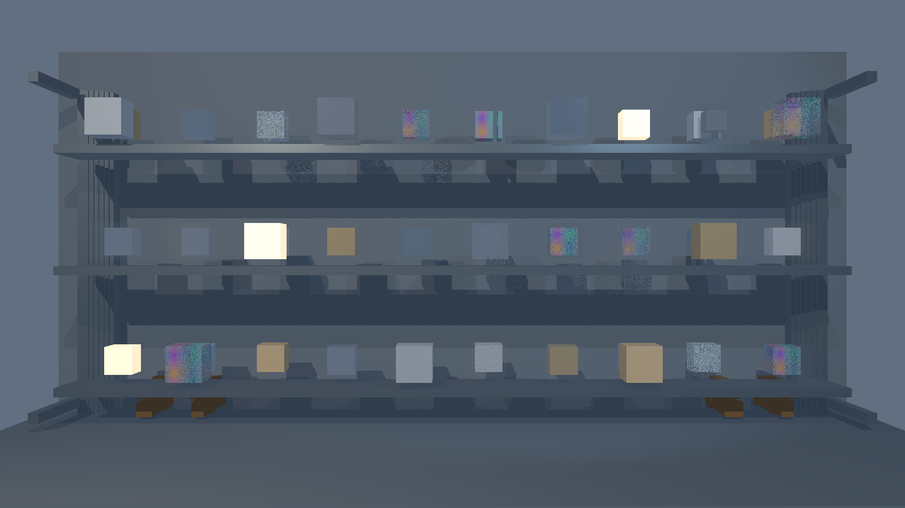
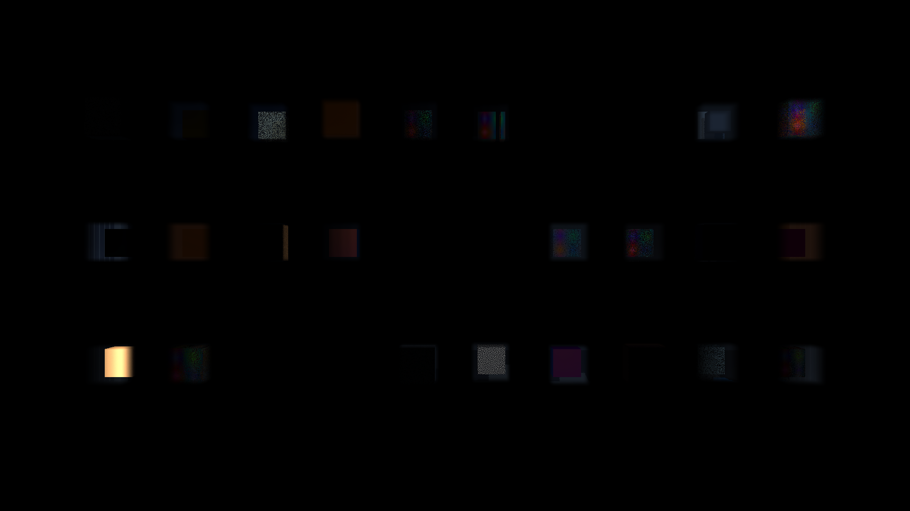

# 2026-11-01 原生出帧测试：Flow 完整混合帧补测

> 清理说明（2026-11-02）：历史 JSON／CSV／JSONL 等实验原始数据及一次性诊断脚本已清理；本文结论、参数和截图保留。原始文件见[清理前版本](https://github.com/CeroxeAnivie/RTRendererAPI/tree/eb3bc21c8b7559dd847c575ca3f392a2f896d86f/docs/quality)，当前工具与验证入口见[工具说明](../../tools/README.md)。

## 最终结果

本机 RTX 5080 Laptop，输出 1920×1080，FG 关闭。Flow 本次起测 GPU 占用 0%。下表汇总各引擎当前已有的原生输出测量，模式与支持语义不同，不是相同画质和相同介质能力下的速度排名。RTXPT 包含窗口呈现，其余为完成整幅图像，不包含窗口呈现。

| 引擎与模式 | 完成帧 FPS | ms/帧 | 直接影响比较的差异 |
|---|---:|---:|---|
| RTXPT 1.9.0，DLSS-RR Balanced | 156.87 | 6.375 | 内部 1114×626；现有桥接 sigmaS=0，未覆盖散射/HG/异质介质/体积发光 |
| 原生 EEVEE＋Flow，静态密度/体积阴影缓存 | **89.84** | **11.131** | 原生 1080p；每帧重新绘制实体、深度和体积合成，复用静态密度/体积阴影 |
| 原生 EEVEE＋Flow，每帧密度/体积阴影刷新 | **78.86** | **12.681** | 原生 1080p；每帧另执行上游密度注入/体积阴影更新；不是流体动态模拟 |
| LuxCore RTPATHOCL，resolutionReduction=4 | 38.23 | 26.155 | 等效光线网格 480×270；已发现横向 FOV 30 与其余竖向 FOV 30 未对齐，暂不参加严格横向比较 |
| Cycles OptiX，1080p 1 SPP＋OptiX 降噪 | 6.36 | 157.243 | 独立整图调用，计入 CPU 调用与降噪成本 |
| Mitsuba CUDA forward，1080p 1 SPP＋OptiX 降噪 | 4.44 | 225.426 | 独立整图调用，JIT 预热后计入 CPU＋GPU 和降噪 |

Flow 89.84/78.86 是整条 EEVEE＋Flow 链的测量，不是 Flow 体积段吞吐，也不是 Flow 独立完成 PBR 的成绩。此前约 250 FPS 的 Flow 数值只有体积段，不能替换这里的整帧结果。UE 按用户要求取消，没有 UE 成绩。

## Flow 计时边界与设置

- Blender 4.5.9 原生 EEVEE 绘制实体颜色；Blender 内置 `UNIFORM_COLOR` 批次逐帧绘制实际不透明实体深度。深度预通道包含在计时中。
- EEVEE 输出共享 GPU buffer，交给原生 Flow Vulkan 读取、体积 ray march、合成，最后等待 Flow 完成 fence。OpenGL `glFinish`、跨 API 交接、复制和完成等待全部计入。
- 同一 RTX GPU 按 OpenGL/Vulkan UUID 匹配：`576a173b4d32e49e5c4917231e7a07ef`，不依赖两种 API 的枚举顺序。
- 没有逐帧 CPU 像素读回，没有缓存实体颜色图。证据截图和 CPU 像素比较在计时后执行。没有窗口 present。
- Flow SDK 提交 `b97365c6ddb32fda8469bc788ec18024862b0368`；未修改上游渲染/模拟 shader。仅构建工具编译并行度受内存上限约束。
- Flow cell size 0.035，stepSizeScale 0.75，体积阴影 16 步，32 个输入局部介质，441 个活跃块。静态场景每帧刷新模式重新注入相同输入，并不证明动态流体模拟吞吐。
- EEVEE `taa_samples=1`、`taa_render_samples=1`；Flow 采用原生 ray marching，1 SPP 不是它的参数。未开启 FG、DLSS 或外加降噪。
- 每种模式预热 3 秒，再测 3 轮、每轮至少 3 秒及至少 60 帧。最终 FPS = 总完成帧数 / 三轮总墙钟时间，含循环开销。初始化和首次 shader 编译不计入稳态出帧。

场景为 120 个对象、1440 个三角形的轻量工业架子/道具布局。原始 fixture SHA256：`8a687bbb9b81c36aeb01b503dfecc8560c4506b333f41cc16d702558c49a8c18`。局部体积投影约 10.84%，主射线最多穿过两个局部体积，总程最大约 0.4627m。

## Flow 三轮实测

| 模式 | 第一轮 FPS | 第二轮 FPS | 第三轮 FPS | 三轮完成帧 | 合计时间 ms | 合计 FPS |
|---|---:|---:|---:|---:|---:|---:|
| 静态密度/体积阴影缓存 | 92.78 | 87.52 | 89.20 | 810 | 9016.433 | **89.84** |
| 每帧密度/体积阴影刷新 | 78.27 | 78.58 | 79.73 | 711 | 9015.947 | **78.86** |

修正深度后的早期 1 秒短测曾出现 147.69/133.64 FPS；没有把短测选为最终成绩。上表是最终三轮测量，不把两次短测差异描述成代码优化收益。

## 完整帧的延迟与每秒占比

以下是串行墙钟阶段，互不重叠，可以求和。不能把 Flow 局部耗时的倒数冒充整个场景 FPS。

| 阶段 | 静态 ms/帧 | 静态每秒 ms | 静态占比 | 每帧刷新 ms/帧 | 每帧刷新每秒 ms | 每帧刷新占比 |
|---|---:|---:|---:|---:|---:|---:|
| EEVEE 实体＋不透明深度＋共享 GPU 交接/等待 | 8.5902 | 771.709 | 77.17% | 9.0808 | 716.117 | 71.61% |
| Flow 输入复制＋体积处理/合成＋完成等待 | 2.5354 | 227.766 | 22.78% | 3.5921 | 283.275 | 28.33% |
| Python 外层计时循环开销 | 0.0058 | 0.525 | 0.05% | 0.0077 | 0.608 | 0.06% |
| **总计** | **11.1314** | **1000.000** | **100.00%** | **12.6807** | **1000.000** | **100.00%** |

## 正确性核验与已修复的测量错误

最初 `GPUOffScreen.draw_view3d` 的颜色输出正确，但其附带深度纹理全为 0；直接交给标准正向 Z 的 Flow 后，全部体积被裁掉。因此早期 84.66/77.52 及 160.37/108.12 FPS 的数据被拒绝，不是有效 Flow 混合帧成绩。

工具现已补上 Blender 原生不透明深度预通道，且逐帧计费。透明边界、玻璃和带连续透明因子的表面不写入该深度；不会将透明介质外壳当作不透明遮挡体。

最终验收证据：

- 输出 1920×1080，颜色数据全部有限；同帧实体输入和 Flow 输出比较，**92,561 个像素**的最大 RGB 线性差值超过 1/255。
- 最大 RGB 线性差值 0.140625，平均 RGB 绝对差值 0.000518096。
- 实际不透明深度范围 0.999815822～1.0，深度预通道 924 个三角形。
- 另在计时外用远平面深度作对照，正常深度裁剪使 **26,528 个像素**的差异超过 1/255，确认深度输入实际参与合成。
- 计时、截图和资源释放完成后进程退出码 0。旧的退出崩溃来自 Blender 工厂重置后的 UI 退出上下文，现改为测试进程保存/释放完成后直接退出。

体积差异图把线性颜色差放大 10 倍，仅作可见性证据，不能拿它当最终画面。





## Flow 能力边界

本测试保留原场景几何、实体材质/纹理、灯和 32 个局部体积输入，由 EEVEE 绘制实体、Flow 绘制介质。Flow 使用原生标量消光/colormap/方向体积阴影；没有自行实现 HG、介质 priority、折射耦合、相机初始介质状态，也不声称 RGB 吸收、多次散射、体积发光与原 API 物理语义等价。介质边界的折射和透明遮挡耦合仍是这条测试接入链的能力差异。

因此这次证明的是该轻量场景能通过原生 EEVEE＋Flow 完成实时混合出图，三轮平均 78.86～89.84 FPS；不是原 API 全功能等价接入已经完成，也没有达到该项目微缩全路径场景 180 FPS 的验收线。

## 复现与原始证据

测试代码：`tools/compare_flow_mixed.py`、`tools/flow_mixed_bridge.cpp`、`tools/flow_native_benchmark.cpp`。测试前已全量提交并推送工具，最终性能测试使用提交 `4558c0b`。

```powershell
& tools/Build-FlowComparison.ps1
& build/renderer-comparison-venv/Scripts/python.exe tools/compare_flow.py --fixture build/reports/game-renderer-comparison/scene/medium-on/fixture.json --output build/reports/native-recommended/flow-mixed --prepare-only
& build/renderer-comparison-sdk/blender-4.5.9-windows-x64/blender.exe --factory-startup --gpu-backend opengl --python tools/compare_flow_mixed.py -- --fixture build/reports/game-renderer-comparison/scene/medium-on/fixture.json --output build/reports/native-recommended/flow-mixed --device 1 --seconds 3 --rounds 3 --warmup-seconds 3
```

`--device 1` 仅为 fallback；正式路径强制按实体绘制 GPU 的 UUID 选择 Vulkan GPU。

原始逐帧阶段数据及三轮数据在 [Flow result.json](https://github.com/CeroxeAnivie/RTRendererAPI/blob/eb3bc21c8b7559dd847c575ca3f392a2f896d86f/docs/quality/data/native-recommended-20261101/flow-mixed/result.json)，画面差异数据在 [verification.json](https://github.com/CeroxeAnivie/RTRendererAPI/blob/eb3bc21c8b7559dd847c575ca3f392a2f896d86f/docs/quality/data/native-recommended-20261101/flow-mixed/verification.json)，初始化/运行输出在 [run.log](data/native-recommended-20261101/flow-mixed/run.log)。其他引擎原生结果、输入 fixture、GPU/驱动记录一并存于 `data/native-recommended-20261101/`。旧报告的纯体积段/旧关闭降噪结果没有覆盖本表。
