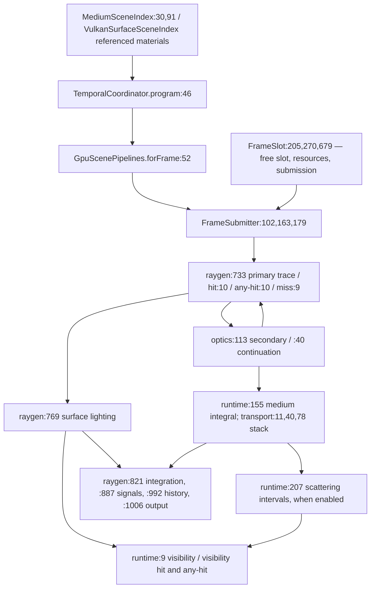
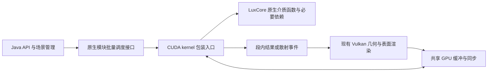

# 质量验证与性能报告

## 2026-10-31 完整门禁发现的阻断修复

首轮 `verifyApiClosure` 完整执行 280 项任务，发现吞吐测试整段超时、镜像介质进出面、旧队列路由断言和动态灯光测试类改名四处阻断，原失败记录保留。后续还修复了场景收敛时的公共拒绝分类，以及本机 Khronos validation 1.4.350 多线程 deferred pipeline 完成登记竞争；诊断实例使用单个 host join，关闭诊断仍保留并行编译。

受影响专项现已通过：边界 24 项解析 HDR 对照；介质 26 帧（含镜像、点光、聚光、方向光、环境太阳与 TIR）；队列 11 对逐字节一致 HDR，并逐例核对 2 对普通队列和 9 对原生 PBR/光学路由；动态灯光 96 帧、97 次更新、29 种校验值；吞吐保留原 32 帧预热和三轮各 256 帧、完整序号与 GPU 时间戳检查。散射使用 8 SPP 的中心图像均值，原亮度门槛未降低，额外加入独立均匀平板积分。三组严格 validation 日志均完整关闭，警告、错误、丢弃消息为零。

专项证据见 [api-closure-blockers-20261031.json](data/api-closure-blockers-20261031.json)。完整当前版本结果由 `verifyApiClosure` 成功后生成的 `build/reports/api-closure/result.json` 单独记录，包含全部原生门禁与实际制品哈希。以下各日期段落保留各自验收时的记录。

## 2026-10-31 光学无阴影灯与完整门禁回归

修复光学路线把 `castsShadow=false` 灯光仍做介质连接衰减的问题。该标志现与相机直接散射、密度路线一致，跳过整段可见性查询；有阴影灯继续积分其完整连接。语义独立对照 Blender Cycles 固定版本 `a51f293548adba0dda086f5771401e8d8ab66227` 的 `shadow_ray_setup`，未复制实现。原独立等 IOR 散射解析预期及容差保留，8 个 optical-trace SPIR-V 已重建，CUDA 来源清单通过。

完整光学生产测试通过 46 项比较、152 帧原生传输和 1 次无效边界拒绝后恢复，包含新加入的部分 PBR Snell/Fresnel/发光解析对照。PBR 焦散专项通过 5 帧，精确验证关闭时 2 帧原生 PBR、开启时 3 帧原生光学及 3 次光子调度；Beer 比例和实际焦散能量检查保留。两个 Vulkan 日志全部正常关闭，警告、错误和丢弃消息均为零。另修正 PBR 焦散 shader 合同中已过时的 AoS 字符串断言，同时检查平面布局 stride 和完整接收面字段。证据见 [optical-shadow-contract-20261031.json](data/optical-shadow-contract-20261031.json)。完整 CPU、core 原生、NVIDIA 和本轮制品门禁仍在继续，本项不宣称全 API 已闭合。

## 2026-10-31 覆盖、叠层、LIGHTMAP 与部分透射

光学 ABI 7 的 352 字节连接先保存表面延续，再执行灯光连接。局部光照按 `opacity*(1-transmission)` 计权；无竞争分支的覆盖使用精确背景合成，孔洞与金属/介电延续竞争时保留概率补偿。单面材质继续使用共享 any-hit 的背面规则。延续保留原始命中误差界、累计距离和介质栈，不会因灯光连接覆盖几何命中而丢失折射信息。

LIGHTMAP_MODULATED 保留已有贴图、顶点、帧 lightmap、雾与 surfaceVisibility 合成。叠层验证接收 mask 和深度间距，再执行 ALPHA_OVER 或 MULTIPLY；光连接与两种光子路径均跳过叠层，非投影实例不阻挡灯光连接。原生光子查询使用公共 PHOTON_QUERY 的纹理足迹语义，透明覆盖与部分透射按各自概率传输通量。

新增 `cudaCompositeMediumProductionNativeSelfTest` 通过 29 项最终 HDR 检查、37 帧原生光学传输。逐像素参考覆盖材质/顶点/纹理 alpha 及乘积、全局/边界密度、逐帧图元、LIGHTMAP 与分数 visibility、叠层两种模式和 mask/深度不匹配；两端画面对照验证 PBR alpha 与部分透射的实际光连接权重。IOR 1.5、透射率 0.2/0.5/0.8 另有 Snell/Fresnel/Beer 解析对照。全组最大绝对误差 `4.87772653e-4`。

同一最终资源通过金属 40 项/25 原生帧回归及 16 帧密度/边界 PBR 和体积焦散回归；独立 CUDA 光学/焦散数值、三个 CPU 合同和来源清单通过。8 个 optical-trace、8 个 photons SPIR-V 已重建。证据见 [composite-medium-closure-20261031.json](data/composite-medium-closure-20261031.json)。新表面能力与散射/焦散的进一步交叉专项、主树集成、完整门禁、展厅及最终制品验证仍待完成；本项不作为全 API 完成率。

### 表面合成与散射、焦散交叉专项

随后对新表面路径和参与介质组合做了独立生产验证。透明 alpha、LIGHTMAP_MODULATED、MULTIPLY 叠层及粗糙部分透射玻璃分别与全局均匀介质、显式边界密度和全局密度散射组合。41 项检查执行了 61 帧原生光学传输，12 组均保留有限非负 HDR，散射相对吸收对照产生正增量；玻璃对照保留其太阳圆盘反射基线。

焦散专项将透明 alpha 接收面、IOR 1 的部分透射 PBR、ALPHA_OVER 叠层和 MULTIPLY 叠层分别与显式边界、全局密度及无边界均匀介质组合。52 项检查执行 49 帧原生光学传输；12 个开关对照均观察到正的最终 HDR 焦散增量。无边界均匀介质用来覆盖普通光子路径，其他参与介质帧通过原生光子传输。两个 Vulkan 验证会话各 135 条消息并正常关闭，警告和错误为零。机器记录见 [composite-scattering-caustics-closure-20261031.json](data/composite-scattering-caustics-closure-20261031.json)。完整门禁、展厅和最终制品验收仍待完成。

## 2026-10-31 金属介质反射与焦散路由

原生光学路径现保存真实金属率和公共 GGX 采样点；完成接收面灯光连接后继续追踪一次金属反射。反射保持介质栈与剩余距离，沿途积分吸收、发光、密度和散射。连接仍为 304 字节，内部光学 ABI 升至版本 6。小粗糙度采样改为直接计算正弦，避免 `sqrt(1-cos²)` 的浮点相消。单面 PBR/UNLIT 仍执行共享 any-hit 的背面规则。

所有启用焦散的参与介质帧统一选择光学执行器。原生光子路径补齐非金属 PBR 的 F0 镜面分支，避免有界介质中只有金属能产生反射光子。最终 HDR 专项通过 40 项检查，25 帧执行原生光学传输；覆盖金属率 0.2/1、单/双面、SPP 1/2/8、反射两段 Beer/发光、密度、零密度、持久/逐帧边界、事件预算、散射和玻璃。三个焦散开关场景分别验证金属边界、非金属边界、非金属全局密度的实际输出贡献。

独立 CUDA 光学数值测试（含 81 组 GGX 方向与 `f*cos/pdf`）、焦散数值测试、三个受影响 CPU 合同与来源清单通过；8 个 optical-trace SPIR-V 变体已重建。证据见 [metallic-medium-closure-20261031.json](data/metallic-medium-closure-20261031.json)。本阶段尚未证明全部组合或最终制品闭合；部分覆盖、叠层、LIGHTMAP_MODULATED 和 PBR 部分透射仍在实现。

## 2026-10-31 内置介质与应用数据布局

仅声明 `dataBindingCount` 曾被当成自定义 shader 程序，因而绕开内置介质执行。现在按实际替换的 GLSL/SPIR-V 阶段判断传输归属，内置特化管线保留应用声明的 descriptor 布局；各介质准入不再把合法应用数据当作未知传输功能拒绝。绑定数量、大小和对齐仍在接纳帧前检查。

`cudaBuiltinShaderDataNativeSelfTest` 在 RTX 5080 Laptop GPU 通过 12 组完整线性 HDR 逐字节对照，共 24 帧，其中 22 帧执行原生介质。组合覆盖吸收/发光、密度、PBR、显式边界、单次与多次散射和玻璃。每组缺失、多余及三字节未对齐绑定均明确拒绝，随后同一序号的有效帧成功；快照跨尺寸变更、slot 复用与 renderer 关闭保持不变。8 个受影响 CPU 合同通过。机器可读记录见 [builtin-medium-shader-data-20261031.json](data/builtin-medium-shader-data-20261031.json)。本项不代表金属、所有交叉组合或最终制品门禁已经闭合。

<a id="api-closure-20261030"></a>
## 2026-10-30 当前 API 闭合验收

当前状态按交付项登记。旧的“6/8”只是阶段验收组数量，不能当作整个 API 的完成率；历史阶段包也不包含本轮新增代码。

| 项目 | 当前状态 | 验收入口 |
| --- | --- | --- |
| 公共 API、ABI 与模块边界 | 本轮通过 | `:renderer-api:check` |
| core 合同与 shader | 226 个 SPIR-V 已通过；边界修复影响的 2 个变体已重建，最终合同待验 | `rendererCoreContractGate` |
| 共享内存与同步 | 专项通过；完整介质组执行中 | 固定图案、epoch、count/pointer 检查 |
| 完整通用 API 原生测试 | 通过 | `rendererCoreUnifiedApiNativeGate` |
| 完整介质原生测试 | 执行中 | `rendererCoreMediumNativeGate` |
| 密度、边界、玻璃、PBR、体积焦散 | 16 帧联合专项通过 | `cudaOpticalMediumProductionNativeSelfTest -PopticalVolumeCaustics` |
| 展厅 | 折射云盒与焦散关闭对照 16 帧通过；完整 12 变体及 FPS 窗口待完成 | `mediumGalleryNativeSelfTest`、`mediumGalleryDemo` |
| 独立 Maven 消费者 | 阶段包通过；最新包待验 | `verifyPublishedMavenConsumer` |
| 完整运行包、源码和校验和 | 阶段包通过；最新包待验 | `verifyRuntimeDistribution` |

剩下完整门禁、展厅与最终制品验收。已通过项保留证据；修复后只重跑失败或受改动影响的测试。性能优化当前暂停。

### 共用棱边的介质退出修复

折射云盒中，精确落在共用棱边的反射路径会漏掉相邻面的退出，随后灯光连接再次进入同一介质，触发严格栈检查 `error=37`。仅将命中点改为重心坐标稳健重建仍有 10 条路径失败，因此该重建不是完整修复。

当前对介质边界三角形的浮点棱边不确定带做明确归属：仅在重心坐标距离边小于 8 个浮点 epsilon 时，将点约束到被命中三角形内部，再进行既有法线偏移。Fresnel/Snell 仍使用原面的法线，不修改介质栈校验。受影响的两个 closest-hit SPIR-V 已重建，原失败预设与焦散关闭对照共 16 帧通过，图像相对差异为 `0.02049699`。日志为 `build/closure-edge-spawn-retest-20261030.log`；该结果是正确性验收，不是性能收益。

## 2026-10-30 密度、边界体积焦散与 PBR 光连接

生产链路新增 `CudaOpticalPhotonPass`：Vulkan 只提供完整几何命中，CUDA 复用现有密度积分、严格介质栈和玻璃采样。光子图完成后，在同一次所有权交接中回传 Vulkan；相机按介质 slot 读取体积记录。记录存储入射通量，散射系数只在相机传输中计入一次。光子预算覆盖全部记录，驻留检查同时计入光子状态、命中、哈希与相机场景。

PBR 终端复用原生灯光连接，按当前介质栈计算相机和灯光两段衰减。内部光学 ABI 升至版本 5；每条连接保留接收点、法线、视线和材质，避免在边界/密度中套用全局均匀衰减。UNLIT 终端直接返回颜色与发光。

专项 `cudaOpticalMediumProductionNativeSelfTest -PopticalVolumeCaustics` 16 帧通过。四帧 PBR 解析对照的最大绝对误差为 `6.185226823642032E-5`，零密度恢复真空的误差为 0。其余 12 帧分别覆盖密度、零密度、显式体积边界、粗糙玻璃、嵌套 IOR/优先级，以及内部相机和点光源；六个启用焦散的帧各生成一次光子图。

| 体积焦散组合 | 开启后的平均 RGB 总能量增量 |
| --- | ---: |
| 密度介质 | 0.115375501 |
| 显式边界与密度 | 0.0521937119 |
| 粗糙玻璃与边界密度 | 0.0343257556 |
| 嵌套 IOR 与优先级 | 0.032959743 |
| 内部相机与点光源 | 0.0116567087 |
| 零密度 | 最终能量 0 |

能量增量用于检查焦散确实进入最终图像。独立 CUDA 数值测试另行核对入射通量、散射通量、均匀/密度自由程、距离扣减、重要性传输和归一化核。完整介质、统一 API、展厅和最终制品验收见本报告顶部的[闭合清单](#api-closure-20261030)。性能优化仍暂停。


## 2026-10-30 确定同步根因：三处提交没有等待 CUDA

已定位并修复 `CudaSharedRayFrame` 的三处 legacy `VkSubmitInfo`：paired 中间提交、paired 最终 acquire 和普通 acquire 均漏设 `waitSemaphoreCount(1)`。实际使用的 LWJGL 3.4.3 中，`pWaitSemaphores` 与 `pWaitDstStageMask` 不会设置这个独立字段；calloc 后数量为零，Vulkan 实际忽略了 CUDA 等待依赖。此前 binary semaphore 与取消 ownership 的诊断实验均已撤回，保留的是这三处等待数量修正，以及 CUDA 参数结构清零。

无中间主机等待的固定图案及共享射线测试已通过：两 slot、两生命周期、closest/occlusion、epoch、全数组、嵌套交换与异常清理均通过；先前失败的 `thin-optical8-SPP1` 用例也通过。队列提交入口另加零分配 count/pointer 一致性检查及 CPU 防回归测试，避免同类遗漏静默发生。这证明了本轮旧值问题的实际同步错误，不代表全 API、全部介质组合或剩余性能差距都已闭合。

### 无插桩完整帧 ABBA

两组都包含等待数量修正；A 保留中间 `cuStreamSynchronize`，B 删除该等待，仅靠正确的 GPU semaphore 链交接。相同冻结 JAR，1920×1080、SPP=1、单光学样本、确定性双分支、不可变 CPU RGBA16F，每臂 64 帧预热、256 帧完成，JVM 配置相同。

| 顺序 | 中间主机等待 | 平均 ms/帧 | FPS | P50 ms | P95 ms |
| --- | --- | ---: | ---: | ---: | ---: |
| A1 | 保留 | 15.646631 | 63.911522 | 15.462900 | 19.033300 |
| B1 | 删除 | 14.764554 | 67.729779 | 14.383600 | 18.837700 |
| B2 | 删除 | 14.640006 | 68.305984 | 14.242950 | 19.529800 |
| A2 | 保留 | 15.946385 | 62.710137 | 15.331550 | 20.114100 |

两组均值 `15.796508 → 14.702280 ms/帧`，节省 `1.094228 ms/帧`，帧时间降低 `6.9270%`；两轮平均 FPS `63.310830 → 68.017882`，提高 `7.4348%`。四臂最终 HDR SHA-256 均为 `943d29327f276420817df19ddd43ed6662aa97b956e44cfc1c2407757ecc630c`。收益属于修正同步协议后删除中间主机等待的对照，不能将旧 CUDA 等待桶全部算作回收。

### 候选的新耗时排名

另行启用阶段计时，256 个完整帧均值 `14.647761 ms`。下表互斥墙钟桶合计完整帧；插桩绝对值只用于排名，不混入 ABBA 收益。

| 排名 | 成分 | ms/帧 | 整帧占比 |
| --- | --- | ---: | ---: |
| 1 | Vulkan 末端栅栏等待，包含整条 GPU 依赖链 | 9.548195 | 65.1854% |
| 2 | CPU 不可变 HDR 快照 | 2.071998 | 14.1455% |
| 3 | 其余提交后轮询与等待 | 1.209763 | 8.2590% |
| 4 | 其余 CPU 校验与调度 | 0.926207 | 6.3232% |
| 5 | Vulkan 录制与提交 | 0.600408 | 4.0990% |
| 6 | CUDA 主机入队与回收 | 0.291190 | 1.9880% |

同候选的另一次 Nsight 采样关联 1024 次 optical kernel 与实际 API 调用，已适配每对路径只在末尾同步一次的新顺序。其 GPU 工作按单次分支/轮次从高到低如下；这些工作与墙钟等待重叠，不能再加进上表。

| 排名 | 实际 GPU 成分 | ms/帧 |
| --- | --- | ---: |
| 1 | 首分支首次 Vulkan producer | 2.335556 |
| 2 | 次分支 Vulkan continuation | 1.195551 |
| 3 | 次分支首次 Vulkan producer | 1.092612 |
| 4 | 首分支 Vulkan continuation | 0.975009 |
| 5 | CUDA round 0 kernel | 0.921324 |
| 6 | CUDA round 2 kernel | 0.917300 |
| 7 | 最终着色与 GPU 回读 | 0.884991 |
| 8 | CUDA round 3 kernel | 0.831897 |
| 9 | CUDA round 1 kernel | 0.648117 |

当前最大单项是首分支首次 Vulkan producer，后续性能工作应沿其 trace/命中存储与整条队列依赖继续拆解。末端栅栏的 9.548 ms 包含实际相交与传输工作，绝非可直接删除的空转。无中间主机等待仍未默认启用：新增显式边界散射测试触发严格介质栈错误，射线生成修正已通过 CUDA 数值回归，但完整生产组合仍在修复与复验。机器可读 ABBA、互斥排名和 Nsight 逐轮数据见 [optical-wait-count-fixed-abba-20261030.json](data/optical-wait-count-fixed-abba-20261030.json)。

## 2026-10-30 时间线等待边界复核：无等待候选失败

按固定 LuxCore PathOCL 的单设备路径推进结构对照后，复核本机 Vulkan/CUDA 外部内存交接。参考实现不覆盖该互操作协议，因此同步正确性以本机共享缓冲区测试和完整 HDR 门禁为准。

默认同步路径的 1920×1080、SPP=1、单光学样本、确定性双分支采样包含 64 帧预热和 256 个完整 CPU RGBA16F HDR 帧。阶段计时启用，仅用于重新排序；完整帧均值 `13.807962 ms`、`72.421985 FPS`，HDR SHA-256 为 `943d29327f276420817df19ddd43ed6662aa97b956e44cfc1c2407757ecc630c`。下表是互斥墙钟桶，合计完整帧；CUDA 项包含设备工作与等待，不是 CUDA host API 耗时。

| 排名 | 互斥墙钟成分 | ms/帧 | 整帧占比 |
| --- | --- | ---: | ---: |
| 1 | CUDA 交接及依赖等待 | 6.737414 | 48.7937% |
| 2 | CPU 不可变 HDR 快照 | 2.219874 | 16.0768% |
| 3 | Vulkan 后续栅栏等待 | 1.984653 | 14.3732% |
| 4 | 其余提交后轮询与等待 | 1.210911 | 8.7697% |
| 5 | 其余 CPU 校验与调度 | 1.015791 | 7.3566% |
| 6 | Vulkan 录制与提交 | 0.639318 | 4.6301% |

无等待候选在 128-byte 共享缓冲区上做了固定图案检查。默认同步下 32 轮都通过；禁用首轮 host wait 后，第 11 轮 CUDA 首轮检查读回 `0xDEADC0DE`，后续回读也为该哨兵值。CUDA 仅在没有读到 Vulkan producer 写入的 `0x34567890` 时写入哨兵。候选随后在已有共享射线 epoch 测试中也出现 stale epoch。它不具备正确性，未做性能 ABBA，未计入任何优化收益。

因此当前已定位到跨 API timeline/共享内存可见性边界，但尚未修复协议根因。生产默认同步行为保持原样；成熟参考只能说明单设备执行链能避开该互操作边界，不能证明本机无等待 timeline 候选正确。同步基线复验通过 42 项比较、123 个原生帧和 1 次预期拒绝恢复；226 个 pinned SPIR-V 字节核对通过。完整机器可读数据见 [optical-timeline-boundary-reverify-20261030.json](data/optical-timeline-boundary-reverify-20261030.json)。

## 2026-10-30 光学续接 SER 候选：ABBA 退化并撤回

对照成熟实现中按方向重排射线的做法，曾在原生玻璃续接 raygen 的每次后续追踪前加入 SER，并强制启用 SER 完成全套光学生产回归。正确性通过 42 项比较、123 个原生帧和 1 次预期拒绝恢复；但无插桩完整 HDR ABBA 显示整帧变慢，故已撤回 shader、路由放行及测试开关，受影响的 8 个 pinned SPIR-V 已从恢复后的源码重新生成。

负载为 RTX 5080 Laptop GPU、1920×1080、SPP=1、单光学样本、确定性双分支、64 帧预热、每轮 256 帧完整不可变 CPU RGBA16F HDR。相同核心制品 SHA-256 为 `C23BF63FC1481DA04B1AFD546A5109EBD0F69BD98C639B207AB930A958FC1B9B`，四轮 HDR SHA-256 完全一致：

| ABBA | SER | 均值 ms/帧 | FPS | P50 ms | P95 ms |
| --- | --- | ---: | ---: | ---: | ---: |
| A1 | 开 | 14.973112 | 66.786385 | 14.686300 | 17.737400 |
| B1 | 关 | 13.558121 | 73.756533 | 13.389150 | 16.499500 |
| B2 | 关 | 13.703118 | 72.976094 | 13.331300 | 17.050200 |
| A2 | 开 | 14.405040 | 69.420146 | 14.195850 | 17.344400 |
| 两轮均值 | 开 | 14.689076 | 68.077801 | — | — |
| 两轮均值 | 关 | 13.630620 | 73.364237 | — | — |

启用 SER 后帧时间增加 `7.7653%`、等效 FPS 降低 `7.2057%`，增加 `1.058457 ms/帧`。候选不保留，也不将正确性通过表述成性能收益。完整逐轮数据及限制见 [optical-ser-branch-abba-20261030.json](data/optical-ser-branch-abba-20261030.json)。随后立即对恢复后的默认路径重新采样第一至第三名，见下一节；两种插桩口径不混作收益对比。

## 2026-10-30 默认路径当前前三名复核

SER 回滚并重新生成光学 raygen 制品后，以相同 RTX 5080 Laptop、1080p、SPP=1、单光学样本和确定性双分支负载重新采集 256 个完整 HDR 帧。阶段计时启用，因此整帧均值 `13.462065 ms`、`74.282807 FPS` 仅作本次插桩定位值。HDR SHA-256 为 `943d29327f276420817DF19DDD43ED6662AA97B956E44CFC1C2407757ECC630C`，生产回归和 Vulkan validation 均通过。

| 排名 | 阶段 | 累计 ms/帧 | 相对整帧均值 |
| --- | --- | ---: | ---: |
| 1 | CUDA 交接及依赖等待 | 6.642354 | 49.3413% |
| 2 | CPU 不可变 HDR 快照复制 | 2.044967 | 15.1906% |
| 3 | Vulkan 后续栅栏等待 | 1.968853 | 14.6252% |

本表是当前阶段累计耗时排序，不是互斥分桶；CUDA 项包含 producer 与设备工作的等待，GPU 时间戳阶段也与墙钟重叠。百分比只表示该阶段值相对整帧均值，不能互相求和。原始采样见 [optical-current-ranking-20261030.json](data/optical-current-ranking-20261030.json)。第一名仍是架构边界：LuxCore 的路径推进在单设备执行链，当前路径每轮跨 Vulkan RT 与 CUDA 交接。此前移除首轮等待的候选已丢失红色分支贡献，所以下一步先把 branch/sample/epoch 级证据补全，再调整交接协议；本轮没有性能修复收益可报告。

## 2026-10-30 成熟参考对照与当前大头复核

固定 LuxCore 源码版本 `b872186d2fe995a762f73708c606847eed55843e` 的 `AdvancePaths_MK_RT_NEXT_VERTEX` 将相交结果写回路径状态，`AdvancePaths_MK_RT_DL` 继续处理直射光可见性；这两段都处于同一 PathOCL 设备执行链。当前 API 则由 Vulkan RT 产生交点、CUDA 推进介质路径，再通过外部 timeline semaphore 交接。差异在执行架构，不是 CUDA host API 单项耗时。

最新完整帧归因是 1080p、SPP=1、单光学样本、确定性双分支的 256 帧同步基线，包含 Nsight 和 GPU 时间戳插桩，只用于定位。完整帧均值 `13.703083 ms`、`72.976 FPS`。前三名已在候选撤回后复核；下表是互斥墙钟区间，合计为完整帧，不能把后面的重叠 GPU 表再加进来。

| 排名 | 互斥墙钟成分 | ms/帧 | 整帧占比 |
| --- | --- | ---: | ---: |
| 1 | CUDA 交接，含 producer 等待和实际 GPU 工作 | 6.866575 | 50.1097% |
| 2 | CPU 不可变 HDR 快照 | 2.067950 | 15.0911% |
| 3 | Vulkan 后续栅栏等待 | 1.994409 | 14.5545% |
| 4 | 其余提交后轮询与等待 | 1.205026 | 8.7938% |
| 5 | 其余 CPU 校验与调度 | 0.931687 | 6.7991% |
| 6 | Vulkan 录制与提交 | 0.637437 | 4.6518% |

第一名的 `streamCompletionWait` 是 `6.459417 ms/帧`，内部 host 等待分为 round 0 `2.699911 ms`、round 2 `2.235397 ms`、round 3 `0.832277 ms`、round 1 `0.643605 ms`。它等待相依的 Vulkan producer 和 CUDA kernel 完成，不是空转 API 时间。五类 CUDA host 调用合计只有 `0.217696 ms/帧`。移除首轮 `cuStreamSynchronize` 的旧候选会丢失红色分支贡献，完整测试失败；因此不能把约 6.46 ms 视为可直接回收的收益。

下表是同一轮中的实际 GPU 工作时间，互相有执行依赖，也与墙钟区间重叠，不可相加成另一个帧时间。

| GPU 工作排序 | 成分 | ms/帧 |
| --- | --- | ---: |
| 1 | branch 0 首次 Vulkan producer | 1.753223 |
| 2 | branch 1 首次 Vulkan producer | 1.128115 |
| 3 | branch 1 Vulkan continuation | 0.973289 |
| 4 | CUDA round 0 kernel | 0.953369 |
| 5 | CUDA round 2 kernel | 0.949742 |
| 6 | 最终着色与 GPU 回读 | 0.921212 |
| 7 | CUDA round 3 kernel | 0.843089 |
| 8 | branch 0 Vulkan continuation | 0.660923 |
| 9 | CUDA round 1 kernel | 0.654285 |

更细 shader 采样将 raygen 中的 `traceRayEXT` 单独标记为最高延迟阶段；采样值是每个 GPU invocation 的设备时钟差，不换算成 ms/帧。生产路径每帧只生成一次相机首交点，第二个确定性分支读取同一缓存命中，所以重复首交点也不是根因。pair step 0 的每个分支都输入并输出 `2,073,600` 条路径，没有 inactive path 可压缩。当前证据支持的架构根因是逐轮跨 API 交接与实际相交/传输工作共同构成第一名；CUDA host 调用微优化和 inactive-path 压缩都触不到大头。

本轮没有保留新的性能候选，也没有宣称性能收益。此前主命中省略 ABBA 稳定退化 `9.7216% FPS`，专用 closest-hit ABBA 退化 `0.3676% FPS`，均已撤回。下一步需要减少真实 Vulkan/CUDA 轮次或每轮 GPU 工作，并继续以完整 HDR 和无插桩 ABBA 认证；单纯删除正确性所需的同步不算完成。

验证状态：全量生成和逐字节核对 `226/226` 个 pinned SPIR-V 通过，合计 `37,411,992` 字节；shader 目录中 `232` 个物理 SPIR-V 均通过 `spirv-val --target-env vulkan1.2`，合计 `37,862,920` 字节。`coreCudaOpticalMediumSelfTest`、`cudaOpticalMediumNativeSelfTest` 通过；`cudaOpticalMediumProductionNativeSelfTest` 通过 `42` 项比较、`123` 个原生帧和 `1` 次预期拒绝恢复。旧 `43/124` 记录多出的 `resolved-no-outline-primary-omission` 是现已撤回候选专属检查，当前源码已移除该候选和该项检查。机器可读采样与验证摘要见 [optical-mature-reference-handoff-20261030.json](data/optical-mature-reference-handoff-20261030.json)。

## 2026-10-30 主命中队列省略候选：已撤回

按成熟渲染器把最终辐射与主命中消费者分开的职责边界，验证了无 temporal、描边及 overlay 场景省略 Vulkan 主命中队列。候选保持正确 HDR，但没有消除每路径 208 字节的主命中：它把全帧主命中改放到 CUDA 共享存储中的 tile 缓存，导致 tile 容量减半并将完整帧拆成两块。

同一源码制品、相同 1080p/SPP=1/单光学样本/确定性双分支负载，无性能插桩；每轮 64 帧预热、256 帧完整 CPU HDR 交付。A 为直连完整主队列，B 为省略候选：

| 顺序 | 省略候选 | tile 数 | 平均 ms/帧 | FPS | P95 ms | HDR SHA-256 |
| --- | --- | ---: | ---: | ---: | ---: | --- |
| A1 | 关 | 1 | 13.063774 | 76.547557 | 14.840900 | `943d2932...7ecc630c` |
| B1 | 开 | 2 | 14.734802 | 67.866540 | 17.053900 | `943d2932...7ecc630c` |
| B2 | 开 | 2 | 14.734244 | 67.869108 | 17.603600 | `943d2932...7ecc630c` |
| A2 | 关 | 1 | 13.549274 | 73.804691 | 15.755500 | `943d2932...7ecc630c` |
| 汇总 A | 关 | 1 | **13.306524** | **75.176124** | — | 一致 |
| 汇总 B | 开 | 2 | **14.734523** | **67.867824** | — | 一致 |

候选增加 `1.427999 ms/帧`（帧时间 `+10.7316%`，FPS `-9.7216%`）。四轮最终 HDR 文件逐字节哈希相同。由于主命中数据仍须按 tile 缓存并写入，外部队列的省略没有减少总路径数据量，只增加了 tile 数和分块调度，因此撤回 proof、ABI 标志、shader fallback 与选择开关。四轮明细和限制见 [optical-primary-omission-abba-20261030.json](data/optical-primary-omission-abba-20261030.json)；设备输出保留于 `renderer-core/build/luxcore-native-optical-20261030/primary-omission-abba/`。

## 2026-10-30 首次追踪路径细粒度归因

同步候选撤回后，保持同步基线，重新采集 1080p、SPP=1、单光学样本、确定性双分支负载的 256 个完整帧，并为 branch/round 记录输入、续接、界面和完成计数。完整回归通过 43 项比较、124 个原生帧及 1 次预期拒绝恢复。该轮含 Nsight 和 GPU 时间戳插桩，只用于定位，不是性能收益 ABBA；HDR SHA-256 为 `943d29327f276420817df19ddd43ed6662aa97b956e44cfc1c2407757ecc630c`。

### 整帧互斥墙钟排名

平均完整帧 `13.703083 ms`、`72.976 FPS`。下表互斥且总和为整帧；CUDA 交接包含等待及 GPU 工作，不能把整段归类为主机 API 调用。

| 排名 | 互斥墙钟成分 | ms/帧 | 整帧占比 |
| --- | --- | ---: | ---: |
| 1 | CUDA 交接，含生产者等待与 GPU 工作 | 6.866575 | 50.1097% |
| 2 | CPU 不可变 HDR 快照 | 2.067950 | 15.0911% |
| 3 | Vulkan 后续栅栏等待 | 1.994409 | 14.5545% |
| 4 | 其余提交后轮询与等待 | 1.205026 | 8.7938% |
| 5 | 其余 CPU 校验与调度 | 0.931687 | 6.7991% |
| 6 | Vulkan 录制与提交 | 0.637437 | 4.6518% |

### 第一名内部及重叠 GPU 段

五类 CUDA enqueue/kernel-launch/readback 主机调用共 `0.215880 ms/帧`；`streamCompletionWait` 为 `6.459417 ms/帧`，其中包含 CUDA 与 Vulkan 设备工作和生产者等待，不能当作可删除的 API 开销。分段 GPU 时间与整帧墙钟重叠，不能相加进上表。

| GPU 段，按耗时排序 | ms/帧 |
| --- | ---: |
| 分支 0 首次 Vulkan producer | 1.753223 |
| 分支 1 首次 Vulkan producer | 1.128115 |
| 分支 1 Vulkan continuation | 0.973289 |
| CUDA 第 0 轮 | 0.953369 |
| CUDA 第 2 轮 | 0.949742 |
| 最终着色及 GPU 回读 | 0.921212 |
| CUDA 第 3 轮 | 0.843089 |
| 分支 0 Vulkan continuation | 0.660923 |
| CUDA 第 1 轮 | 0.654285 |

首次 producer 时间戳再拆分后，分支 0 的 `metadata→trace` 区间是 `1.749154 ms/帧`，分支 1 是 `1.124867 ms/帧`；开始、构建与主依赖区间合计各不足 `0.003 ms/帧`。因此下一项应在首次追踪 shader 内继续细分，不应优化这几个微秒级的录制区间。

### 活跃路径与结论

每个分支每帧有 `2,073,600` 条输入路径。pair step 0 的输入、输出及界面计数均为 `2,073,600`；step 1 输入及完成计数也均为 `2,073,600`。该单玻璃负载首步所有路径都跨过一个界面，第二步全部完成，没有可通过压缩 inactive path 获得的大头收益。每帧调度 `4,147,200` 个 CUDA path-slot（两个 pair step），但这不是重复完成的逻辑路径数。

固定版本 LuxCore 用于介质数学和路径推进对照，不包含本项目 Vulkan/CUDA 互操作；同步正确性仍以本项目 epoch 和 HDR 回归为准。当前没有从这次归因采样声称性能收益。原同步基线测量及首轮等待候选失败记录继续保留于下节，完整本轮数据见 [optical-active-paths-ranking-20261030.json](data/optical-active-paths-ranking-20261030.json)。

### 专用 closest-hit 架构候选：已撤回

按细粒度 shader 时钟定位，对照 LuxCore 的职责边界后，尝试为 native optical ray 加独立 closest-hit 轻路径，绕过通用历史、合成和光照字段工作。正确性第一轮失败于绿色 outline 验收，新增字段与真实主命中语义对齐后，完整回归通过 43 项比较、124 个原生帧及 1 次预期拒绝恢复。

同制品、同 JVM、无性能插桩 ABBA，每次 64 帧预热和 256 帧完整 HDR 交付：

| ABBA 顺序 | 专用路径 | 平均 ms/帧 | FPS | HDR SHA-256 |
| --- | --- | ---: | ---: | --- |
| A1 | 开 | 13.529005 | 73.910997 | `943d2932...7ecc630c` |
| B1 | 关 | 13.303315 | 75.169235 | `943d2932...7ecc630c` |
| B2 | 关 | 13.355742 | 74.874094 | `943d2932...7ecc630c` |
| A2 | 开 | 13.227617 | 75.599301 | `943d2932...7ecc630c` |
| 汇总 | 专用路径 | **13.378711** | **74.745** | 一致 |
| 汇总 | 通用路径 | **13.329535** | **75.021** | 一致 |

专用路径慢 `0.049176 ms/帧`，帧时间退化 `0.3689%`，FPS 变化 `-0.3676%`；A1/A2 与 B1/B2 的单轮波动大于组间差异，不支持正收益。HDR 完全一致，但“省掉通用字段”没有转化为整帧收益，因此专用路径及其开关已撤回，默认继续使用通用 hit 实现。细粒度 trace 样本约 `10,425` 个设备时钟 tick/样本，远高于相邻 raygen 状态写入；ticks 只用于定位，不能换算 ms 或占比。故下一轮的大头应沿 `traceRayEXT`/RT traversal 与跨 API 调度链继续拆，不再改 closest-hit 小字段。原始四组数据见 [optical-specialized-hit-abba-20261030.json](data/quality/data/optical-specialized-hit-abba-20261030.json)。

## 2026-10-30 CUDA/Vulkan timeline 首轮等待候选：正确性未通过

对照成熟波前推进时，先从刚完成的 blocking 基线 Nsight SQLite 按 kernel correlation ID 逐轮拆开 CUDA 同步。整帧归因运行含 Nsight 插桩，不能拿它作性能收益；原始 CUDA `cuStreamSynchronize` 合计 6.411190 ms/帧，其中两次首轮生产者/光学工作等待为 4.935308 ms，两个末轮 pinned 统计回读等待为 1.475882 ms。LuxCore 固定版本只提供介质推进参考，不实现本项目的 Vulkan/CUDA 互操作；跨 API 同步依据需由本项目的 epoch 和 HDR 测试证明。

| 排名 | 互斥整帧墙钟成分 | ms/帧 | 整帧占比 |
| --- | --- | ---: | ---: |
| 1 | CUDA 交接，含生产者等待与 GPU 工作 | 6.823808 | 50.2486% |
| 2 | CPU 不可变 HDR 快照 | 1.994047 | 14.6836% |
| 3 | Vulkan 后续栅栏等待 | 1.993998 | 14.6833% |
| 4 | 其余提交后轮询与等待 | 1.196896 | 8.8136% |
| 5 | 其余 CPU 校验与调度 | 0.942605 | 6.9411% |
| 6 | Vulkan 录制与提交 | 0.628729 | 4.6298% |

| CUDA 交接内部 API 项，非互斥，不可与整帧排名相加 | ms/帧 |
| --- | ---: |
| 首轮等待：round 0 | 2.699911 |
| 首轮等待：round 2 | 2.235397 |
| 末轮统计等待：round 3 | 0.832277 |
| 末轮统计等待：round 1 | 0.643605 |
| 两次外部 semaphore wait 入列 | 0.055151 |
| 两次计数 kernel 入列 | 0.069953 |
| 两次光学 kernel 入列 | 0.019913 |
| 两次异步计数回读入列 | 0.040364 |
| 两次外部 semaphore signal 入列 | 0.032316 |
| 其余 Java/FFM 上下文及调度 | 0.194922 |

| GPU 时间戳/内核时间，和墙钟重叠，不可相加 | ms/帧 |
| --- | ---: |
| 分支 0 初始 Vulkan producer | 1.743208 |
| 分支 1 初始 Vulkan producer | 1.124632 |
| 分支 1 Vulkan continuation | 0.963022 |
| CUDA round 0 kernel | 0.947910 |
| CUDA round 2 kernel | 0.943794 |
| 最终着色与 GPU 回读 | 0.920727 |
| CUDA round 3 kernel | 0.840858 |
| 分支 0 Vulkan continuation | 0.657565 |
| CUDA round 1 kernel | 0.651265 |

五种 CUDA enqueue/kernel-launch/readback API 的主机调用时间合计 0.217696 ms/帧（1.6031%）；`cuStreamSynchronize` 的 6.411190 ms 包含 Vulkan producer 等待和实际 CUDA 执行，不能归类成 CUDA API 调用耗时。削减 API 调用本身无法解释约 7 ms 的第一名。

首轮主机等待候选只移除了 round 0/2 的 `cuStreamSynchronize`，保留 Vulkan 对首个 timeline 值的设备等待、round 1/3 的计数读取完成等待及全部事件/样本预算。共享射线原生测试通过两 slot、两次生命周期、4096 条路径、五轮 RT epoch 与失败清理；但这不足以覆盖光学分支。完整光学测试在 `opticalSamples=8`、SPP=1 的确定性双分支 HDR 对照中失败：候选首像素红色为 0.373291，基线为 0.426514，所有 1,073 像素的红色均少 0.053223，其他通道一致。同步基线路径随后通过 43 项比较、124 个原生帧、1 次预期拒绝恢复；验证记录关闭 4 次、0 WARNING、0 dropped messages，唯一 ERROR 是 OBS 隐式层 DLL 加载失败（Win32 error 126），没有项目 Vulkan 资源或同步错误。该形态表明一个分支/样本贡献丢失，但尚未定位更低层的具体 epoch/可见性触发点；候选已撤回，未跑性能 ABBA，也不声称有性能收益。恢复后的当前基线复采均值为 13.580084 ms/帧、73.637 FPS，含 Nsight 插桩，只作排名，不与前一轮计算性能收益；HDR 哈希仍为 943d29327f276420817df19ddd43ed6662aa97b956e44cfc1c2407757ecc630c。证据见 [optical-async-timeline-continuation-20261030.json](data/optical-async-timeline-continuation-20261030.json)。

## 2026-10-30 CUDA 状态辅助函数内联：消除本次工作负载的局部访存

保留原有全局字段引用与按需读写，仅对 finish、initialize、segment 和路径推进模板函数显式内联。局部状态结构体候选两次整帧分别退化 17.08% 和 9.83%，已经撤回，未混入正式实现。成熟实现仍以固定版本 b872186d2fe995a762f73708c606847eed55843e 的追踪、推进及最终回读边界为参照。

| 两制品 ABBA，各次 64 预热 / 256 完整 CPU HDR 帧，无性能插桩 | 原实现 ms/帧 | 内联后 ms/帧 | 原/新 FPS | FPS 收益 | 节省 ms/帧 |
| --- | ---: | ---: | ---: | ---: | ---: |
| 第一组 | 13.582411 | 13.120321 | 73.6246 / 76.2176 | +3.5219% | 0.462089 |
| 重复组 | 13.734191 | 13.513760 | 72.8110 / 73.9986 | +1.6312% | 0.220430 |

所有 HDR 字节一致。最终制品 SHA-256 为 1d6e814f3b3fee46750b28e7f9e56b3abee6923b74fce0fbbfb0b3a60eeffe56，基线为 e7b9cb3414e2c91d3342968fc3433bbf27076a7d0bdc133c679c7014c590401e。不同阶段收益不能相加，跨时段的绝对 FPS 不用于计算收益。两组证据为 data/optical-helper-inline-abba-20261030.json 与 data/optical-helper-inline-repeat-20261030.json。

硬件复查中，四轮 L2 local theoretical sectors 从 4,147,200 / 3,628,800 / 4,147,200 / 3,628,800 降为全部 0，每线程寄存器由 108 降为 104。每线程 stack size 仍为 1024 字节；不能宣称栈消失，也不能外推其他工作负载没有局部访问。全局理论扇区不变，occupancy 仍约 32%～33%。NCU 重放耗时不作为整帧收益。见 data/optical-helper-before-hardware-20261030.json 和 data/optical-helper-inline-hardware-20261030.json。

生产回归通过 42 项比较、123 个实际原生帧、1 次预期可恢复拒绝；独立原生光学参考、两种状态布局与尾部保护通过，226 个预编译 shader 变体、37,411,992 字节 SPIR-V 检查通过。生产证据为 data/optical-helper-inline-regression-20261030.json。

最新单独归因运行整帧 14.168876 ms，含采样开销；原三个目标仍排第 1、2、6。

| 排名 | 互斥墙钟成分 | ms/帧 | 整帧占比 |
| --- | --- | ---: | ---: |
| 1 | CUDA 交接，包含生产者等待及 GPU 工作 | 7.198219 | 50.8030% |
| 2 | Vulkan 后续栅栏等待 | 2.122309 | 14.9787% |
| 3 | CPU 不可变 HDR 快照 | 2.025582 | 14.2960% |
| 4 | 其余提交后轮询与等待 | 1.240684 | 8.7564% |
| 5 | 其余 CPU 校验与调度 | 0.948485 | 6.6941% |
| 6 | Vulkan 录制与提交 | 0.633598 | 4.4718% |

| GPU 段，已包含于墙钟内，不可重复相加 | ms/帧 |
| --- | ---: |
| 分支 0 初始生产者 | 1.845178 |
| 分支 1 初始生产者 | 1.164919 |
| 分支 1 续接生产者 | 1.049582 |
| CUDA 第 0 轮 | 1.006199 |
| CUDA 第 2 轮 | 1.002658 |
| 最终着色及 GPU 回读 | 0.933777 |
| CUDA 第 3 轮 | 0.876870 |
| 分支 0 续接生产者 | 0.699058 |
| CUDA 第 1 轮 | 0.680094 |

streamCompletionWait 为 6.780383 ms，横跨生产者与实际 GPU 工作，不能称为可直接删除的纯 API 开销。最大单段仍是分支 0 初始生产者，尚未解决。完整排名见 data/optical-helper-inline-ranking-20261030.json。当前指定负载约 74 FPS，未达到 200 FPS；此前记录的 API 与介质组合验收缺口仍然存在。

## 2026-10-30 原生光学结果发布：消除末段重复着色

按成熟波前实现的最终辐射交付边界继续对照，发现 CUDA 已完成所有路径与分支的累积辐射，最终 Vulkan consumer 却仍读取完整主命中并进入通用着色，再乘零透射率。增加内部完成证明，仅在全部光学路径成功完成后发布。无需时序、降噪、重建及描边的像素直接平均既有原生辐射并输出；其他像素保留完整主命中及原有路径。样本、预算、体积栈与图像语义未削减。

| 同制品 ABBA，各次 64 预热 / 256 完整 CPU HDR 帧 | 原路径 ms/帧 | 新路径 ms/帧 | 原/新 FPS | FPS 收益 | 节省 ms/帧 |
| --- | ---: | ---: | ---: | ---: | ---: |
| 第一组 | 15.479516 | 14.469977 | 64.6015 / 69.1086 | +6.9768% | 1.009539 |
| 重复组 | 15.541198 | 14.483113 | 64.3451 / 69.0459 | +7.3056% | 1.058085 |

八次 HDR SHA-256 均为 943d29327f276420817df19ddd43ed6662aa97b956e44cfc1c2407757ecc630c。A/B 测量制品 SHA-256 为 cdde43ec75b88dd417566aa89f4aa3a3f7b59e319fc8c2747b5d46173b1afea0，正式默认开启后的核心制品 SHA-256 为 e7b9cb3414e2c91d3342968fc3433bbf27076a7d0bdc133c679c7014c590401e。与早前终止面和初始化融合的独立收益不能直接相加。证据见 data/optical-resolved-publication-abba-20261030.json 和 data/optical-resolved-publication-repeat-20261030.json。

生产回归现为 42 项比较、123 个原生帧、1 次预期可恢复拒绝。新增真实描边边缘及 1/2/8 SPP 的开关逐字节对照，确认存在实际绿色描边；新增两次独立时序会话、各三帧相同序列的逐字节对照，覆盖历史和抖动。完整主命中 ABI 与原始辅助输出保留。完整 226 个 shader 变体重新生成，随后另一次打包。回归结果见 data/optical-resolved-publication-regression-20261030.json。

单独采样运行整帧 15.277602 ms，原三项仍位于第 1、2、6。该运行有采样开销且时钟状态与前次不同，不能用其总帧时间计算收益。

| 排名 | 互斥墙钟成分 | ms/帧 | 整帧占比 |
| --- | --- | ---: | ---: |
| 1 | CUDA 交接，包含生产者等待及 GPU 工作 | 7.941957 | 51.9843% |
| 2 | Vulkan 后续栅栏等待 | 2.245730 | 14.6995% |
| 3 | CPU 不可变 HDR 快照 | 2.130091 | 13.9426% |
| 4 | 其余提交后轮询与等待 | 1.256157 | 8.2222% |
| 5 | 其余 CPU 校验与调度 | 1.029036 | 6.7356% |
| 6 | Vulkan 录制与提交 | 0.674630 | 4.4158% |

| GPU 段，已包含在墙钟内，不可重复相加 | ms/帧 |
| --- | ---: |
| 分支 0 初始生产者 | 2.140742 |
| 分支 1 初始生产者 | 1.193604 |
| 分支 1 续接生产者 | 1.156112 |
| CUDA 第 0 轮 | 1.151808 |
| CUDA 第 2 轮 | 1.139650 |
| 最终着色及 GPU 回读 | 0.953966 |
| CUDA 第 3 轮 | 0.914598 |
| CUDA 第 1 轮 | 0.715805 |
| 分支 0 续接生产者 | 0.711863 |

另行稀疏 shader 时钟采样定位到追踪、命中写入和命中着色，时钟 ticks 仅用于定位，不换算整帧毫秒或占比。历史位置及雾距离裁剪实验仅有 +0.0372% 整帧 FPS，个别运行方向相反，已撤回全部候选源码并重新生成二进制；证据见 data/optical-lean-primary-rejected-20261030.json。完整毫秒归因见 data/optical-resolved-publication-ranking-20261030.json。当前工作负载约 69 FPS，仍未达到 200 FPS，也不代表 API 全量发布认证。

## 2026-10-30 执行链对照、终止面裁剪与首轮初始化融合

本阶段按成熟波前渲染器的初始化、追踪、推进、完成回读链路逐段对照，并以完整 CPU HDR 交付耗时检验收益。参考版本固定为 b872186d2fe995a762f73708c606847eed55843e。发现 CPU 已证明光学终止面采用 UNLIT 语义，GPU 却仍携带通用 PBR 光照及二次查询；同时 Vulkan 写出的确定性首轮状态又被 CUDA 消费者读取和初始化。分别落实终止面语义，以及将确定性初始化融合到 CUDA 首次消费。显式边界的 256 字节状态与完整 32 层体积栈保留，采样、分支、事件预算和功能未削减。

无性能插桩、两制品 ABBA，各次 64 帧预热及 256 帧计时，包含不可变 CPU RGBA16F 快照交付。两侧使用相同 JVM 配置。

| 指标 | 本阶段基线 | 两项修复合并 | 变化 |
| --- | ---: | ---: | ---: |
| 完整帧平均耗时 | 16.115500 ms | 14.594123 ms | 节省 1.521377 ms，-9.4405% |
| 完整帧吞吐 | 62.052060 FPS | 68.520731 FPS | +10.4246% |
| 两次各自平均耗时 | 16.155307 / 16.075693 ms | 14.706684 / 14.481562 ms | 两次修复后均更快 |

四次 HDR SHA-256 均为 943d29327f276420817df19ddd43ed6662aa97b956e44cfc1c2407757ecc630c。新核心制品 SHA-256 为 df5187535da202f05fbf8655d8b3732ac7e570f41671bb2a19765f6bbce77e93。终止面修复单项 ABBA 提升 4.5735%；初始化融合三组 ABBA 分别提升 8.6649%、6.0697%、6.3820%。各组百分比不能相加，合并收益以上表为准。证据见 data/optical-terminal-fused-combined-abba-20261030.json、data/optical-terminal-proof-abba-20261030.json 和 data/optical-fused-init-*-20261030.json。

### 最新完整帧毫秒排名

以下为另一次开启墙钟、GPU timestamp 和 CUDA 关联采样的归因运行，整帧 14.954055 ms；存在采样开销，不能替代上述无采样收益。原指定三项仍位于第 1、2、6。

| 排名 | 互斥墙钟成分 | ms/帧 | 整帧占比 |
| --- | --- | ---: | ---: |
| 1 | CUDA 交接，包含生产者等待和 GPU 工作 | 7.381430 | 49.3607% |
| 2 | Vulkan 后续栅栏等待 | 2.166496 | 14.4877% |
| 3 | CPU 不可变 HDR 快照 | 1.978421 | 13.2300% |
| 4 | 其余提交后轮询与等待 | 1.832252 | 12.2525% |
| 5 | 其余 CPU 校验与调度 | 0.952262 | 6.3679% |
| 6 | Vulkan 录制与提交 | 0.643195 | 4.3011% |

下面的 GPU 时间已包含在墙钟区间内，不能与上表相加。

| GPU 段，按耗时排序 | ms/帧 |
| --- | ---: |
| 分支 0 初始生产者，追踪及主命中缓存等 | 1.840318 |
| 最终着色及 GPU 回读 | 1.541299 |
| 分支 1 初始生产者 | 1.171897 |
| CUDA 第 0 轮 | 1.078024 |
| CUDA 第 2 轮 | 1.071446 |
| 分支 1 续接生产者 | 1.063588 |
| CUDA 第 3 轮 | 0.887632 |
| 分支 0 续接生产者 | 0.729548 |
| CUDA 第 1 轮 | 0.691971 |

CUDA 总计 3.729073 ms，Vulkan 初始生产者 3.012215 ms，续接生产者 1.793136 ms。CUDA streamCompletionWait 为 6.967371 ms，跨多个 GPU 阶段，不能作为可直接删除的纯 API 开销。寄存器为每线程 108；Systems 的 localMemoryPerThread=0 不证明 SASS 没有 local 访问。证据见 data/optical-fused-final-ranking-20261030.json。

### 正确性、异常及未采纳实验

生产原生回归通过 38 项比较、111 个实际原生帧及 1 次预期可恢复拒绝，新增 UNLIT 部分透射终止面、发光及灯光独立性验证。共享射线测试通过两次生命周期、每次 64 对及 4096 条实际 RT epoch，并验证 32 对传输顺序；新增四个回调失败点的清理和后续恢复。来源清单、ABI、场景 admission、pipeline 和预编译程序检查通过；完整预编译 shader 验证覆盖 226 个变体、37357352 字节 SPIR-V。延迟计时查询在失败时逐一关闭并保留异常，防止失败路径泄漏。

惰性纹理计算实验整帧退化 1.2429%，已撤回。跳过 any-hit 的严格不透明场景证明两次 ABBA 为 -0.5066% 和 +2.1618%，结论不稳定，候选默认关闭。两轮 timeline 调度保留首步完成等待与最终统计同步，以及旧路径 fallback；彻底移除中间等待的 epoch 失败实验未采纳。单次 Graal JVM 编译器访问违规后，两侧统一使用本机 -XX:-UseJVMCICompiler 重跑，失败组不计收益，该参数未写入通用项目配置。各项证据和撤回决定保存在 data/ 对应 JSON。

当前约 68.5 FPS，尚未达到 200 FPS 目标；上述是指定工作负载的性能阶段成果，不是 API 全量发布认证。显式 IOR 边界与散射、异质散射与玻璃、散射与 PBR 终止面、异质或显式边界体积焦散、expert shaderData 组合、综合可视化及完整消费者制品验收仍有缺口。均匀全局散射下的玻璃体积焦散已有专项 GPU 通过证据。

本报告合并原 `docs/quality/` 下的 29 份 Markdown 记录，保留各次历史运行的测试事实、失败、未完成项和测量限定。源码与制品、设备、场景和预算随日期变化；CPU 检查、shader/SPIR-V 验证、GPU correctness、Vulkan validation、pipeline 创建、GPU timestamp、完成帧吞吐和显示呈现属于不同证据，不能互相替代。

JSON、CSV、原始日志、构建输出及上游许可证/NOTICE/AUTHORS/source manifest 保留于原路径。清单完整不等于介质功能完整；各阶段的结论只对报告记录的源码、制品和工作负载成立。

## 2026-10-30 路径状态连续布局：硬件定位、修复与完整帧验证

NCU 硬件计数器与 SASS 共同定位到无显式边界路径的 112 字节 AoS 状态访问：相邻线程读取同一标量字段时步长为 112 字节，部分读取的理论访问扇区达到理想值的 8 倍。旧布局四轮 DRAM 峰值吞吐利用率为 71.23%～85.10%，SM 计算吞吐利用率为 10.13%～14.14%；这些是内核硬件指标，不是整帧占比。

将这类状态改为 28 个标量字段平面，Vulkan 初始化/追踪和 CUDA 读写使用相同的实际 tile 路径数，尾块不使用容量代替实际数量。CUDA 字段引用保留原本的按需读取、单字段写入和提前返回，不强制整条状态装入或回写。存在任意显式介质边界时保留 256 字节状态及完整 32 层体积栈。布局选择固定在帧 Plan 中，并通过内部开关 opticalTransposedStates 保留同制品对照。

无性能插桩、同制品 ABBA，每次 64 帧预热和 256 帧计时，工作负载仍为既有 1080p 光学单平面，包含不可变 CPU RGBA16F 快照交付。采样、分支和事件预算不变。

| 指标 | 原状态布局 | 连续状态布局 | 变化 |
| --- | ---: | ---: | ---: |
| 完整帧平均耗时 | 20.285848 ms | 18.438495 ms | -9.1066% |
| 完整帧吞吐 | 49.295451 FPS | 54.234363 FPS | +10.0190% |
| 两次各自平均耗时 | 20.134848 / 20.436847 ms | 18.223904 / 18.653085 ms | 两次新布局均更快 |
| 两次 P95 | 24.1305 / 26.2301 ms | 20.7325 / 21.4605 ms | 两次均改善 |

四次最终 HDR SHA-256 均为 943d29327f276420817df19ddd43ed6662aa97b956e44cfc1c2407757ecc630c。制品 SHA-256 为 ada89eca6dc7d948a0724f31a078a0641583f0d8491e2262f28a558e3d3a9447。来源清单、CPU ABI、CUDA 独立原生及生产原生回归通过；生产回归包括 36 项比较、109 帧及 1 次预期拒绝恢复，覆盖不同 SPP、光学样本、边界、散射、密度、尺寸变化及恢复。新增字段探针验证两种状态布局的 28 个字段、单字段修改和尾部保护，路径数为 1/31/32/33/255/256/257/1069。全部 8 个 shader 变体重新生成后另一次构建打包。证据见 data/optical-transposed-states-abba-20261030.json。

### 修复后的硬件复查

| CUDA 轮次 | 原多余全局理论扇区 | 新多余全局理论扇区 | 减少 | 原/新多余扇区占该轮理论全局扇区 |
| --- | ---: | ---: | ---: | ---: |
| 1 | 67,910,400 | 15,552,000 | 77.10% | 67.22% / 31.74% |
| 2 | 26,956,800 | 3,110,400 | 88.46% | 58.83% / 14.63% |
| 3 | 67,910,400 | 15,552,000 | 77.10% | 67.22% / 31.74% |
| 4 | 34,214,400 | 6,220,800 | 81.82% | 63.22% / 24.48% |

理论扇区减少不等于实际 DRAM 字节减少，更不等于整帧加速比例。NCU 采用 kernel replay，未锁定时钟或缓存；重放运行的 FPS 不参与收益结论。新布局每线程寄存器由 90 增至 110，实测 occupancy 仍约 32%～33%，这是保留的资源代价。SASS 仍有 local 访问，不能用 Nsight Systems 的 localMemoryPerThread=0 声称不存在 local 访问。硬件证据见 data/optical-before-transposed-states-hardware-20261030.json 和 data/optical-transposed-states-hardware-20261030.json。

tools/AnalyzeOpticalHardwareProfile.py 将 source 导出的相同相邻重复段与 raw 实际 kernel 数核对，本次 8 个导出段对应 4 轮，不能误报为 8 轮。

### 更新后的完整帧排名

下面为单独的墙钟/GPU timestamp/Nsight 归因运行，包含采样开销；不能替代上面的无插桩 ABBA 收益。原指定三项仍排第 1、2、6。

| 排名 | 成分 | ms/帧 | 整帧占比 |
| --- | --- | ---: | ---: |
| 1 | CUDA 交接，含生产者等待和实际 CUDA 工作 | 9.766319 | 50.99% |
| 2 | Vulkan 后续栅栏等待 | 3.280793 | 17.13% |
| 3 | CPU 不可变 HDR 快照 | 2.036553 | 10.63% |
| 4 | 其余提交后轮询与等待 | 1.887031 | 9.85% |
| 5 | 其余 CPU 校验与调度 | 1.206596 | 6.30% |
| 6 | Vulkan 录制与提交 | 0.974633 | 5.09% |
| — | 合计 | 19.151925 | 100% |

| 已包含于墙钟的 GPU 工作 | 上轮归因 ms/帧 | 本轮归因 ms/帧 |
| --- | ---: | ---: |
| Vulkan 初始追踪、主射线缓存和状态初始化 | 4.730603 | 4.427693 |
| CUDA 光学内核 | 5.116928 | 4.142553 |
| Vulkan 后续追踪 | 2.864598 | 2.372963 |
| 最终着色和 GPU 图像回读 | 1.681867 | 1.701798 |

CUDA 四轮内核分别为 1.249109 / 0.725004 / 1.243699 / 0.924741 ms。第一次流等待为 9.004043 ms（整帧 47.01%），包含生产者与光学内核；信号后等待仅 0.004995 ms（整帧 0.026%）。初始 Vulkan 工作现已略大于 CUDA 内核，后续应继续拆解这一项，不能沿用旧的大头排名。证据见 data/optical-transposed-states-ranking-20261030.json。

本次证明并修复了一处主要代码瓶颈，没有证明所有性能根因已解决。54.23 FPS 尚未达到 200 FPS，也不代表完整介质场景或 API 已全部闭环。

## 2026-10-30 命中布局、初始化清理与失败实验

在状态连续布局之前，先将 96 字节可变命中记录改为 6 个 16 字节字段平面，完整 208 字节主射线缓存不变。同制品无插桩 ABBA 为 20.894450 → 20.228699 ms、47.859599 → 49.434717 FPS，FPS +3.2911%，四次 HDR 相同；这是另一组独立对照，不能与后续百分比直接相加。命中字段探针覆盖三种布局及相同的非整 warp/整 block/尾块数量。证据见 data/optical-transposed-hits-abba-20261030.json 和 data/optical-transposed-hits-ranking-20261030.json。

状态初始化移除先清零后立即覆盖的 80 字节重复写入，保留确定性去冗余。两组 ABBA 的 FPS 收益分别为 +2.18% 与 +0.24%，不计作稳定的整帧收益。证据见 data/optical-minimal-state-abba-20261029-2351.json 和 data/optical-minimal-state-repeat-abba-20261030-0000.json。

独立 nonparticipating kernel 实验使完整帧 19.688413 → 21.545427 ms、FPS -8.6191%，已精确撤回相关代码；保留原始制品、patch 和退化证据。更细 clock 插桩改变异常表现，确切退化根因尚未证实，不能归咎某条算术指令。见 data/optical-specialization-rejected-abba-20261029.json 和 data/optical-specialization-rejected-ranking-20261029.json。

## 2026-10-29 无显式边界状态压缩：清洁 GPU 正式对照

对没有显式介质边界的路径，状态记录由 256 字节缩至 112 字节；存在任意显式边界时仍使用完整 32 层体积栈。保持相同 512 MiB CUDA 上限、空间/光学采样、分支及事件预算，1080p 从 2 块、8 次交接降为 1 块、4 次交接。

清洁 GPU、同一制品、关闭性能插桩，64 帧预热和每轮 256 帧计时，ABBA 完整不可变 CPU HDR 交付为 **26.0796 → 20.1116 ms，38.3441 → 49.7225 FPS，FPS +29.6744%，帧耗时 -22.8838%**。A1/A2 为 20.3976/19.8257 ms，B1/B2 为 26.0554/26.1038 ms。四次最终 HDR SHA-256 相同。制品 SHA-256 为 609cd8598aec85078c935624527a7d3dc03d4a7b15ea1b90118417e7462f654a。来源清单、CPU ABI、CUDA 独立原生及生产原生回归通过，后者包含 36 项比较、109 帧及 1 次预期拒绝恢复。完整对照见 data/optical-clean-state-abba-20261029.json。

再次执行完整帧墙钟、GPU timestamp 和 Nsight CUDA 采样，关闭内核阶段插桩；此采样用于排名，收益以上述无插桩 ABBA 为准。

| 排名 | 成分 | ms/帧 | 整帧占比 |
| --- | --- | ---: | ---: |
| 1 | CUDA 交接（含生产者等待与实际 GPU 工作） | 11.0069 | 52.57% |
| 2 | Vulkan 后续栅栏等待 | 3.8142 | 18.22% |
| 3 | CPU 不可变 HDR 快照 | 2.1598 | 10.32% |
| 4 | 其余提交后轮询与等待 | 1.7976 | 8.59% |
| 5 | 其余 CPU 校验与调度 | 1.1935 | 5.70% |
| 6 | Vulkan 录制与提交 | 0.9649 | 4.61% |
| — | 合计 | 20.9370 | 100% |

原指定三项排名为 1、2、6，不能继续称三项都是前三。信号后的第二次 CUDA 流同步只有 0.0061 ms，约整帧 0.029%；第一项中的 GPU 计算与初始 Vulkan 工作仍应优先拆分。数据见 data/optical-clean-state-ranking-20261029.json。稀疏内核 clock64 周期仅用于定位，启用时会改变资源及性能，不能当作整帧占比。当前仍未达到 200 FPS，也不代表 API 全部闭环。

## 2026-10-29 真空段提前返回：性能退化，已撤回

同一制品、相同 1080p 工作负载、64 帧预热和每轮 256 帧计时，关闭墙钟与内核插桩，执行 ABBA 对照。真空段提前返回使完整不可变 CPU HDR 交付平均从 20.1362 ms 增至 28.2378 ms，49.6619 → 35.4136 FPS：帧耗时增加 40.2339%，FPS 下降 28.6906%。四次最终 HDR 字节完全一致。正确性通过不能抵消性能退化；该条件分支、编译宏及开关均已从源码撤回。具体退化原因尚未确认。证据见 data/optical-vacuum-rejected-abba-20261029.json。

当前保留已通过原生回归的 112 字节无显式边界状态布局及细分采样。清洁 GPU 下该状态布局的正式无插桩 ABBA 对照仍待执行，不能将环境改善计入代码收益。

## 2026-10-29 可变命中压缩：已验证收益与重新排序

光学中间命中记录由 208 字节缩为 96 字节，仅保留 CUDA 消费字段；完整原始主射线仍以 208 字节保存。相同 512 MiB CUDA 上限下，1080p 基准由 3 块、每帧 12 次交接变为 2 块、8 次交接。没有减少空间样本、光学样本、分支、事件或公开功能预算。

无插桩 ABBA：每轮 64 帧预热、256 帧计时，同一制品切换内部布局开关。完整不可变 CPU HDR 交付平均由 **37.3524 ms 降至 30.4935 ms，26.7721 → 32.7939 FPS，吞吐 +22.4929%，帧耗时 -18.3626%**。四次最终 HDR SHA-256 完全一致；两次新布局 P95 为 36.7957/35.4561 ms，两次旧布局为 46.1136/42.5913 ms。原生回归通过 36 项比较、109 帧及 1 次预期拒绝恢复。逐帧数据和制品哈希见 `data/optical-compact-hits-abba-20261029.json`。

另做相同配置的 Nsight/墙钟/GPU timestamp 采样，专门核对三个目标是否仍是大头。以下包含采样开销，用于归因；收益以上述无插桩 ABBA 为准。

| 成分 | 旧布局 ms/帧 | 新布局 ms/帧 | 新布局整帧占比 | 新排名 |
| --- | ---: | ---: | ---: | ---: |
| CUDA 交接 | 19.8425 | 16.3721 | 58.03% | 1 |
| Vulkan 后续栅栏等待 | 8.5763 | 4.9325 | 17.48% | 2 |
| CPU 不可变 HDR 快照 | 2.0040 | 2.1028 | 7.45% | 3 |
| 其余提交后轮询与等待 | 1.9556 | 1.7895 | 6.34% | 4 |
| Vulkan 录制与提交 | 2.6917 | 1.7493 | 6.20% | 5 |
| 其余 CPU 校验与调度 | 1.4818 | 1.2663 | 4.49% | 6 |
| 合计 | 36.5519 | 28.2125 | 100% | — |

前两项仍是主要耗时，原第三项已降为第五。CUDA 交接中的第一次流等待为 15.0160 ms（整帧 53.22%），包括实际生产者与内核，不能全部视为可删除同步。GPU 光学内核为 7.6804 ms、初始 Vulkan 追踪/初始化为 6.4629 ms，均已包含于墙钟；信号后第二次流等待仅 0.0120 ms。内核报告 94 个寄存器/线程、每线程 localMemory 指标为 0；这些数据不能单独证明访存瓶颈或排除所有溢出。内核内部阶段仍需拆分。

`tools/AnalyzeOpticalFrameProfile.py` 从实际轮数与关联 ID 逐轮匹配 CUDA API，生成完整排序、整帧百分比及内核数据；不硬编码每帧 12 轮。证据见 `data/optical-compact-hits-profile-20261029.json`。后续每次优化都重新检查这三项排名，不能沿用旧占比。

此结果仅覆盖既有 1080p 光学单平面工作负载，尚未达到 200 FPS（5 ms/帧），不代表完整介质演示或 API 已完成。

## 2026-10-29 完整完成帧耗时分解与失败优化记录

这次分解针对一直用于光学 FPS 对照的单平面基准，不代表综合介质验收场景或全部 API。1920×1080、1 SPP、1 光学样本、首界面确定性分裂、16 事件、最大距离 30、截断关闭、Vulkan validation 开启、temporal 关闭，包含不可变 CPU RGBA16F 快照交付。64 帧预热后计时 256 帧，平均 38.0436 ms（26.2857 FPS），P50 37.6356 ms，P95 44.3350 ms。此轮含插桩及 Nsight CUDA 追踪开销，是归因测量，不是优化收益对照。

### 可加总的整帧墙钟分解

| 成分 | 平均毫秒/帧 | 整帧占比 |
| --- | ---: | ---: |
| CUDA 交接阶段：初始 Vulkan 追踪等待、CUDA 内核、回读与同步 | 18.2016 | 47.84% |
| Vulkan 后续追踪完成栅栏等待 | 6.3181 | 16.61% |
| Vulkan 释放/获取命令录制与提交 | 5.6339 | 14.81% |
| 不可变 CPU HDR 快照分配与复制 | 3.7312 | 9.81% |
| 提交后其余完成轮询与等待 | 1.8645 | 4.90% |
| 场景校验、调度及尚未细分的其余 CPU 开销 | 2.2942 | 6.03% |
| 合计 | 38.0436 | 100.00% |

### 已包含于墙钟中的 GPU 工作，不能再次相加

| GPU 工作 | 平均毫秒/帧 | 相对整帧墙钟 |
| --- | ---: | ---: |
| CUDA 光学传输内核 `native_optical_step` | 7.5554 | 19.86% |
| Vulkan 初始追踪、主射线缓存与状态初始化 | 6.4642 | 16.99% |
| Vulkan 后续射线追踪 | 3.5192 | 9.25% |
| 最终着色与 GPU 图像回读提交 | 1.5618 | 4.11% |
| CUDA 计数复位内核 | 0.0103 | 0.03% |

Vulkan 数据来自同一计时窗口的 GPU timestamp；CUDA 数据取 Nsight 中最后 3,072 次对应内核，即 256 帧 × 每帧 12 轮，排除冷帧和预热。GPU 样本和轮数完整；最终 HDR 哈希与既有同质量对照一致。完整数字、预算、制品 SHA-256 与逐帧耗时见 `data/optical-full-frame-components-20261029.json`；原始追踪保存在忽略的构建目录中。

**结论边界：** 交接阶段的 18.2016 ms 包含必须执行的 GPU 工作和依赖等待，不能当作全可删除的 CPU 同步开销；CUDA API 内部占比 92.5% 不能用于声称整帧占比。当前最大已分离的 GPU 工作是光学 CUDA 内核，其次是 Vulkan 初始追踪；二者内部的具体计算/访存热点尚未分解。6.03% 的剩余 CPU 开销也尚未继续拆分。

### 优化验收结果

- 块归约计数：同质量 ABBA 为 27.301275 → 27.733848 FPS（+1.5844%），等效帧耗时 -1.5597%；P95 50.0448 → 50.2642 ms，没有改善。4 张最终 HDR 完全一致；这是小收益，不能冒充主要瓶颈。见 `data/optical-reduced-counters-abba-20261029.json`。
- 以 Vulkan consumer fence 替代信号后的重复 CUDA 流等待：同质量 ABBA 为 28.031548 → 27.392381 FPS，回退约 2.28%；进一步复测还触发 pinned 回读与 Vulkan 覆写的竞争，整个新增交接方案及开关已撤回，不计入收益。见 `data/optical-fence-completion-abba-20261029.json`。
- 更激进的异步计数回读尝试在生产光学回归中触发路径 epoch 不一致，未通过验收；该光学调度改动已撤回，仍保留必要的同步计数决策。不能用互操作微测试通过替代光学完整帧通过。
- 修复来源清单的 Git 换行归一化问题：对按 SHA-256 固定的源码目录保留原始字节，避免工作区验证通过而重新检出后字节不同。

## 2026-10-29 阶段性源码快照

本次提交保存当前实现、测试、预编译 shader 和文档整理成果，是开发阶段快照，尚未达到 7.0.0 完整发布条件。历史制品的验证结果不自动覆盖本次快照。

### 本轮已验证

- 15 项介质契约测试通过；密度、场景表面索引和焦散传输测试通过。
- 生产光学路径测试通过 36 项比较、109 个实际原生帧，包含均匀相机散射与普通玻璃/粗糙玻璃、解析单散射对照、移除灯光对照和低散射极限。
- PBR 反射焦散与均匀非散射吸收介质的原生组合测试通过：3 个原生帧、2 次光子派发，绿色/蓝色比值最大误差分别为 0.001309881/0.000417394。该结果不包含散射或玻璃焦散。
- 1080p 同质量 ABBA 测量：复用 Vulkan 原始主射线后，完成帧吞吐由 23.471422 FPS 提升到 26.2697255 FPS（+11.9222%），等效平均帧耗时降低 10.6522%；4 次最终 HDR SHA-256 完全一致。每次 24 帧预热、64 帧计时，包含不可变 CPU RGBA16F 快照交付；详见 `data/optical-direct-primary-abba-20261029.json`。该性能尚未达到优秀实时表现。

### 尚未完成

- 散射与显式光学/IOR 边界、异质散射与玻璃、散射与 PBR 终端、完整光学/体积焦散、内置介质与专家 shaderData 组合。
- 综合可视化预设的真实 GPU 验收、最新代码的全量 API/原生门禁和最终制品消费者验证。
- 光学计数器的块归约优化代码已写入但 ABI 开关仍为 0，默认保持旧计数路径；该优化尚未编译和验证，不能计入性能收益。
- 仍需对最新全部 shader、来源清单及打包一致性重新执行完整门禁。

阶段提交不宣称代码或工程完成度为 100%，也不宣称已交付最终完整 API 制品。

## 4.0.2 证据保留候选验证 {#4-0-2-retention-validation}

本节摘要：记录有界执行证据、资源退休和 readback 修复；最终 native smoke/consumer 尚未完成。


Date: 2026-09-05. Status: implementation complete; stopped before final smoke at user request.
No Git commit, GitHub push or Maven Central release was performed for this candidate.

Post-review corrections were applied on 2026-09-06: generic readback is now recorded in the
producing fence submission and backed by a bounded reusable host-buffer pool; MSAA resolve targets
are selected as CPU-frame outputs; native retirement is completed before logical transaction commit;
and public retention statistics validate inventory relationships. These corrections still require
the targeted native gates listed below and do not change the smoke-before-stop status.

## Implemented Contract

- Bounded command history protects pending and unobserved terminal results, with explicit
  backpressure and bounded leases for multiple readers.
- Retired-resource history is bounded independently of resident generations and exact mutations.
- Sparse resource IDs retain exact version/kind replay protection within an explicit identity
  budget. Exhaustion rejects new identities; known IDs can continue advancing generations.
- Composition validates the current output mutation independently of command history. Pins
  prevent source overwrite and retirement; invalid source requests reject before submission.
- Terminal failures retain native ownership until safe close; close timeouts remain retryable.
- Explicit evidence-query states, statistics, configuration, API ABI baseline and documentation
  are synchronized at 4.0.2. The published 4.0.1 baseline and artifacts remain unchanged.
- Vulkan validation exposed the incorrect AS input access mask in both upload paths. Geometry
  inputs now use SHADER_READ at the AS build stage, consistent with the Vulkan specification.
  Targeted native tasks now fail on validation errors or dropped validation messages.

See [Evidence Retention](../Evidence-Retention.md) for budgets and consumer migration details.

## Completed Verification

The final source compiled with the repository wrapper and Zulu Java 21.0.12.1. Final non-GPU checks
passed: renderer API contracts, resource lifecycle and command contracts, API ABI and boundaries,
renderer-core boundary, version consistency, Javadoc, host lifecycle and AS dependency contracts.
The command-history regression completed 100000 iterations with capacity two, including delayed
observation, multiple leases, failure, exhaustion, expiration and close.

Before the smoke restriction, intermediate native retention tests completed 2000 repeated frames
and 2000 resource generations with a 256 MiB heap. Live command evidence stayed 4 -> 4 and live
resource evidence stayed 5 -> 5. Pixel checks, pin protection, stale mutations, rollback, sparse
ID limits and replay rejection passed. Intermediate API/core/NVIDIA checks and generic graphics,
procedural readback, composition and BLAS/TLAS/trace tests also passed their existing assertions.

Those intermediate runs logged AS input synchronization errors. They are not a validation-clean
acceptance of the final source. The corrected barriers, final failure/close adjustments and added
public/native boundary assertions have compiled but await final native execution.

## Remaining Acceptance

- Run the targeted native retention, generic graphics, composition and BLAS/TLAS/trace tasks;
  require clean validation logs under `renderer-core/build/reports/vulkan-validation`.
- Run final full checks. The current renderer-core `check` includes a native composition task,
  so it must not be run while the smoke restriction remains active.
- Build an isolated consumer candidate and run all provider correctness tests and the unchanged
  600-second acceptance: correct pixels, >=60 completed FPS, P99 <=100 ms, GC <=10%, post-GC heap
  growth <=32 MiB at a 256 MiB heap limit. This was not run for 4.0.2.
- Preserve the original consumer reports. The original O2VRT repository remains on its frozen
  dependency; its sources and reports were not changed by this task.

## Local Artifact Identity

These are local compiled JARs, not published or final native-accepted release artifacts:

| Artifact | SHA-256 |
| --- | --- |
| renderer-api-4.0.2.jar | cb9d09795d4a03cee067e2ed7ff4501ec8c01cbe0d242767add4e2cffb31795a |
| renderer-core-4.0.2.jar | 6088ed19ee33079f6ba25b58e2270598b8416e06044a4492952d78fc38ee086e |

An unused isolated consumer source copy remains in `build/verification/o2vrt-4.0.2`; automatic
approval blocked its recursive cleanup. It was never used for a consumer test run.

## 4.1.0 程序化几何验证 {#4-1-0-procedural-validation}

本节摘要：记录 AABB BLAS BUILD/UPDATE、ABI、硬件验证和历史发布事实。


The release adds explicit AABB BLAS BUILD/UPDATE and connects the existing procedural hit groups
to executable Vulkan geometry. Triangle constructors and accessors are unchanged. All public ABI
blocks extracted from the Maven Central 4.0.3 API JAR are preserved; exactly two public types were
added. The checked-in 4.0.3 ABI file was stale for pipeline retirement and was not used as a proxy
for the published binary surface. The historical file remains unchanged.

On 2026-09-18, Java 21.0.12.1 and Gradle Wrapper 9.7.0 completed:

```
gradlew.bat :strictAcceptanceTest :assemble :renderer-core:vulkanGenericProceduralRayTracingNativeSelfTest :renderer-core:vulkanGenericRayTracingNativeSelfTest --offline --dependency-verification=strict --no-daemon --no-parallel --max-workers=1 --console=plain
```

Result: BUILD SUCCESSFUL, 179 tasks, 22 minutes 9 seconds. This includes CPU contracts, the
published Maven consumer, supply-chain and license checks, release checksums, NVIDIA native
acceptance, and core GPUScene acceptance on an NVIDIA GeForce RTX 5080 Laptop GPU.

The new procedural gate verified exact RGBA output for intersection/any-hit shaders, two
geometries, two padded primitives per geometry, nonzero input offset, changed bounds after
UPDATE, rejection of changed geometry flags/type, and fence-completed TLAS/BLAS retirement.
Vulkan validation was enabled and the gate rejected ERROR and dropped-diagnostic events.
The original triangle RT gate also passed. The initial procedural test was corrected to initialize
its read/write storage output before binding it; the provider correctly rejected the uninitialized
texture. No provider validation was relaxed.

The added equal-capacity AABB-versus-triangle shape regression and signed bundle verification
also passed (40 tasks, 1 minute 4 seconds):

```
gradlew.bat :renderer-core:vulkanGenericAccelerationStructuresSelfTest :verifyCentralPortalBundle -PcentralRelease=true --offline --dependency-verification=strict --no-daemon --no-parallel --max-workers=1 --console=plain
```

All 15 detached signatures passed local GPG verification. Maven Central accepted automatic
deployment `8d9ac55b-ab43-49f8-a747-810e670fd422` on 2026-09-18. The three modules
`renderer-api`, `renderer-core`, and `renderer-nvidia` at `top.ceroxe.rt:4.1.0` were then resolved
from `repo.maven.apache.org`; all nine binary JAR, POM and Gradle module metadata SHA-256 values
matched the signed staging artifacts. Local receipts and hashes remain in ignored build/release
outputs. The source is identified by annotated tag `v4.1.0`; GitHub does not host release binaries.

No dependency was added. Published modules retain Apache-2.0 and the existing dependency/native
license inventory. Rollback selects 4.0.3 coordinates and removes procedural build commands.
The extended sealed command hierarchy requires exhaustive consumer switches to handle the new
command on recompilation. Host-supplied/GPU-produced AABB contents must obey the finite ordered
bounds contract; invalid GPU contents are not repaired or inferred by the provider. Results above
cover the named device and driver, not every Vulkan implementation.

## 4.2.1 缓冲可见性验证 {#4-2-1-buffer-visibility-validation}

本节摘要：记录 Vulkan buffer/AS 可见性修复和帧生成硬件验收边界。


Validation date: 2026-09-24. Candidate version: 4.2.1.

## Change

The Vulkan generic command planner separates acceleration-structure input visibility from general
buffer visibility. Caller-provided barriers retain their exact native scopes but no longer mark an
entire buffer visible to every consumer. Upload, buffer-copy, texture-to-buffer-copy, and shader
writes invalidate previous visibility. Automatic AS-input dependencies cover prior device writes
and target AS_BUILD/SHADER_READ. Full-buffer automatic dependencies are conservative; no public
API signatures or serialized contracts change.

The generated 4.2.1 public ABI is byte-identical to the 4.2.0 baseline. Its SHA-256 is
`2fa8104aca4154fba875af093ef725d50cfabfd447bf7edff298df8cdc35da4c`.

## Passed checks

Using Java 21.0.12 and Gradle Wrapper 9.7.0 with strict dependency verification:

- Root `:check`, including deterministic API/core/NVIDIA contracts, ABI, license consistency,
  repository neutrality, runtime supply-chain metadata, and archive configuration.
- `verifyCentralPortalBundle`, including signed artifacts for all three published modules.
- `verifyPublishedMavenConsumer`, Maven topology, packaged NVIDIA runtime closure, and
  `verifyReleaseChecksums`.
- `vulkanGenericBufferVisibilitySelfTest`: consumer scopes, generations, repeated writes.
- `vulkanGenericProceduralRayTracingNativeSelfTest`: 20 command-plan regressions plus actual
  AABB BUILD/UPDATE pixel and retirement checks. Plans cover partial/full explicit barriers,
  repeated writes, indexed and AABB inputs, and AS/copy consumer ordering.
- `vulkanGenericRayTracingNativeSelfTest`: indexed triangle build, explicit shader/partial index
  barriers, ray dispatch, and resident dependency lifetime.
- `vulkanGenericGeometryBarrierNativeSelfTest`: 24 exact graphics output frames.
- `vulkanGenericCommandNativeSelfTest`: transfer, graphics, and procedural commands.

The four targeted native tasks enforce Vulkan validation logs with no ERROR or dropped events.
The final combined check/consumer/checksum/targeted-native invocation completed successfully:
161 actionable tasks, 136 executed and 25 up-to-date.

## DLSS-G hardware acceptance investigation

`strictAcceptanceTest` failed in `nvidiaStreamlineFrameGenerationNativeSelfTest`. An isolated
`--no-parallel` rerun failed identically: 360 proxy presents, 360 actual presented frames,
zero generated frames, zero state-query failures, zero generation-request misses, native status 0.
Verbose SDK logging identified an invalid `cameraPinholeOffset` constant. The native publisher
now explicitly sets the centered projection offset to zero. The unchanged FG 2x gate then passed
repeatedly, including a clean rebuild without diagnostic output: 12 application presents,
24 actual presented frames, 12 consecutive generated-frame samples, zero query failures and
zero request misses. MFG 3x also reported 36 actual frames for 12 application presents. These
results establish working hardware acceptance after the correction, not a general guarantee
against driver-dependent pacing failures. No assertion or threshold was relaxed.

`RTRENDERER_STREAMLINE_LOG_DIR` optionally enables verbose SDK logs in a caller-selected
directory. It is unset for normal release acceptance.

## Final release verification

`strictAcceptanceTest verifyCentralPortalBundle -PcentralRelease=true --offline --no-daemon
--no-parallel --console=plain` completed successfully on 2026-09-24: 184 actionable tasks,
159 executed and 25 up-to-date (10m 46s). This includes the NVIDIA native matrix, root checks,
published Maven consumer, artifact checksums, and the core GPUScene hardware gate.

The additional `:renderer-nvidia:nvidiaStreamlineFrameSupportNativeSelfTest` passed independently
and is registered in the native acceptance aggregate. It invokes the production constants
publisher with an SDK callback double, checking explicit zero pinhole offset, both history-reset
states, inverse jitter, motion scale, null function rejection, and SDK error propagation. The
test executable is separate from the shipped JNI bridge and adds no runtime dependency.

The extra composed gate exposed stale test assumptions: the recommended policy requests ordinary
2x FG, not adaptive MFG, and leaves the unrequested MFG technology DISABLED. The composed checks
now enforce those exact contracts; the separate adaptive case explicitly requests ADAPTIVE with
a 4x ceiling. The frame scheduler also stops replaying missed startup deadlines as a burst. The
360-frame bound and requirement for 12 consecutive generated samples remain unchanged. With this
correction the composed NRD + DLSS SR + FG gate passed at 98 application frames, with 12 generated
frames, zero query failures and zero request misses. It is now included in native release acceptance.
The constant initialization alone did not eliminate intermittent native-only samples; it should
not be interpreted as proof of the sole cause of every earlier pacing failure.

The final focused matrix without verbose SDK logging passed FG 2x (90 application / 102 total
frames), adaptive 4x (12 / 48), and composed FG 2x (12 / 24). Each required-generation case
reached 12 consecutive generated samples. The MFG 3x non-crash gate passed but reported no
generated frames in its 12-frame window on this run; earlier actual 3x output does not establish
stable 3x pacing across runs. The existing expert-only MFG limitation remains.

No new third-party dependencies or public ABI changes were introduced. Existing license and
runtime supply-chain checks passed; dependency verification remained strict. Hardware evidence
is from the NVIDIA GeForce RTX 5080 Laptop GPU and is not certification of every driver/device.

## 6.0.4 性能与回归证据 {#6-0-4-performance}

本节摘要：记录同 hex-ball 负载下的版本性能、冷启动与功能回归。


Measured on 2026-10-27 with an NVIDIA GeForce RTX 5080 Laptop GPU, driver 616.92,
Windows 11 and Oracle GraalVM Java 25.0.5. GPU clocks and power limits were not overridden.

## Identical demo workload

`DemoPerformanceBenchmark` uses the actual hex-ball meshes, materials, lights and camera at
1920×1080, 1 SPP, with frozen ball positions. It disables reconstruction, denoising, temporal
accumulation and SER identically for all versions, uses eight frame slots, and discards GPU
leases without CPU readback or presentation. After 2,400 warmup frames, it measures three
ranges of 600 completed frames. The same benchmark class runs against all three runtime JARs.

The reference builds come from `fa809d5` (5.1.1) and `f400d6f` (6.0.3). NVIDIA module sources
are unchanged between these references; all reference packages use the same locally built
native DLL as the candidate. No resolution, geometry, sample count, lighting or reflection
quality was reduced for the candidate.

| Runtime | Median GPU frame time | Median GPU capacity | Median completed throughput |
| --- | ---: | ---: | ---: |
| 5.1.1 | 1.3090 ms | 763.93 FPS | 757.10 FPS |
| 6.0.3 | 6.2917 ms | 158.94 FPS | 158.61 FPS |
| 6.0.4 | 1.3068 ms | 765.24 FPS | 757.76 FPS |

6.0.4 is approximately 4.81× faster than 6.0.3 in this workload and matches the 5.1.1 level.
The approximately 0.2% difference from 5.1.1 is within ordinary host variation. These are GPU
capacity and completed-throughput measurements, not displayed or generated-frame counts.

The three measured GPU times were:

- 5.1.1: 1.2931, 1.3090, 1.3562 ms.
- 6.0.3: 6.3309, 6.2917, 6.1720 ms.
- 6.0.4: 1.2550, 1.3068, 1.3315 ms.

Local raw logs are `build/performance-{5.1.1,6.0.3,6.0.4}-final.log`.

## Startup

| Runtime | Renderer open with pipeline cache | Process benchmark start to first completed frame |
| --- | ---: | ---: |
| 5.1.1 | 3,342 ms | 3,486 ms |
| 6.0.3 | 3,492 ms | 3,647 ms |
| 6.0.4 | 3,256 ms | 3,404 ms |

Startup includes NVIDIA runtime initialization in this benchmark. The first run of the final
new surface program required driver compilation: renderer open was 12,950 ms and first frame
was 13,099 ms. The cached result above must not be presented as first-ever driver compilation
time. No shaderc compilation occurs in production startup, and the existing full transport
program/cache identity remains compatible with 6.0.3. A driver or shader change can require
native compilation again.

## Function and image regression

The final source and packaged shaders passed root `check`, demo `check`, native hardware
checks, local Maven publication and the independently compiled published consumer: 173 tasks,
143 executed, 30 up to date. The final log is `build/verification-6.0.4-final.log`.

- All 42 pinned shader variants match recompilation, including the eight new surface variants.
- The public 6.0.4 ABI snapshot is byte-identical to 6.0.3; the 6.0.0 major baseline is retained.
- The actual demo is compared with the original full SPIR-V program in SDR and linear HDR.
  Twenty-four frames cover 1/2/4/8 SPP and transitions through camera absorption/emission/scattering,
  transmissive materials, persistent medium boundaries and frame-local boundaries, including
  restoration of the fast path. SDR tolerance is one code value per component; HDR tolerance
  is `0.002 + 0.002 * abs(reference)`. This is a numerical-equivalence check, not a claim of
  bit-identical output. Vulkan validation recorded zero warnings, errors and dropped messages.
- Opacity admission tests cover material/vertex alpha, opaque textures, fractional alpha only
  in a lower mip, texture replacement, lightmap fallback and scene reset.
- Native medium tests verify absorption, nested boundaries, emission, point/spot/directional/sun
  single scattering, Snell/Fresnel behavior and total internal reflection.
- SER rendering, precompiled SDR/HDR programs, application data and repeated slot reuse passed.
- NIS and the ordered NRD + DLSS SR path passed their native moving-scene tests.
- NRD + DLSS SR + FG 2x produced 604 actual presented frames from 302 native presents, including
  302 generated frames. MFG 3x produced 897 actual frames from 299 native presents, including
  598 generated frames. Both reported zero state-query failures and generation-request misses.

The installed GraalVM compiler crashed in `jvmcicompiler.dll` during the first full CPU check.
Verification was rerun with `-XX:-UseJVMCICompiler` in the verification process environment;
all checks passed. Performance measurements above use the normal GraalVM configuration.
No JIT workaround or machine proxy setting is committed to project configuration.

## Artifacts and limits

The executable is `demos/hex-ball/build/libs/RTRendererAPI-HexBallDemo-6.0.4.jar`.
SHA-256: `d5c24320a88f80f2d14ac0744a52f0fa9f45b3c81f8e2364854d850025639953`.
The three Maven modules, sources, Javadocs, metadata and checksums are staged in `build/repository`.
No remote release or Maven Central publication was performed.

An earlier 15-second recommended-profile window run measured 1.19 ms for 5.1.1 and 1.20 ms
for the initial 6.0.4 candidate, with DLSS SR active. Desktop presentation was limited to roughly
60 FPS and did not measure the user's reported 100 displayed-FPS gap directly. The controlled
GPU benchmark establishes renderer performance parity; displayed FPS still depends on resolution,
presentation, optional features and the consumer's machine. No universal frame-rate guarantee is made.

## 7.0.0 相机吸收准备切片 {#7-0-0-cuda-camera-segment-foundation}

本节摘要：记录相机吸收准备 ABI 与 Vulkan/CUDA 输出验证，尚非完整 framebuffer 接入。


2026-10-28：本切片通过，适合继续接入正式最终 HDR。已验证新常量、输出和共享存储路径；尚未把相机吸收段接入正式 framebuffer，不代表完整介质能力或性能验收。

## 修复及接口

- `CudaCameraMediumAbi.constants(request, firstPixel, count, jitterX, jitterY, rayEpsilon)` 返回 96 字节常量。width、height、firstPixel 是精确整数位，不经 float 数值转换；吸收系数已乘 API medium density。入口校验 tile 范围、有限 jitter/epsilon、basis/FOV 投影与同质纯吸收条件。
- `CudaMediumRuntime.launchBlocking(kernel, records, count, 128, constants, output)` 校验 128 字节 ray record、96 字节 constants 和 `count × 16` 字节 RGBA 输出，拒绝重叠和错位视图。输出从传入切片的元素零开始；调用方可用 `Slice.slice(firstPixel × 16, count × 16)` 绑定全帧中的 tile。
- `camera_absorption.cu` 的 init 按整数 pixel ID 生成与相机 basis/FOV/jitter 对应的射线，RT 查询 tmax 使用 transport maxDistance。resolve 直接调用未修改的锁定上游 `HomogeneousVolume_SegmentScatter`，将最近命中距离或 miss 的 maxDistance 转为纯吸收透射率。
- `CudaSharedRayFrame.storage(...)` 的非 ray 存储和 BDA 分配已实际运行；deviceAddress 返回零时明确失败。输出经阻塞所有权交接后由 Vulkan copy 消费，验证不是 CUDA 私有回读冒充共享输出。
- `CudaCameraMediumProfile` 的严格候选范围已有 CPU 测试：零边界、retained opaque/double-sided 几何、同质纯吸收、IOR=1、1 SPP、basis/FOV。被拒绝的能力仍是后续完整迁移工作。

源 manifest 已补入 `camera_absorption.cu` 并更新适配器 NOTICE/hash；上游函数未修改。

## 实测结果

全部经 `tools/Invoke-BoundedBuild.ps1`，10 GB 总上限、单 worker、offline、顺序执行。RTX 5080 Laptop GPU，驱动 616.92，Java 25。2026-10-28 20:38（Asia/Shanghai）完成。

| 检查 | 结果 |
|---|---|
| Java/main/test 编译、资源和 JAR | 通过 |
| 原上游 source/ABI 与 ray ABI contract | 通过 |
| 新 camera admission/constants contract | 通过，覆盖大于 2²⁴ 的整数 pixel/width、密度和 tile 拒绝 |
| 原 runtime native | 通过，3 sessions，5376 输出通道 |
| 原 shared-ray native | 通过，双 slot、双生命周期、三个 fresh path、五轮查询及 occlusion |
| 新 camera native | 通过，2 生命周期、6 个非整齐 tile、1122 hit、942 miss、6192 RGB 值 |
| 新共享输出消费 | 通过，真实 Vulkan RT 后 CUDA resolve，Vulkan copy 读回；前后 guard 保持 |
| validation | 270 条，WARNING/ERROR/drop 均 0，2 次正常 closed，droppedMessages=0 |
| JAR 内容 | 保留 camera 源、新 ABI 和共享 frame；4 个已退休旧 GLSL 源均不存在 |

相机方向与解析平面相交分别检查，RGB 对应 `exp(-absorption × density × distance)`，绝对误差界 4e-5，未放宽阈值。命中距离、pixel ID、returned epoch、输出 alpha、alignment/extent/alias 拒绝均通过。

bounded 进程树峰值 2.730 GB，exit 0，wall 19.215 s。此墙钟包含 Gradle、NVRTC、各项测试等，**不是渲染帧耗时，也不构成加速收益证据**。

证据目录：`build/luxcore-camera-foundation-20261028/`，包含 `run.ps1`、`run-1.log`、`validation.jsonl`、`result.json`。

## 下一生产切片

当前已验证的调用顺序如下：

1. 由 renderer owner thread 打开 `CudaMediumRuntime`，从正式资源加载 `camera_absorption.cu`，编译 `camera_medium_init` 和 `camera_medium_resolve` 两个 `BatchKernel`。
2. 创建固定容量 `CudaSharedRayFrame`、绑定当前 active TLAS 的 `MediumRayQueryPipeline`，以及 RGBA shared storage；分配 96 字节 CUDA constants。
3. 用 `CudaCameraMediumAbi.constants` 打包一个 tile 并 upload；`rays.exchangeBlocking` 在 CUDA init 后记录 query，返回时 Vulkan 查询已完成。
4. `output.exchangeBlocking` 内持有 CUDA output slice，再以 `rays.nativeOnlyBlocking` 读取已完成的 hit records 调用 resolve，输出为调用方有界 tile slice。返回前 output 已重新归 Vulkan；随后 Vulkan 可以读取/合成。
5. query pipeline 在对应 TLAS/slot 退休前关闭，两个 kernel/所有 import 和 constants 在 CUDA runtime 前关闭。测试中的 nested exchange 保证两个独立共享资源同时被 CUDA 使用时的所有权完整。

这些资源尚未挂进 `VulkanFrameSlot`。预期应由 frame slot 拥有随其最终 HDR 消费退休的共享输出；仅在 slot `FREE` 时创建/替换，纳入 extent/预算核算与 `close`。固定容量 workspace 若跨 slot 复用，必须由 owner-thread manager 串行完成全部 blocking 操作并等待 Vulkan fence，不能复用仍在消费的输出。当前 runtime 默认 512 MiB cap 仍保持。

临时拒绝介质帧的 guard 位于 `VulkanGpuSceneTemporalCoordinator.program(RenderFrameRequest)`，检查非 vacuum camera medium 或任何 frame boundary 后抛 `RendererException`（当前源码约第 43 行）。下一代理只能在对应请求已真正路由 native HDR 时替换这条拒绝；不能把拒绝删除后让缺少介质的 shader 静默运行。

正式 manager 可按 tile 重用固定容量 ray workspace，常量更新后调用相机 kernel；全帧 RGBA 输出使用一个明确预算的 shared storage，不能给每个 frame slot 无界堆叠完整 128 字节 records。

最终 HDR 接入必须消费 native 透射率，并用实际 primary hit 距离。若使用本 init/query 预查询后普通 raygen 再追 primary，会重复追踪，必须完整计入成本；应优先让表面主射线结果交给 CUDA，随后将 native 结果写入最终 HDR。此准备切片没有选择或证明最终集成架构。

当前 ray ABI 的 origin 是 float，公开 API 的大坐标相机为 double；完整生产接入还需统一 camera-relative anchor，不能据本测试宣称大坐标精度已覆盖。HG、32 层、密度、发光、玻璃、采样预算与完整生产能力仍需后续适配和独立验收。

## 7.0.0 CUDA 介质运行时基础 {#7-0-0-cuda-medium-runtime-foundation}

本节摘要：记录 core 内 CUDA/NVRTC 批量执行运行时、资源预算和原生测试。


日期：2026-10-28。此切片把试验代码转为 `renderer-core` 的正式可构建运行时，**不代表完整介质路径已替换**。现有生产渲染路由与公共 API 未改变。

## 正式接口

包：`top.ceroxe.rt.renderer.backend.vulkan.medium.cuda`。

- `CudaMediumRuntime.open(ordinal)`：发现 CUDA 驱动/NVRTC并创建线程归属明确的实例。
- `open(ordinal, nvrtcLibrary[, maxResidentBytes])`：独立部署及设备预算显式选择。默认注册/分配上限为 512 MiB，可用 `top.ceroxe.rt.medium.cuda.maxResidentBytes` 配置；它不是整个渲染器的显存预算。
- `allocate(bytes)`、`DeviceMemory.slice(offset, bytes)`：独立 slot 可拥有各自资源，范围和总量均检查。
- `importWin32Memory(handle, allocationBytes, offset, bytes, dedicated)`：导入 Vulkan `OPAQUE_WIN32` 内存；注册字节计入本实例上限，调用者仍负责关闭 Win32 原始句柄和 Vulkan 资源。
- `importWin32Semaphore(handle)`、`waitExternalBlocking`、`signalExternalBlocking`：调用者按 Vulkan 所有权/信号协议交接。信号和计算完成后执行 CUDA context 同步，使用已验证的阻塞式正确性机制。
- `evaluateSegmentsBlocking(input, output, count)`：批量输入/输出设备切片；所有 kernel 工作完成后返回，无逐射线主机回调。
- `upload`/`download`：资产、测试与必要回读接口；不作为逐段生产连接方式。

所有对象限定到创建线程。每个运行时实例独立持有库句柄、主 context retain、显式 stream、module 和资源表；关闭前 drain，自有资源逆序释放，close 幂等。实例 owner 线程不得在有 Vulkan 在途使用时释放导入内存；Vulkan fence 的等待仍由 frame-slot owner 完成。

## 原生依赖与资源

生产仅从 classpath 的 `assets/rtrenderer/medium/luxcore/` 读取锁定源文件，不读取任何 `build/` 试验源码。上游 commit 为 `b872186d2fe995a762f73708c606847eed55843e`。完整 LICENSE/AUTHORS/NOTICE、来源与各文件 SHA-256 随资源分发。合同测试断言段内函数摘要保持不变。

不随包放置 NVIDIA NVRTC DLL/wheel，也不自动下载、安装或修改 PATH。可设置当前 JVM：

```text
-Dtop.ceroxe.rt.medium.cuda.nvrtcLibrary=<NVRTC 动态库完整路径>
```

也可使用当前进程 CUDA_PATH 或库搜索路径。Windows 显式 NVRTC 路径会按实际 NVRTC 版本预加载同目录匹配 builtins，不依赖试验环境的 PATH 注入。缺驱动、缺编译器或缺 builtins 均返回明确初始化错误。

`CudaMediumAbi` 的 batch 输入为 12 floats（u、允许散射、距离、sigmaA RGB、sigmaS RGB、emission RGB），输出为 7 floats（散射距离/escape sentinel、透射权重 RGB、发光 RGB）。此为内部原生执行协议，不是公开 API ABI，也不是完整路径状态。

## 测试入口

- `:renderer-core:coreCudaMediumContractSelfTest`：provider-free，无需 CUDA/NVRTC。
- `:renderer-core:cudaMediumRuntimeNativeSelfTest`：执行正式 runtime，3 个 create/evaluate/close 会话；覆盖真空、吸收、发光、彩色 scatter/escape、有限值、所有权、close 幂等与设备预算。需要真实 NVIDIA GPU 与 NVRTC。

独立首批验证（源文件 javac + main resources，并非 build 试验实现）：合同测试通过；GPU 3 session 各 256 段、64 scatter/192 escape，4 次阻塞计算，共 5,376 个输出通道与 double 参考在容差内一致。exit 0，job peak 0.978 GB，wall 1.703 s。后续正式 Gradle 任务结果应另行保存，不把此数值当作正式渲染性能。

最终预算与资源核算补丁后，独立复验仍通过：job peak 1.007 GB、wall 1.616 s、exit 0。

正式离线 Gradle 验证已通过 `compileJava`、`processResources`、`compileTestJava`、`jar`、合同测试和上述真实 GPU 测试。`BUILD SUCCESSFUL`，bounded wall 19.851 s、job peak 2.069 GB、exit 0；GPU 再次完成 3 session / 5,376 通道核对。测试源码容差为 `4e-5 * (1 + abs(reference))`，不是逐位一致要求。证据摘要保存于 `build/luxcore-runtime-foundation-20261028/result.json`。

## 下一切片

把实际 Vulkan frame-slot 导出资源和 Ray/RayHit 服务接入这些 owner 接口，再扩展原生 continuation kernel。这里仅包装上游段函数，不包含灯光/MIS、相函数、密度采样、玻璃表面、32 层介质状态机或完整最终图像。保留 HG、32 层及其他公共语义需后续对应实现与验证；没有静默降级。

## 7.0.0 HG 与边界栈语义组件 {#7-0-0-cuda-medium-transport-semantics}

本节摘要：记录 HG 数值和 32-entry 优先级栈兼容组件及其边界。


The production resource tree now contains exact Henyey–Greenstein phase helpers and a 32-entry adaptation of the pinned LuxCore priority stack. Independent CPU and real CUDA tests pass. These are callable transport components; they do **not** establish that the public renderer already supports scattering or 32 nested boundaries.

## Source and integration contract

The upstream commit remains `b872186d2fe995a762f73708c606847eed55843e`. `upstream-pathvolumeinfo-functions.cl` is an unchanged contiguous excerpt from `include/slg/utils/pathvolumeinfo_funcs.cl`, including its license header and `Init`, `StartVolume`, `AddVolume`, `RemoveVolume`, `SimulateAddVolume`, and `SimulateRemoveVolume`. Its SHA-256 is `19dcb0a1de4e4ae058b6c4f1b593e856d7b9921175fc5b14c57ed0f03100097d`.

`medium_transport_types.cu` supplies the namespace `rtr_medium`, a minimal material-priority projection, and a 32-entry wire type instead of the upstream eight-entry capacity. It stores `scatteredStart` as a 32-bit word. No priority-function body is modified. `medium_transport.cu` supplies the checked mutation wrappers and HG compatibility math. These project adapters are identified separately in NOTICE and the source manifest.

Append `CudaMediumTransportSource.source()` to a continuation wrapper passed to the existing `CudaMediumRuntime.compileBatchKernel`. The runtime already prepends its pinned compatibility and segment source; do not prepend a second copy. The source deliberately resides outside the default homogeneous-segment assembly so existing segment kernels gain no extra behavior.

The controller calls:

```cpp
rtr_medium::PathVolumeInfo_Init(&pathState);
rtr_medium::Status status = rtr_medium::add(&pathState, boundaryIndex, priorities, boundaryCount);
status = rtr_medium::remove(&pathState, boundaryIndex, priorities, boundaryCount);
float pdf;
float3 continuedDirection = rtr_medium::hgSample(incidentDirection, g, u, v, &pdf);
float phase = rtr_medium::hgEvaluate(dot(incidentDirection, lightDirection), g);
```

`priorities` points to contiguous `rtr_medium::Material` records, each containing one signed 32-bit `volume.priority`. Boundary indices identify distinct boundaries, even when their optical coefficients are equal. They must be below the supplied boundary count. The controller supplies finite public-API `g` in `(-1,1)`, normalized nonzero ray directions, and samples in `[0,1]`.

Use `add` and `remove` for real boundary events. The raw upstream `StartVolume` assumes an empty, valid, sufficiently sized state; it is retained for provenance/compatibility, not as an unchecked production admission path. The wrappers reject the 33rd entry and missing removals before calling upstream code. A rejected mutation leaves the state unchanged. Positive priority wins, and the most recently added boundary wins equal priorities, matching `MediumBoundary`'s documented contract. Removing the selected boundary restores the last remaining boundary at the highest priority.

| Stack field | Byte offset | Storage |
| --- | ---: | --- |
| current volume | 0 | uint32; `0xffffffff` means none |
| volume indices | 4 | 32 × uint32 |
| volume count | 132 | uint32 |
| scattered start | 136 | uint32 |
| trailing alignment | 140 | 4 bytes |

The aligned per-path stride is 144 bytes. `CudaMediumTransportAbi` defines the Java constants and creates an empty state. Status values are `OK=0`, `OVERFLOW=1`, `NOT_FOUND=2`, `INVALID_VOLUME=3`, and `CORRUPT_STATE=4`. Controllers must handle a nonzero status explicitly rather than discard a boundary or continue with a truncated stack.

## HG numerical and direction contract

The normalized phase is `(1-g²)/(4π(1+g²-2g cosθ)^(3/2))`, with positive `g` scattering forward along the incident ray. Sampling uses the exact inverse CDF, not Schlick and not an approximate reparameterization. Near zero, an algebraically equivalent rational form avoids cancellation; near either pole, evaluation forms the denominator from `(1-|g|)² + 2|g|(1-sign(g)cosθ)`. Double intermediates preserve finite values at the closest valid float parameters to ±1.

Sampling returns a unit float direction and evaluates its PDF on that returned wire-precision direction, so sample and evaluate agree. `hgEvaluate` returns phase density; it does not include albedo, transmittance, or light radiance. A controller using phase importance sampling still applies the medium's scattering/albedo weight and its estimator's other factors separately.

## Executed evidence

`build/luxcore-native-semantics-20261028/run.ps1` independently compiles the two new main classes and two test classes against the existing production build. This avoids racing simultaneous edits to unrelated renderer files. It executes `CudaMediumTransportSelfTest` and `CudaMediumTransportNativeSelfTest` under the shared 10 GB bounded-build wrapper. The Gradle tasks are also registered as `coreCudaMediumTransportSelfTest` and `cudaMediumTransportNativeSelfTest`.

- CPU: the pinned excerpt digest, 32-entry/144-byte ABI, wide sizing, empty-state offsets, and stratified analytic HG mean checks pass.
- GPU: 257 different signed-priority sequences retain all 32 boundaries. The 33rd insertion reports overflow without mutation; removing an absent boundary preserves size/current; removal and simulated removal agree; the remaining priority is restored; all boundaries drain; invalid/corrupt states report explicit statuses. Device `sizeof` and field offsets match the Java ABI.
- GPU: 589,824 HG samples across nine `g` values cover zero, ±0.000001, ±0.5, ±0.9, and ±`nextDown(1f)`. Returned sample/evaluate PDFs agree exactly; pole evaluations and inverse-CDF endpoints remain finite; rotated incident directions preserve the API's forward convention. Maximum direction norm error is `1.57210986229e-7`; maximum independent phase relative error is `5.93245830356e-8`.
- For `g≈±0.9`, sampled means are `-0.899999965556` and `0.899999965303`, consistent with the actual float parameters ±`0.899999976`. The extreme near-pole mean can exceed the unit bound by about `3e-9` from float direction/dot rounding; this is inside the checked numerical tolerance.

The wrapper returned exit 0, peak process-tree commit 0.699 GB, and wall 3.800 s. These are test execution statistics, not renderer frame performance. `result.json` contains the actual GPU results, and `source-evidence.json` binds the new sources. The outer wrapper writes directly to its console, so the empty `bounded.log` is **not** a captured raw execution log; wrapper observations are recorded separately in `wrapper-observation.json` from the tool result. `actual-tool-output.log` preserves the tool-returned console text with its provenance stated in the first two lines; no GPU run was repeated merely to obtain a log.

No Java API scattering route, heterogeneous density/emission estimator, physical full-image reference, or same-quality renderer performance claim follows from these component tests. The continuation manager must connect this state and phase math to the actual medium event loop before those capabilities can be admitted.

## 7.0.0 共享射线服务 {#7-0-0-cuda-shared-ray-service}

本节摘要：记录共享 GPU 槽位、RayQuery ABI 与 Vulkan/CUDA 所有权交接。


日期：2026-10-28。此生产切片已编译、打包并在真实 GPU 上通过三次独立进程验证；默认渲染路由尚未替换，不代表完整介质迁移完成。

## 生产接口

- `MediumRayQueryAbi`：每记录 128 字节，0=origin/tmin，16=direction/tmax，32=uint active/queryKind/pathId/requestEpoch，48=float hitT/baryU/baryV/frontFace，64=uint primitiveId/instanceCustomIndex/geometryIndex/returnedEpoch，80–127 为 native continuation 私有状态。ID 使用 uint 位布局，不能转换成浮点 ID。
- `CudaSharedRayFrame(runtime, cuda, capacity, maxSlotBytes)`：独立、线程归属明确的可复用 GPU 槽位。固定容量，调整容量采用在旧任务完成并关闭其 pipeline 后创建替代槽位，不在在途资源上修改 descriptor。测试已覆盖容量 4096 → 8192 的生命周期替换。
- `frame.exchangeBlocking(nativeStep, vulkanStep)`：Vulkan release/signal → CUDA wait/计算/signal及context完成等待 → Vulkan acquire/查询 → Vulkan fence完成。返回时所有此次操作均已完成。异常后槽位禁止复用。
- `frame.nativeOnlyBlocking(nativeStep)`：同一所有权协议，Vulkan阶段为空；可供资产初始化或测试回读，不是逐射线主机回调。
- `MediumRayQueryPipeline(runtime, tlasHandle, frame)` 与 `record(command, count)`：绑定调用方真实 TLAS 与该槽位。支持最近交点和任意命中遮挡查询，返回面朝向和重心坐标，不执行表面着色。当前强制 opaque 几何语义，alpha/透射材质的后续 continuation 需要另外接入。
- `CudaMediumRuntime.compileBatchKernel(wrapper, entry)`、`launchBlocking(kernel, records, count, recordBytes)`：内部原生模块扩展入口，包装代码同锁定上游段函数一起编译。入口是 `(recordPointer,count)`，每次 kernel 在显式 stream 上运行并阻塞到 context 完成。此为 core 内部接口，不改公共 renderer-api。

交接时序示例：

```java
try (var frame = new CudaSharedRayFrame(device, cuda, capacity, slotLimit);
     var queries = new MediumRayQueryPipeline(device, activeTlasHandle, frame)) {
    frame.exchangeBlocking(records -> cuda.launchBlocking(init, records, count, 128),
                           command -> queries.record(command, count));
    frame.exchangeBlocking(records -> cuda.launchBlocking(advance, records, count, 128),
                           command -> queries.record(command, count));
}
```

调用方拥有 scene/TLAS revision 和 pipeline retirement，必须保证它们覆盖整个 exchange。多个槽位可交替使用；本切片不声称 GPU 任务重叠。

## 资源与预算

使用导出所需的独立 dedicated Vulkan 分配，不能把普通 VMA 子分配直接导出。分配前检查显式 slot 上限及 `VulkanDeviceRuntime.memoryBudget()`；CUDA 导入核算已修正为**实际 allocationBytes**，而不是只核算映射切片大小。Vulkan/CUDA UUID 必须相同，Win32 导出句柄导入后即关闭，CUDA import、信号量、command pool/fence 与 Vulkan buffer/memory按所有权释放。

默认 CUDA runtime 512 MiB 上限没有提高。128 字节 × 1080p × 4 槽位约 1.06 GB，不能直接在默认预算内全尺寸配置；后续 manager 应明确 tile/workspace 复用或在整体设备预算内分配，不自动抬高上限。进程总 10 GB 有界机制保持不变。

正式资源位于 `assets/rtrenderer/shaders/medium/native_query.{rgen,rmiss,rchit,rahit}`；对应四个 base SPIR-V 已随 core JAR 打包。`MediumRayQueryShaderSelfTest` 可重新生成或验证源/二进制一致性。生产没有读取 build 试验源码或绝对本机路径。

## 实测

真实使用正式 `CudaMediumRuntime`、共享槽位及预编译 query pipeline，场景沿用已有 scene buffers、BLAS/TLAS。每个独立进程执行：两个 slot × 两次创建/关闭生命周期 × 三个 fresh 任务 × 五轮原生介质续接与真实 RT 查询，另加遮挡查询；4096 条路径中 3072 条穿过两层真实三角面，1024 初始 miss。全量 pathId、epoch、交点数量、透射率与全部浮点字段有限值检查通过。

| 运行 | 结果 | job峰值 | bounded墙钟 |
|---|---|---:|---:|
| run-1 | compileTestJava、四 stage生成、native通过 | 1.561 GB | 14.350 s |
| run-2 | 加容量替换及更完整有限值检查后通过 | 1.302 GB | 9.773 s |
| run-3 | 正式 Gradle ABI/上游source契约/native/JAR全部通过 | 2.283 GB | 9.064 s |

三份 Vulkan 日志各 135 条，severity 字段为 WARNING/ERROR 的记录均为零，正常 closed 且 droppedMessages=0。日志文本中 loader 的 `error:13` 和信息级验证层启动消息不是 severity ERROR/WARNING。全部测试进程已退出。

run-2 准备脚本曾因 PowerShell 未引号保护 `-Dfile.encoding` 参数退出，未执行 GPU；修正引号后重新运行通过。没有驱动崩溃、OOM 或失败后放宽阈值。

原始日志、脚本和摘要：`build/luxcore-shared-ray-production-20261028/`。CPU契约任务为 `coreMediumRayQueryAbiSelfTest`，真实 GPU 任务为 `cudaSharedMediumRayNativeSelfTest`。

## 后续接入边界

下一切片使用当前 scene activation 的 `requireActiveTlas(revision).handle()` 进入此服务，映射实际材质/边界/纹理/灯光，再建设上游 native continuation。当前服务没有实现 HG 相函数、32层状态、密度积分、玻璃 BSDF、多次散射照明或最终 framebuffer，也没有完整场景 FPS 数据。保留现 API 和默认路径，不能把本切片验收当作删除旧实现的依据。

## 7.0.0 介质功能增量验收 {#7-0-0-integrated-medium-20261029}

本节摘要：记录 PBR 阴影、异质多散射、粗糙玻璃与光学缓冲增量。


本记录补充同日旧冻结候选的验收记录。这里的新增实现首先使用开发构建验收，不能把旧候选 JAR 的指纹或旧性能结果套用到新增代码；新制品还需重新冻结、打包和解压验证。完整介质迁移尚未完成。

## 新增正式路径

| 能力 | 当前证据与边界 |
| --- | --- |
| PBR 介质阴影 | 公共 HDR 13 项对照、16 个原生帧通过。双面、不透明、metallic=0 PBR/UNLIT，IOR=1 非散射介质；太阳、点光、聚光、嵌套优先级、接收面内部体积栈、逐帧体积、密度代际、相机发光、远处真实遮挡和预算。全部灯光按 tile 批量查询、一次 CUDA resolve。 |
| 异质多散射 | 公共 HDR 验收通过。常量网格有限阶解析、非均匀密度独立 CPU Woodcock 参考、RGB 发光、纹理代际与均质/网格切换、29 灯分块与 reservoir、真实遮挡、SPP 1/2/8、额外 bounce 1/2/8、resize。当前不含显式体积边界。 |
| 粗糙玻璃 | 固定 LuxCore RoughGlassMaterial_Sample、SchlickDistribution 与 eval-stack 已接入正式 optical 路径。CPU 合同、CUDA 独立方向/能量数值测试及正式 HDR 测试通过；包括 roughness .12/.45/.85、roulette、黑透射、平滑极限、equal IOR、TIR 与密度。保留平滑路径；散射光学等组合尚未支持。 |
| 光学缓冲布局 | 完整 primary 移至 Vulkan 缓冲，CUDA 仅缓存当前 tile 初始命中。CPU 合同、shader、96 个正式 HDR 帧与 ABBA 性能验证通过。1080p、SPP1 从 26 tile 降至 4 tile；相同查询和事件预算。 |

PBR 与异质多散射各自的 Vulkan validation 记录均为 opened=1、closed=1，最后事件 closed，零 WARNING/ERROR、零丢失消息。原始开发证据保存在 `build/luxcore-api-package-20261029/integrated-v2-pbr` 与 `integrated-v2-heterogeneous`。尚未用新冻结制品重复运行。

粗糙/平滑光学正式 HDR 在 96 个原生帧中通过 33 项对照，包括密度与纹理代际、优先级、透射/反射采样、TIR、SPP、分支预算、事件预算、1080p 多 tile 与 resize。validation 为 opened=1、closed=1，零 WARNING/ERROR。完整生产证据在 `build/luxcore-api-package-20261029/integrated-v3-optical`。

216 个 SPIR-V 变体已经生成。光学布局另重新生成 8 个 optical 变体。CUDA runtime 新增同源 module 复用及生命周期测试通过，包括共享设备全局、关闭创建者后其他入口可用、缺失入口不破坏已有 module、不同源码隔离及最后引用关闭后的卸载；原有 5,376 个段输出通道仍通过。

新粗糙 sampler 的独立参考保留上游单精度半角量化，再以双精度构造方向和能量。极小 roughness 在单精度下退化为精确法线时额外使用零公差断言；原有方向和能量误差阈值未放宽。

## 性能工作

继续优先消除完整路径上的大块读写、重复密度积分和跨 API 交接。PBR 不按每盏灯与主机同步；异质多散射避免按 scatteringSteps 重复计算相机方向，并在非发光碰撞时复用已采样光学质量。实际整帧收益仍需测量。

光学新布局保持 512 MiB CUDA 上限，额外 Vulkan primary 已计入总 GPU headroom。所有 sample、branch、event、距离和密度积分预算保持原值。内部 `top.ceroxe.rt.medium.cuda.opticalExternalPrimary=false` 保留旧布局以做同制品、同预算比较。完整 primary 仍供 temporal、NRD、outline 使用。

同一冻结 core JAR 在 RTX 5080 Laptop GPU 以 O-N-N-O 顺序完成 ABBA，每臂 12 帧预热、40 个完成帧；1920×1080、SPP1、opticalSamples1、maxEvents16、maxDistance30、cutoff0。新布局平均 27.934 完成 FPS，旧布局 15.253，提升 83.14%；两臂中位完成帧耗时均值 33.321 ms 与 65.224 ms。每臂均处理 331,776,000 个查询路径和 165,888,000 个界面事件；完整 HDR 对同一解析参考最大误差 0.000152995，均低于既有阈值。逐臂耗时和 validation 证据见 [optical-layout-abba.json](data/integrated-20261029-optical-layout-abba.json)。该提升只适用于此 workload/设备与固定制品，不外推到其他 SPP、roughness、场景或显卡。

旧冻结候选在另一组吸收/发光体积场景测得的 1080p +33.97% 收益，仍仅对应旧冻结指纹与原场景。本记录不把该数字作为 PBR、多散射或光学路径的性能结论。

## 后续闭环

散射与显式体积边界、散射与玻璃、一般金属反射及部分透射 PBR、光子焦散等组合仍需实现及独立参考验证。不能以资源清单或支持切片代替完整介质接入。

使用进程级代理重试后，带通用短 CMake 构建目录修复的旧解压源码已通过 `:renderer-api:check`，原 DXC 下载中断已解除。新代码完成后仍需重新打包源码并验证，不能以这次旧解压目录结果替代新制品的验收。

## 7.0.0 原生介质迁移完整交接 {#7-0-0-native-medium-full-handoff-20261028}

本节摘要：归纳早期迁移路线、失败队列、语义差异和完整工作交接。


仓库：`D:\Engineering\code\APIs\RTRendererAPI`  
日期：2026-10-28，Asia/Shanghai  
当前 HEAD：`fa27dbf210a0c3ac11cd78afe19f395b3a3eff73`  
状态：当前两个执行子代理均完成各自小任务并停止；未创建下一批代理。交接前未发现 Java、javac、nvcc、shader 编译或 bounded build 残留进程。全部工作未提交，必须保留。

**长期目标完成度粗估约 25%，合理区间 20%–30%。这是工程完成程度判断，不是公开 API 支持率、默认渲染迁移率、场景通过率或性能提升百分比。正式公共渲染的原生介质最终 HDR 接入尚未完成，同画质整帧性能收益尚未取得验收结论。**

## 1. 用户目标、最新指令与停止边界

长期目标：

**保留现有 Java 公共 API、场景系统和 Vulkan 后端，采用成熟的 LuxCore 原生 GPU 介质代码替换自研介质执行核心，最终取得同画质、同能力下的实测性能收益。**

用户明确要求尽量复用成熟代码，可以裁剪上游依赖、小幅修改、Java 调用 C/C++、组合现有工具；不迁移到完整 LuxCore renderer，也不因替换介质丢弃 Vulkan 后端投入。

本次会话中的最新指令顺序如下，后续应以最新指令为准：

1. 用户要求接手完成长期任务，撤销原交接中“相机准备小点验证后就停”的旧停点。
2. 用户更换了模型，要求重启子代理；旧代理已中断，随后创建了两个新执行代理。
3. 用户明确改为**优先删除旧介质实现**，要求**只删一次、不能误删、由本次主线程执行**，并两次强调不得删除新路径代码。这覆盖了更早“完整验收后再删旧核心”的顺序要求。
4. 主线程已完成下文记录的一次旧源码删除，不要重复执行或扩大清理。
5. 用户随后要求当前两个代理都只做小部分，各自做完就停，不创建新代理。
6. 用户明确指出长期目标未完成，**主线无需继续编译和打包**。主线程因此没有执行后续普通 shader 生成、主线编译或打包。
7. 用户现在要求报告长期目标百分比、输出完整交接文档，由另一个 agent 接手。本次会话到此交接，不再执行后续实现或测试。

协作要求仍需保留：

- 主线程协调、监控；通常由执行代理写代码、构建和测试。此次旧代码删除由主线程按用户指定执行。
- 最多两个执行子代理并行，一条生产 API 改造线，一条复杂场景验证线；子代理不得继续分派。
- 任务拆小；完成后结束，下一任务创建新代理，不复用已完成代理。当前没有继续创建代理的指令。
- 构建、shader 编译、NVRTC 和 GPU 测试必须排队，不能并行运行。
- 迟缓、无响应或只有审查没有产出时及时中断替换。
- 不以不断计划、审查和报告替代真实执行；复杂场景必须包含真实几何、介质、照明和遮挡工作。
- 结论明确给出具体切片“通过、适合”或“失败、淘汰”，同时限定范围。
- 不把微测试、冷编译、CPU 提交或已经结束路径的空轮次称作整帧加速。
- 极小的既有 half 1 ULP 差异已经接受，不再专项调查。
- 没有提交、推送、发布授权。

## 2. 环境与硬约束

- Windows / PowerShell；GraalVM Java 25.0.5。
- GPU：NVIDIA GeForce RTX 5080 Laptop GPU；本轮重新记录的驱动仍是 616.92。
- 全部文本、源码、日志保持 UTF-8，注意中文乱码。
- 所有联网使用本机代理 `http://127.0.0.1:14455`，只设当前进程或命令环境，**不得写入项目或全局配置**。
- 所有构建、shader 编译、NVRTC、原生 GPU 测试都经 `tools/Invoke-BoundedBuild.ps1`。
- **总预算 10 GB**，不能提高，也不是每个代理各 10 GB；wrapper 内 Job Object 实际给进程树保留 9.5 GB，另留 0.5 GB 给 PowerShell host。
- OOM 或驱动崩溃先保存证据，不反复重跑相同失败输入。
- 保留全部 dirty work；禁止 `git reset/clean`、整树覆盖或误删历史实验/新路径。
- 现有 `build/` 含重要源码、日志、HDR、JSON 与失败证据，不能当普通临时目录整体清理。

## 3. 25% 的含义与实际完成状态

之前交接粗估约 20%。本轮完成相机基础修复/验证，补上平滑玻璃与介质组合的独立验证，因此更新为约 25%。旧源码删除不作为功能或性能通过项加分。

| 工作阶段 | 当前状态 | 尚缺的关键工作 |
|---|---|---|
| 锁定上游、生产 CUDA runtime、FFM、共享显存、blocking 查询 | 基础已通过 | 生产 frame slot/场景/最终输出的完整生命周期集成 |
| 独立原生复杂场景 | 密度、多散射、点灯、介质阴影、平滑玻璃/TIR 局部通过 | 粗糙玻璃、完整灯光路径与物理参考、完整公开语义 |
| 相机纯吸收准备 | 本切片已通过 | 真正消费生产 primary hit、进入现有最终 HDR |
| Java API 与全部场景能力兼容 | 未完成 | HG、32 层、发光、预算、灯光/材质/密度/大坐标等 |
| 正式 native 介质默认生产路由 | 未完成 | manager、资源归属、shader consumer、submitter hook、失败处理 |
| 同画质整帧正确性与性能验收 | 未完成 | 公平 A/B、完成帧 drain、GPU 与端到端成本、相同误差比较 |
| 旧介质清理 | 旧源码删除已执行一次 | 普通 shader 二进制更新和删除后回归尚未执行 |

不能把单独实验图跑通解释成 25% 的默认渲染已经迁移。**目前正式 renderer 没有已验收的原生介质最终 HDR 路由。**

## 4. 已确定的架构和上游来源

采用：

`Java 批量调度 → CUDA 原生介质计算 → Vulkan 真实场景相交 → CUDA 继续路径`

Vulkan/CUDA 共享显存交接，不能逐射线经 CPU 往返。当前可靠方案是 blocking：

1. Vulkan 完成必要资源交接。
2. CUDA 等待外部信号量。
3. CUDA 批量执行更新或续接。
4. CUDA 发出外部信号。
5. 显式等待 CUDA 完成。
6. Vulkan 消费结果并完成真实相交。
7. 下一次 CUDA 消费前等待 Vulkan fence。

所有阻塞等待必须计入测量。用户已经决定停止异步方案调试。

上游：`LuxCoreRender/LuxCore`，commit `b872186d2fe995a762f73708c606847eed55843e`，tag `wheels-v2.11.2`。

已复用 `HomogeneousVolume_SegmentScatter`、异质段积分、密度三线性采样、Tausworthe RNG、介质优先级、Schlick 相函数、点光源 Illuminate、OpenCL→CUDA 兼容层；本轮实验另外提取了平滑玻璃透射/反射及 Fresnel 函数。

**事件选择、场景控制器、与 Vulkan 查询的连接、玻璃坐标适配和 roulette 包含项目代码，不是完整 LuxCore integrator 原样提取。**

## 5. 本次旧源码删除：已执行一次，不得重复

用户要求优先删除后，主线程先做项目外快照，校验了 1281 个源码/资源文件的 SHA-256，再执行明确路径的删除补丁。一次组合命令被工具审批拦截，未执行；随后使用显式路径补丁完成实际删除。实际源码删除批次只有一次。

删除清单仅这四个文件，根目录均为 `renderer-core/src/main/resources/assets/rtrenderer/shaders/gpuscene/`：

- `gpuscene_transport.glsl`
- `gpuscene_transport_runtime.glsl`
- `gpuscene_density.glsl`
- `gpuscene_multiscatter.glsl`

混用文件同时剥离了旧 GLSL 介质栈、密度/段积分、散射及其调用，保留表面照明、普通透明/玻璃 BSDF 和表面反射代码：

- 修改 `gpuscene_raygen.glsl`：改用 surface helper includes，移除旧介质状态参数和 primary 段积分/旧介质 denoising 修正。
- 修改 `gpuscene_optics.glsl`：保留表面反射/折射/覆盖与 GGX/Fresnel，移除旧介质状态转换和段积分。
- 修改 `gpuscene_photon_trace.glsl`：保留表面 photon tracing，移除旧介质栈与段吸收。
- 新增 `gpuscene_surface_transport.glsl`：保留通用表面 IOR/Fresnel/Snell、epsilon/hash 辅助函数。
- 新增 `gpuscene_surface_lighting_runtime.glsl`：保留普通表面可见性和照明。
- 修改 `VulkanGpuSceneShaderSelfTest.java`：相应更新表面合同，检查旧介质调用不可达和新 CUDA source 仍存在。**该测试的最后修改尚未编译/运行。**

没有删除 Java 公共 API、场景/介质打包、Vulkan 基础设施、CUDA/LuxCore runtime、共享 ray frame、`MediumRayQueryPipeline`、相机准备代码、query shaders 或 primary queue 新代码。交接前 `git diff --name-only --diff-filter=D` 再次核对，只有上述四个文件。

### 快照与删除证据

项目外目录：

`D:\Engineering\code\APIs\RTRendererAPI-backups\legacy-medium-before-removal-20261028-203236`

其中：

- `source/`：删除前源码/资源快照，包含当时未提交修改。
- `manifest.json`：1281 文件 SHA-256/大小。
- `head.txt`、`status.txt`：快照时 Git 状态。
- `retirement-plan.json`：修改/删除/保护范围。
- `deletion-completed.json`：实际删除记录，Owner=root，SourceDeletionCount=1。
- `planned/`、`prepare_retirement.py`、`source-edits-applied.json`：当次修改准备和应用记录。

**不要再次运行 `prepare_retirement.py --apply`，不要再次删除这四个文件。快照早于后续新 CUDA 修复，不能整树恢复，否则会覆盖新成果；仅在确需核对时读取确切片段。**

### 当前生产行为与尚未验证部分

为避免删除后把介质静默当真空，`VulkanGpuSceneTemporalCoordinator.program(RenderFrameRequest)` 约第 43 行增加临时 guard：非 vacuum camera medium 或任意 explicit frame medium boundary 会抛 `RendererException`，消息说明需要 native CUDA/LuxCore production path。

**因此当前正式介质帧暂时不可用；没有自动转入新原生最终 HDR。** 下一接入工作只有在相应请求已确实进入 native HDR 路由时，才可替换这条 guard；不能单纯删掉 guard 后让缺少介质的 shader 运行。

`renderer-core/build.gradle.kts` 已对四个退休 GLSL source 增加 JAR exclude，防止增量 build 目录的旧副本被打包。相机基础代理已验证 JAR 不含这四个源文件。

**普通 raygen 的 SPIR-V 未因本次删除重新生成。现有 SPIR-V/JAR 仍可能含旧介质机器码；“四个 GLSL source 未打包”不等于“全部旧二进制已清理”。** 用户要求主线不编译/打包后，主线程没有执行这一步，也没有做完整删除后图像回归。不要宣称当前工作树整体 build/gate 已通过。

旧 wrapper/program 枚举和 SPIR-V 中存在 `compact/volume/passive/primary_*` 名称，不能只按名字批量删除：其中有共享表面入口和新实验路径。后续应接通真实生产路线后按实际引用处理。

## 6. 已通过的生产基础

主要目录：

`renderer-core/src/main/java/top/ceroxe/rt/renderer/backend/vulkan/medium/cuda/`

主要类：`CudaMediumRuntime`、`CudaNativeApi`、`CudaMediumSource`、`CudaMediumAbi`、`MediumRayQueryAbi`、`CudaSharedRayFrame`，本轮新增 `CudaCameraMediumAbi`。

正式原生资源：

`renderer-core/src/main/resources/assets/rtrenderer/medium/luxcore/`

包含上游 source、兼容层、LICENSE/AUTHORS/NOTICE、hash manifest、`segment_batch.cu` 和 `camera_absorption.cu`。runtime 使用正式 classpath，不依赖 build 试验源码，不自动下载安装，不修改 PATH。

runtime 基础已验证 Java 25 FFM 调 CUDA Driver/NVRTC、批量 blocking、device memory/slice、Win32 外部内存和信号量、UUID、owner-thread、失败清理、幂等关闭和预算。默认 CUDA 驻留 cap 仍为 512 MiB。

正式射线服务：

- `renderer-core/src/main/java/top/ceroxe/rt/renderer/rt/pipeline/MediumRayQueryPipeline.java`
- `renderer-core/src/main/resources/assets/rtrenderer/shaders/medium/native_query.*`
- `MediumRayQueryAbi` 集中定义 128-byte ray/hit/path/epoch layout。
- `CudaSharedRayFrame` 使用独立 Vulkan external memory、双信号量和 blocking 交接。

此前三次独立进程验证覆盖双 slots、两次生命周期、三个 fresh path、五轮真实 Vulkan RT + CUDA continuation、4096 路径（3072 双命中、1024 初始 miss），closest-hit/occlusion/epoch/path ID/有限值/透射全部通过，validation 零 WARNING/ERROR/drop。

文档与证据：

- `docs/quality/7.0.0-cuda-medium-runtime-foundation.md`
- `docs/quality/7.0.0-cuda-shared-ray-service.md`
- `build/luxcore-shared-ray-production-20261028/result.json`

## 7. 本轮生产小切片：相机吸收基础已完成

文档：`docs/quality/7.0.0-cuda-camera-segment-foundation.md`  
证据：`build/luxcore-camera-foundation-20261028/result.json`、`run-1.log`、`validation.jsonl`、`run.ps1`。

修复内容：

- `CudaCameraMediumAbi` 定义 96-byte constants、16-byte RGBA output、整数 width/height/firstPixel；避免大于 2²⁴ 的整数先转 float 丢精度。
- 常量包含 density-scaled absorption、basis/FOV/jitter、tile 范围、maxDistance、ray epsilon。
- `camera_absorption.cu` output 改为传入 tile 切片的本地索引，修复绝对 pixel 索引写出风险；RT tmax 使用 maxDistance。
- camera launch 校验 128-byte records、96-byte constants、count×16 output、alignment、extent 和 alias。
- 新增有界 `Slice.slice`；shared generic storage/BDA 已验证，零 BDA 明确失败。
- 新增 `CudaCameraMediumSelfTest`、`CudaCameraMediumNativeSelfTest`，已注册 `coreCudaCameraMediumSelfTest` 和 `cudaCameraMediumNativeSelfTest`。
- 新 source 与 NOTICE/hash manifest 已更新。

实际通过：Java main/test 编译、相关 contract、原 runtime native、原 shared-ray native、新 camera native、JAR。10 GB wrapper 峰值 2.730 GB，exit 0，wall 19.215 s；不是帧耗时。

新 native 测试覆盖 2 次生命周期、6 个非整齐 tile、1122 hit、942 miss、6192 RGB 值；与 `exp(-absorption × density × distance)` 比较，绝对误差界 4e-5；输出实际由 Vulkan copy 消费，前后 guards 通过。validation 270 条，WARNING/ERROR/drop 均 0，2 次正常 closed。原 runtime 回归为 3 sessions、5376 通道；原 shared-ray 双 slot/fresh-path/occlusion 回归通过。

严格候选 profile：opt-in、同质纯吸收、零散射/零发光、IOR=1、1 SPP、basis/FOV、无显式介质边界、retained opaque/double-sided 表面、无 caustics/expert shader data。**不是完整 API 能力。**

已验证接口调用顺序：

1. owner thread 打开 runtime，加载正式 `camera_absorption.cu`，编译 init/resolve kernel。
2. 创建固定容量 shared ray frame、绑定 active TLAS 的 query pipeline、shared RGBA storage、96-byte constants。
3. upload tile constants；ray frame exchange 中执行 CUDA init，再记录 Vulkan query，blocking 返回时相交已完成。
4. output exchange 持有 output slice，内部 ray nativeOnly exchange 读取 hit records 做 resolve；返回前共享输出归 Vulkan 消费。
5. 按 query/TLAS/slot 与 import/runtime 顺序关闭，不能在 GPU 尚消费时复用/释放。

### 仍未做的生产接入

- prepass/continuation manager；实际 frame slot 资源归属和预算/resize/cancel/close。
- native consumer raygen、submitter hook、最终 HDR/temporal/denoising/reconstruction 组合。
- native 结果真正进入公共 renderer 的最终输出和默认路线。
- 复用实际 primary hit，避免先 native prequery 再普通 raygen 重追 primary；若仍有重复工作必须明确计入成本。
- 相机 double 世界坐标与 float ray ABI 的 camera-relative anchor。独立测试不能证明公开大坐标精度已覆盖。

相关入口：`VulkanGpuSceneFrameSubmitter.java`、`VulkanFrameSlot.java`、`VulkanGpuScenePipelines.java`、`GpuSceneRayTracingPipeline.java`、`VulkanFrameUniformPacker.java`。不要把取消临时 guard 误当完成接入。

## 8. 既有真实复杂场景证据

### 吸收、发光、优先级、密度

目录：`build/luxcore-complex-scene-validation-20261028`  
报告：`docs/quality/luxcore-complex-scene-validation-20261028.md`。

三个嵌套/重叠闭合介质体、9216 个 box 表面三角形、发光面板、opaque blocker、相机内外/真空/优先级反转、真实 8³ float 密度。64²、256²、1080p 实际运行并检查最终实验 HDR。

1080p：2,073,600 像素，3,223,896 边界事件、439,502 嵌套/重叠路径、69,671 遮挡终止；超容差、epoch、非有限值失败为 0。同质最大误差 5.70e-8，密度最大误差 1.64e-6，阈值 `3e-5 × (1 + abs(reference))`；不是位一致。validation 零 WARNING/ERROR，正常关闭，job peak 约 2.455 GB。

十二轮同质/密度含首轮冷成本约 21.20/24.72 ms；不是稳态 FPS，没有同质量整帧 A/B，不能用结束路径的后几轮换算性能。

### 多次散射、方向、点光源、介质透射阴影

目录：`build/luxcore-scattering-scene-validation-20261028`。本轮补核对：`build/luxcore-glass-medium-validation-20261028/scattering-evidence.md`。

64²：4983 散射/方向变化，36851 trace，21212 shadow 段，2496 可见点灯、2487 遮挡连接，1180 多散射路径。NEE 开启有 4341 通道变亮/0 变暗；去 blocker 有 4290 通道变亮/0 变暗，遮挡连接降至 0。密度改变事件分布；Schlick sample/evaluate、单位方向 sanity 通过。

1080p 密度+多次散射+两个点灯+介质阴影：2,073,600 路径全部结束，1,561,828 散射，368,589 多散射路径，13,619,317 trace，6,761,878 shadow 段，787,597 可见/774,231 遮挡连接，8,422,061 边界事件，budget/epoch/非有限失败 0。phase 配对差约 5.96e-8，方向长度误差约 2.38e-7，job peak 约 2.439 GB。

97 轮中最后活跃轮为 66，后 30 轮空闲；实验执行 wall 与 Job wall 均不能冒充整帧 FPS。仍没有完整物理参考图或同质量性能 A/B。

## 9. 本轮验证小切片：平滑玻璃组合已完成

全部新增文件位于独立 `build/luxcore-glass-medium-validation-20261028/`，未改生产 Java/shader/Gradle。

主要入口：`RESULT.md`、`summary.json`、`source-manifest.json`、`evidence-manifest.json`、`verified-source/`、`run-suite.ps1`、`run-scene.ps1`、`glass-controller.cu`、`rayloop.cu`、`SceneLoop.java`。

场景：三个闭合介质体+一个 IOR 1.5 的闭合玻璃盒，共 12,288 个 box 表面三角形，两个发光面板、opaque blocker。真实玻璃事件改变主路径方向，随后继续 Vulkan RT。

修复后通过：

| 场景 | 透射 / 反射 / TIR | 散射 / trace |
|---|---|---|
| 64² 密度玻璃 | 537 / 402 / 213 | 2207 / 16585 |
| 64² 真空玻璃 | 1090 / 416 / 54 | 0 / 10616 |
| 64² 相机内 TIR | 3963 / 8821 / 7565 | 0 / 42848 |
| 1080p 密度玻璃 | 256438 / 190105 / 102040 | 1089616 / 8284907 |

1080p：2,073,600 路径全部结束，255,215 多散射路径，3,593,095 边界事件，2,116,369 shadow 段；硬事件预算、epoch、非有限值和玻璃数学检查失败均 0。Snell 最大误差 8.94e-8，方向范数误差 7.75e-7，正入射 Fresnel 误差 5.96e-8，TIR Fresnel 误差 0。四个修复后运行 validation 零 WARNING/ERROR，正常关闭且 dropped=0；1080p job peak 2.414 GB。

### 保存的失败及修复

首次 1080p **失败**：655 条路径触发 192 事件上限。闭合平滑玻璃盒存在各轴均满足 TIR 的困光方向，原实验控制器没有 roulette。失败目录 `glass-density-1080p/`、`1080p-bounded.log` 保留；`rayloop-failed-pre-roulette.cu` 的 SHA-256 与当时来源清单匹配。

修复：第八次及以后玻璃事件按 0.5 存活，存活 throughput×2；终止后续贡献为 0。原硬预算仍单独检查。条件权重恒等式数值误差 0。GPU 常数估计均值 1.00000868，理论 1，5σ±0.00347222；9019 条实际 roulette 路径首次加权均值 0.986362，理论 1，5σ±0.0526491。实际 7563 终止/7469 存活，修复后硬截断 0。这支持终止机制及权重补偿，不是完整 HDR 无偏性证明。

### 不能宣称通过的能力

- 粗糙玻璃、色散、薄膜。
- delta 玻璃上的正确点灯焦散/specular manifold 连接：当前直线 NEE 遇玻璃会被阻断，1080p 记录 1,013,569 次阻断。主路径折射/反射/TIR 已运行，不能称完整玻璃灯光能力。
- 完整物理参考图、正式公共 API/最终 HDR 接入、同质量整帧性能收益。

1080p 预留 193 轮，最后活跃轮 64，后 128 轮空闲。截止活跃轮 wall 76.0811 ms，193 轮总 wall 158.6484 ms，Job wall 12.680 s；含冷成本、阻塞、初始化或统计等不同范围，**全部不能直接当稳态帧耗时/FPS**。

## 10. 公开语义冲突：完整迁移前必须解决

### HG 与 Schlick

API 定义 HG 各向异性，上游提取使用 Schlick。`g=0` 可做各向同性对照；非零参数不能直接当同分布。Schlick 输入 0.5 的 mean cosine 约 0.531995882，符合 Schlick 而非 HG 0.5。不得静默改变 API。

### 32 层与 8 层

API `MediumTransport.MAX_NESTED_BOUNDARIES=32`；上游 CPU/GPU 介质表容量为 8，满容量可能忽略新增介质。当前三个介质/玻璃组合不证明完整 32 层。生产需要明确扩容或等效适配并验证。

### 发光、密度与采样预算

上游段函数及异质调用的发光累计语义和原 API 解析积分不同。实验图按上游实际语义及其参考，不等于旧 API 同画质。公平对照应先选可严格匹配的纯吸收。

API 的 maxEvents、opticalSamples、scatteringSteps、lightSamples、maxDistance、transmittanceCutoff、scatteringBounces、firstInterfaceSampling 必须处理；lightSamples=0 枚举全部灯。默认首界面确定性反射/折射分裂与显式 stochastic 分支的差异不能悄悄改变。

相同 1 SPP 不保证相同工作量或误差，原路径含确定性积分与界面分支。不能改成更少随机工作后称无损加速。

还需覆盖 point/spot/directional/environment sun、alpha/纹理、frame-local geometry、nested/overlap/containment、transparent/glass、postprocessing/temporal/denoising/reconstruction/expert shader 能力边界及大坐标。

## 11. 已淘汰或停止的方向

### 异步 CUDA/Vulkan 原型：停止继续投入

相关目录 `build/luxcore-ray-loop-*20261028`。旧原型会消费上一轮 RayHit：CUDA epoch/origin 已更新，Vulkan 返回旧查询，预期两次命中变三次。

volatile、coherent、ALL_COMMANDS wait、nonblocking stream、单次 system fence 等未可靠修复。曾少量独立任务通过，连续 fresh-task stress 又失败，不能称已修复。关于“父类 helper 默认 stream 导致问题”的根因说法已经撤回。blocking 控制稳定通过，用户已指定 blocking。

### 自研 primary queue：已有性能失败，不是新路线收益基线

`build/primary-queue-ab-20261028`：既有 serial→queue→queue→serial 实测，serial 约 16–22 ms，queue 约 40 ms/约 25 FPS，默认关闭。

这些 dirty 修改仍保留，不能误删或误当 LuxCore 新实现。不应扩大失败方向，也不能拿它作弱基线包装新路线收益。可分析其 primary payload 接口，但复用接口不代表采用其性能结论或默认启用。

## 12. 下一接手代理的建议顺序

**本次两项小任务均已结束，用户没有要求本线程继续。下一 agent 应结合用户新指令确定执行范围，不能自动把“交接”当作发布或提交授权。**

1. 阅读本文件和 `git status/diff`；确认只有四个旧源文件已删除，新路径完整；不要重复清理。识别快照与源码/二进制不一致状态，不把既有 pass 自动覆盖主线程最后 shader/test 修改。
2. 优先确定完整生产接入边界，解决公开语义与 primary hit 复用架构。当前 native 相机准备可作为小入口，但不能以长期停留在严格子集代替完整目标。
3. 让 native 结果真正进入现有最终 HDR，建立 slot/lifetime/budget/resize/cancel/close，连接实际 scene TLAS、frame-local geometry、材质与灯光；分小任务完成实装和真实验证。
4. 在用户新安排允许构建时，由执行线统一通过 10 GB wrapper 做必要 Java/shader/source-SPIR-V/package 和 native 回归。当前源/二进制尚不一致，不能用旧 SPIR-V pass 代替新 shader 验证；也不要在没有对应改动或风险时无限重复检查。
5. 扩展并验收 HG/32 层/密度/发光/多散射/玻璃/灯光及完整能力，不以静默降级或输出真空通过。
6. 做公平整帧 A/B，最后再对新路线给出“同质量下适合”或“失败”的结论。

性能验收至少满足：同源几何、相机、灯光、分辨率、画质、采样/误差条件；统计实际完成帧并 drain；全部 blocking/trace/交接/最终输出计入；冷启动与稳态分开；GPU timestamps 与端到端完成吞吐分开；估计器不同时比较相同误差成本。不要无必要重跑旧 7.0.0 历史基线。外部快照保留删除前版本可作核对，但不得整树覆盖当前新工作。

### 已存在的复现入口（当前不要自动执行）

相机基础：

```powershell
Set-Location -LiteralPath 'D:\Engineering\code\APIs\RTRendererAPI'
& .\tools\Invoke-BoundedBuild.ps1 `
  -FilePath (Get-Command pwsh.exe).Source `
  -ArgumentList @('-NoProfile','-File','build/luxcore-camera-foundation-20261028/run.ps1') `
  -MemoryLimitGB 10
```

该脚本顺序运行 contract/runtime/shared-ray/camera/JAR，使用本地已有 NVRTC 和 Gradle offline。只在确需回归或新任务授权时运行，不用于证明普通 shader 退役修改已验证。

玻璃：同样经 wrapper 调用 `build/luxcore-glass-medium-validation-20261028/run-suite.ps1`；1080p 参数见该目录 RESULT。先检查源码指纹和已存结果，失败后不能沿用旧输出。现有结果已够本切片，不应无改动反复重跑。

## 13. 证据和文档索引

- `docs/quality/7.0.0-cuda-camera-segment-foundation.md`：本轮生产切片与接口。
- `build/luxcore-camera-foundation-20261028/result.json`：本轮 contract/native/JAR 结果。
- `build/luxcore-glass-medium-validation-20261028/RESULT.md`：本轮玻璃范围、失败、修复及限制。
- `build/luxcore-glass-medium-validation-20261028/summary.json`：玻璃汇总。
- `build/luxcore-glass-medium-validation-20261028/scattering-evidence.md`：前轮散射核对。
- `docs/quality/7.0.0-cuda-medium-runtime-foundation.md`：生产 runtime。
- `docs/quality/7.0.0-cuda-shared-ray-service.md`：生产共享射线服务。
- `docs/quality/luxcore-complex-scene-validation-20261028.md`：闭合介质/密度。
- `docs/quality/luxcore-medium-native-extraction-handoff.md`：早期提取交接。
- `docs/quality/luxcore-minimal-probe-20261028.md`：早期最小验证。
- `docs/quality/luxcore-ray-loop-20261028.md`：射线闭环历史。
- 项目外 `...\legacy-medium-before-removal-20261028-203236\deletion-completed.json`：一次源码删除记录。

**最终停点：约 25% 的长期工程准备；相机基础及独立平滑玻璃组合切片通过。旧 GLSL 核心源码按用户要求已删除一次，新路径保留；删除后的普通 shader/SPIR-V 与完整回归未做。正式介质帧当前由临时 guard 拒绝，native 最终 HDR 和同画质整帧性能验收尚未完成。全部 dirty work 保留，无提交/推送，两个执行代理均已停止。**

## 7.0.0 原生介质生产接入交接 {#7-0-0-native-medium-production-handoff-20261028}

本节摘要：记录原生生产接入阶段的代码状态、测试、未完成项及后续入口。


日期：2026-10-28，Asia/Shanghai。停止后现场核对时间约 22:05。  
仓库：D:/Engineering/code/APIs/RTRendererAPI  
HEAD：fa27dbf210a0c3ac11cd78afe19f395b3a3eff73  
工作状态：全部改动未提交；保留现有工作树、历史实验、失败证据和输出。没有提交、推送或发布。

## 0. 接手先读：最终停点和容易误判的地方

**用户最后明确要求停止当前工作，输出详细交接给另一个 agent。当前所有执行子代理已停止；主线程只做了交接所需的只读核对、现场指纹和本文写入，没有继续修复、编译或 GPU 测试。**

当前工程完成度仍按之前向用户报告的 **约 35%，合理区间 30%–40%** 理解。这是长期工程完成程度粗估，不能理解为 API 支持率、默认迁移率、场景通过比例或性能提升。

最重要的六件事：

1. **正式公共 API 的原生相机纯吸收 → 最终 HDR 切片已真正通过。** 这是本轮相对旧交接最实质的进展；已复用生产 primary hit，没有再做一遍 native 相机预查询。
2. 通过版本随后扩展到 1–8 SPP、exact projection、frame-local 几何、跨线程提交和关闭，并完成真实公共 Renderer 验证：23 帧接受、15 帧确认走 native、12 组逐像素对照，validation 无 WARNING/ERROR/drop。
3. **当前工作树比上述通过版本更新。** 最新已改为单 allocation、单次 blocking 交接，并加入解析介质发光。它尚未完成 GPU 验证，consumer SPIR-V 也尚未更新；不能把上述通过结果套到当前源码。
4. 最新一次 CPU 构建 exit 1：停在 CudaCameraMediumSelfTest 第 36 行的过时预算断言。该测试还把纯发光列为 unsupported，和最新 profile 冲突。停止时这两处都没有修。
5. 闭合介质边界的新 controller、ABI、shader、manager 已有源码，但**没有接入生产 selector/submitter，没有本批测试，也没有编译或 GPU 验收**。密度线没有落地新文件。
6. **尚无受控 GPU 条件下的性能验收结论。** 既有 A/B 测量时用户同时运行其他 GPU 工作；“性能失败”的早期判断已撤回。用户后来短暂通知 GPU 干净、要求立即测试，紧接着又要求停止交接，故没有完成那次干净窗口复测。

旧介质四个源码的删除已经在前一线程执行一次，本轮没有再删除。不得重复清理、扩大删除或整树恢复。

## 1. 用户的长期目标与核心精神

长期目标：

**保留现有 Java 公共 API、场景系统和 Vulkan 后端，尽量复用成熟的 LuxCore 原生 GPU 介质代码替换自研介质执行核心，最终取得同画质、同能力下的实测整帧性能收益。**

用户接受裁剪上游依赖、小幅适配、Java 调用 C/C++、组合现有成熟工具。保留 Vulkan 投入，不迁移成完整 LuxCore renderer。

执行精神：

- 成熟代码优先；可做少量明确的公开语义适配，不重新发明一个庞大的自研介质核心。
- 接通正式渲染、最终 HDR、资源生命周期和完整公开能力；独立实验、单个 kernel 或严格子集只是施工步骤。
- 不以减少能力、降低画质、减少随机工作、空轮次或更弱基线包装性能收益。
- 用户本轮明确授权尽可能使用子代理加速，要求高速实装，不要用不断审查、计划、报告代替实现。本轮按可用并发实际使用最多三个执行子代理，覆盖了旧交接“最多两个”的数量限制。
- 所有构建和 GPU 验证仍统一排队，不允许代理各自并行占用总预算。
- 没有提交、推送、发布授权。

本轮最后的用户指令顺序：

1. 授权尽可能多的子代理，高速推进长期目标。
2. 要求复述长期目标和核心精神后继续；已复述并执行。
3. 要求报告进度；已报告约 35%，限定为工程粗估。
4. 说明自己正在运行其他 GPU 工作，干净时会通知。
5. 短暂通知 GPU 干净，要求立即性能测试。
6. **紧接着要求先停止，输出详细交接，由另一个 agent 接手。第 6 条是本线程最终停止边界。**

不能把第 5 条解释为 GPU 会永久保持空闲，也不能在本线程继续按第 5 条跑测试。

## 2. 环境、资源和保留要求

- Windows / PowerShell；GraalVM Java 25.0.5。
- GPU：NVIDIA GeForce RTX 5080 Laptop GPU。继承记录的驱动为 616.92；本轮没有为交接重新跑驱动探测。
- 文本、源码、脚本、日志保持 UTF-8，注意中文。
- 联网使用用户在会话 AGENTS 指令中提供的本机代理，只在执行进程环境设置。**代理地址和设置不能写入项目，包含 ignored 的 build 复现脚本。** 本轮曾有三个新增脚本落入代理设置，已在停止前删除那九行；没有修改历史证据脚本。
- 所有构建、shader 编译、NVRTC、GPU 测试经 tools/Invoke-BoundedBuild.ps1。
- 总构建预算 10 GB，wrapper 实际给子进程树 9.5 GB，给 PowerShell host 留 0.5 GB。不是每个代理各 10 GB，不能提高。
- CUDA 默认驻留 cap 512 MiB。不能通过创建多个各 512 MiB 的 runtime 暗中扩大同一 session 的驻留预算。
- OOM 或驱动崩溃先保存证据，不反复跑同一失败输入。
- 禁止 git reset/clean、整树覆盖、批量删除。build/ 内有重要源码、JAR、HDR、JSON、脚本和失败证据，不是可整体清理的普通临时目录。
- 阻塞 Vulkan/CUDA 路线已经由用户指定；不重新投入此前未稳定的异步交接方案。
- 已接受既有极小的 half 1 ULP 差异，不再专项追查该差异。

停止后的进程核对：没有发现 java、javac、nvcc、glslangValidator、glslc、spirv-val 遗留进程；三个最后执行代理均已完成停止回报。没有终止用户自己的 GPU 应用。

现场文件：

- build/luxcore-stop-handoff-20261028-2205/git-status.txt
- build/luxcore-stop-handoff-20261028-2205/deleted-paths.txt
- build/luxcore-stop-handoff-20261028-2205/state-and-source-manifest.json

最后一个 JSON 记录 HEAD、停止状态、最后失败、51 个关键源码/资源/JAR 的 SHA-256，以及空的 buildProcesses 列表。它是停止现场指纹，不是完整源码备份，也不是测试通过证明。

## 3. 阶段与验收矩阵

| 项目 | 实际状态 | 不能据此宣称 |
| --- | --- | --- |
| CUDA Driver/NVRTC、Java FFM、共享显存/信号量、blocking ray service | 继承基础已通过 | 整个公共 renderer 已迁移 |
| 原生相机准备基础 | 继承已通过 | 当前所有公开相机/介质能力 |
| 首版公开纯吸收最终 HDR | 已通过，15 accepted / 11 native | 新发光/单 allocation 版本已通过 |
| 扩展公开纯吸收最终 HDR | 已通过，23 accepted / 15 native / 12 比较 | 默认路线已覆盖完整介质 API |
| HG 与 32 层 priority stack 组件 | CPU + 真实 CUDA 通过 | 公共散射与 32 层生产场景已接通 |
| 单 allocation + 单次交接 + 解析发光 | 代码已接入，最后 CPU 合同失败，GPU 未跑 | 当前树整体 build/gate 通过 |
| 闭合介质边界生产 controller/manager | 新增源码，尚未挂 selector，无本批测试/编译验收 | nested/overlap 已正式迁移 |
| 生产 density grid 适配 | 只有 ABI 协商，零新增文件 | 已完成密度生产接入 |
| 多散射、玻璃、灯光组合 | 继承独立复杂场景有通过证据 | 公共生产路径同能力通过 |
| 同质量整帧性能 | 有受外部 GPU 负载影响的完成帧观测 | 性能失败、达标或加速 |
| 旧 GLSL 核心清理 | 四个旧源码已删除一次 | 所有旧二进制已彻底更新 |

## 4. 区分通过版本、冻结产物与最新工作树

### 4.1 首版纯吸收

路径：公开 Renderer.open("vulkan-rt", config) → 场景收敛 → 正式 PRIMARY_TRACE → CUDA LuxCore 吸收 → SURFACE_PRIMARY_SHADE → 现有最终 HDR/读回。

初版结果：

- 15 帧 accepted，11 帧实际 native。
- 8 组解析 Beer 对照；最大绝对误差约 0.000310409，输出为 RGBA16F。
- 67×49 hit/miss、319×233 多 tile、resize、maxDistance=4 小于真实 receiver 距离 10。
- 连续三帧 submit 后 drain、可恢复请求拒绝、取消 queued CPU waiter、异线程 submit/close、带未读 frame 关闭。
- validation 135 条，WARNING/ERROR/drop 为 0，closed=1。

冻结文件：build/luxcore-production-native-20261028/initial-spp1/，包含当时 core JAR 与 test class。

### 4.2 扩展纯吸收：本轮最后一个公共 GPU 通过版本

新增覆盖：

- 2 SPP、8 SPP：按每个实际 sample 的路径距离独立求 Beer，再平均，保留全部样本。
- 137×101×8 = 110696 条 primary records，跨 65536 条 scratch dispatch 边界。
- 带偏心和 jitter 的 exact projection。
- frame-local ephemeral TLAS，在首次 native producer 前构建，最终提交不重复 build。
- 已有 resize/rejection/cancellation/cross-thread/close 回归。

精确统计以 JSON 为准：**23 accepted、15 actualNativeRouteFrames、12 comparisons、4 explicitRejections**。曾有一条中间消息把 native 数误报为 19，已更正。

最大解析对照绝对误差 0.000310641225763；validation 135 条，WARNING/ERROR/drop 均为 0。

证据：

- build/luxcore-production-native-20261028/result-expanded-absorption.json
- build/luxcore-production-native-20261028/result.json（仍是上述纯吸收结果，不是最新发光结果）
- build/luxcore-production-native-20261028/native-expanded-bounded-2.log
- build/luxcore-production-native-20261028/validation-expanded-2.jsonl
- build/luxcore-production-native-20261028/validation-expanded-2-summary.json
- build/luxcore-production-native-20261028/images/
- build/luxcore-production-native-20261028/expanded-absorption/

冻结 expanded core JAR 的测量 SHA-256 为 f442c41ef95d0c270cea51b5ada8a5fa2fc50046c0806bd6dbd6711aba624add；具体产物请再对停止指纹核对。

### 4.3 最新工作树

扩展通过后又修改了：

- 共享交换 API。
- manager 的 allocation、输出布局和 CUDA kernel。
- primary push 最后 8 字节含义。
- shader 的发光消费。
- profile 的发光准入。
- boundary 新文件与 Program。

**最新树没有整体通过结论。** 停止指纹核对发现 renderer-core/build/libs 中当前 core JAR 的 SHA 已不同于冻结 expanded JAR；build/classes 中的 Java 也被后来的 CPU 编译更新。不能把当前 JAR 自动视为通过版本，JAR、classes、source、SPIR-V 没有形成新的统一验收结论。

冻结产物只能在隔离 classpath 中作特定版本复现，不能整树回滚覆盖当前新工作。

## 5. 生产相机介质：接口和生命周期

主要文件位于 renderer-core/src/main/java/top/ceroxe/rt/renderer/backend/vulkan/：

- CudaCameraMediumManager.java
- CudaCameraMediumProfile.java
- VulkanGpuSceneTemporalCoordinator.java
- VulkanGpuSceneFrameSubmitter.java
- VulkanGpuScenePipelines.java
- VulkanSurfaceSceneIndex.java

native 基础类位于该目录下 medium/cuda/；RT 接口位于 renderer-core/src/main/java/top/ceroxe/rt/renderer/rt/pipeline/。

### 已通过版本的设计

- 使用真实生产 primary 的 208B GpuScenePayload。
- 不额外跑 native camera prequery。
- CUDA 读取真实 hit distance / hit flag，调用 pinned HomogeneousVolume_SegmentScatter。
- Vulkan consumer 按 BDA 读取透射率，进入已有 HDR、temporal、denoising/reconstruction 代码链。
- 实际验收输出是关闭 temporal/vendor feature 的 linear HDR；“代码经过已有链”不等于 vendor 功能组合已验收。
- manager 归 session/pipelines，frame slot 借用地址。复用前通过同 frame queue 的顺序和 blocking fence 保证前一 consumer 已完成；resize/close 显式 drain。
- CUDA runtime、import、kernel 由专用 owner executor 持有，解决公共 API 从不同线程调用的问题。
- interrupt 不允许让 native 工作在后台继续使用已释放资源；等待完成后恢复 caller interrupt。
- close 尝试 drain、storage close、CUDA close，保留首个异常和 suppressed，最终关闭 executor。
- CudaSharedRayFrame 的 queue submit/waitIdle 已改用 VulkanQueueHostSync，与 managed presenter 共用 host synchronization。
- 不支持的请求使用 FrameValidationException.Reason.UNSUPPORTED_MEDIUM_TRANSPORT，维持 session 可恢复，不能静默渲染真空。

准入 property 仍是 top.ceroxe.rt.medium.cuda.cameraSegment，属于 opt-in。SER、expert shader data、caustics、PBR/lit/透射表面等不在已通过严格切片中。

VulkanSurfaceSceneIndex.cameraAbsorptionOnly(batch) 缓存证明实际引用材质为 opaque、double-sided、UNLIT，并随材质、纹理 alpha、mesh、instance、visibility、reset 更新。未引用的 PBR 资产不影响准入。PBR 即使 emissive 也仍可能需要 lighting/secondary 段，不能冒充 terminal UNLIT。

root 为后续边界接线已把 volume-only 实例标为不破坏 terminal surface proof；相机 profile 仍独立拒绝 explicit boundary，未来边界 profile 必须单独检查它。

## 6. 最新单 allocation 与发光改造：已写但未验收

### 6.1 新共享交换

CudaSharedRayFrame 新增：

    produceThenExchangeBlocking(producer, nativeStep, vulkanStep)

执行：

1. Vulkan producer 前，对共享 buffer 记录 Vulkan → Vulkan read/write barrier，避免上一 final consumer 尚未读完就被覆盖。
2. 记录真实 producer。
3. 释放共享 allocation 到 CUDA，信号量交接。
4. CUDA 执行批量计算。
5. CUDA 发信号，Vulkan acquire，执行 after callback，并 blocking 等 fence。

保留原 exchangeBlocking。release command 每次重录，避免先调用 produceThen 再调用普通 exchange 时重复执行旧 producer。此改动本身还没有新 GPU 回归。

该改造用于减少原来多个 allocation/nested exchange 的多余往返，仍是 blocking 路线。它的性能收益没有测量结论。

### 6.2 相机 manager 最新布局

单 allocation：

    primary[208 * paths] | transmittance[16 * paths] | emission[16 * paths]

paths = renderWidth × renderHeight × samplesPerPixel。

每 path 共 240B；constants 单独 32B；allocation allowance 65536B。1080p / 1 SPP 数据区 497664000B，仍须计入对齐和 runtime cap，不能扩 cap。

新 Prepared：

    (primaryAddress, attenuationAddress, emissionAddress, pixels, samples)

primary push 保持总 32B：

| Offset | 内容 |
| --- | --- |
| 0 | primary BDA，uint64 |
| 8 | firstPixel，uint32 |
| 12 | pixelCount，uint32 |
| 16 | transmittance BDA，uint64 |
| 24 | emission BDA，uint64；旧重载传 0 |

最终每 sample 累积 radiance × T + E；denoising 相关消费也有相应源码改动，尚未验证。

### 6.3 发光语义

新增：

- medium/cuda/CudaPrimaryEmissionAbi.java
- medium/cuda/CudaPrimaryEmissionSource.java
- assets/rtrenderer/medium/luxcore/api_emission.cu
- assets/rtrenderer/medium/luxcore/primary_emission.cu

constants 32B：

    density-scaled sigmaA.rgb, maxDistance,
    density-scaled emission.rgb, reserved

输出为两个连续 float4 数组：先 count 个 T，再 count 个 E。

pinned 上游 HomogeneousVolume_SegmentScatter **保持不变**，仍计算透射率；传给它的 emission 为零。公开 API 的解析发光另用小适配：

    E * (1 - exp(-a * d)) / a
    a = 0 时为 E * d

稳定处理使用 expm1 / 小光学厚度级数，含零/极小吸收、长距离与有限输出处理。LuxCore 原段的 E × d × T 不是这个 API 解析语义，不能直接混用。

新增测试源码：

- medium/cuda/CudaPrimaryEmissionSelfTest.java
- medium/cuda/CudaPrimaryEmissionNativeSelfTest.java
- backend/vulkan/CudaCameraEmissionProductionNativeSelfTest.java

已注册任务：

- coreCudaPrimaryEmissionSelfTest
- cudaPrimaryEmissionNativeSelfTest
- cudaCameraEmissionProductionNativeSelfTest

公开发光测试准备了六组纯发光、混合 RGB、零/极小吸收、hit/miss、maxDistance、8SPP、frame-local 2SPP 等对照。**这些新测试还没有跑完 CPU，更没有运行 GPU。**

### 6.4 最后一个构建结果：失败且未修

唯一最后构建 session 为 8991，已经自然结束，exit 1；peak 1.938GB，wall 30.044s。

该次 compileJava、compileTestJava、processResources、coreCudaMediumContractSelfTest 通过，然后：

    coreCudaCameraMediumSelfTest FAILED
    CudaCameraMediumSelfTest.java:36

当前过时断言：

    requiredBytes(17, 13, 8) == 1768L * 224 + 131072

最新单 allocation 设计对应：

    1768L * 240 + 65536

同一个测试的 unsupported 列表还列着纯 emission medium；最新 profile 已允许它，应同步调整，但旧 CudaCameraMediumAbi/camera_absorption 基础仍只支持吸收，不应混淆两种合同。

**用户要求停止后没有修这些测试。后面的新 E CPU tests、shader 生成没有执行。** 晚于该次编译写入的 boundary 文件也不能自动算在 compileJava 通过范围内。

脚本：

- build/luxcore-native-emission-20261028/run-cpu.ps1：11 项 CPU gates，成功后生成四种 non-SER × 三个生产 shader。
- build/luxcore-native-emission-20261028/run-component.ps1：包含 CUDA 实际执行，不是 CPU-only。

日志限制：

- cpu-bounded.log 只保存第一次 launcher 参数绑定失败，那个失败没有跑 build。
- cpu-bounded-2.log 为零字节，不能宣称有完整第二次构建日志。
- 第二次完整 stdout 在原工具 session 8991 的返回记录中。

不要把空日志当成功，也不要为补历史日志无必要重跑 GPU。

## 7. HG 与 32 层组件：已通过，但尚未完成生产接线

文件：

- medium/cuda/CudaMediumTransportAbi.java
- medium/cuda/CudaMediumTransportSource.java
- medium/luxcore/medium_transport_types.cu
- medium/luxcore/upstream-pathvolumeinfo-functions.cl
- medium/luxcore/medium_transport.cu
- 对应 CudaMediumTransportSelfTest / CudaMediumTransportNativeSelfTest。

复用固定上游 pathvolumeinfo_funcs.cl 连续原样摘录的 Init、Start、Add、Remove、SimulateAdd、SimulateRemove。外围提供 32-entry 类型和最小 priority material projection，放在 rtr_medium namespace；不修改原始上游函数内容。

stack ABI 为 144B：

- currentVolume offset 0。
- 32 个 index 从 offset 4 开始。
- count offset 132。
- scatteredStart offset 136。

wrapper 明确报告 overflow、not-found、invalid、corrupt-state；不存在的 remove 不能落入上游“未找到也减 size”的假设。第 33 层不能静默丢弃。

HG 是公开语义兼容适配，不是把非零 HG 参数塞给 Schlick。正 g 对应 incident 方向前向散射；sample/evaluate/pdf 配套，极端值使用稳定中间量。

真实 CUDA 结果：

- 257 组 stack 场景，32 入栈、priority/tie、模拟移除/恢复、33 溢出、缺失 remove 不变、全部移除等通过。
- 9 个 g 值共 589824 个 HG 样本，覆盖 ±0.9、0、微小 g、接近 ±1。
- ±0.9 的 mean cosine 约 ±0.899999965，符合 API HG。
- 最大方向 norm 误差 1.57210986229e-7。
- phase 独立参考最大相对误差 5.93245830356e-8。
- sample/evaluate pdf 一致，极点有限。
- wrapper peak 0.699GB，wall 3.800s，exit 0。

证据：

- build/luxcore-native-semantics-20261028/result.json
- build/luxcore-native-semantics-20261028/run.ps1
- build/luxcore-native-semantics-20261028/actual-tool-output.log
- docs/quality/7.0.0-cuda-medium-transport-semantics.md

bounded.log 为零字节；actual-tool-output.log 明确标为原 exec 工具返回文本的拷贝，不是成功的外层 redirect 捕获。没有为补日志重复 GPU 测试。

## 8. 闭合介质边界：最新新增源码与未完成接线

新增七个文件：

1. medium/cuda/CudaBoundaryMediumAbi.java
2. medium/cuda/CudaBoundaryMediumSource.java
3. rt/pipeline/GpuSceneBoundaryTraceCommands.java
4. backend/vulkan/CudaBoundaryMediumProfile.java
5. backend/vulkan/CudaBoundaryMediumManager.java
6. medium/luxcore/boundary_transport.cu
7. shaders/gpuscene/gpuscene_native_medium_trace.rgen

GpuSceneRayTracingPipeline.Program 已新增 NATIVE_MEDIUM_TRACE，纳入 primaryQueue()，并排除它的 visibility shader stages。未改 emission 的记录方法块。

**当前没有接通生产边界路线：**

- VulkanGpuScenePipelines 没有创建/拥有 BoundaryManager。
- VulkanGpuSceneTemporalCoordinator 没有选择它。
- VulkanGpuSceneFrameSubmitter 没有执行它。
- shader 枚举生成清单尚未加入新 stage。
- 没有新 trace SPIR-V。
- 没有本批 CPU/native tests，没有编译或运行 controller。
- NOTICE/source-manifest 尚未登记 boundary 新资源。停止只读核对发现 manifest 已登记的 17 个文件指纹都匹配，包括 HG/32 与解析 E 资源；缺少的是 boundary 新资源，不能把“现有条目匹配”理解为清单已覆盖所有新文件。

因此当前 explicit boundary 请求仍由相机 profile / guard 拒绝，不能把新 manager 文件存在当作可用。

### 8.1 CPU 场景导出已落盘

MediumSceneIndex 新增：

    nativeScene(RenderFrameRequest)
      -> NativeScene(List<NativeBoundary> boundaries, int[] containing)

    NativeBoundary(int slot, MediumBoundary boundary,
                   AffineTransform objectToWorld)

列表按 unsigned wire slot 排序；frame-local 使用 transient bit | primitiveIndex，不能按这个高位 slot 分配巨大数组。ensureTrees 先验证 closed mesh；containment 沿既有 priority/identity 初始规则，并作 defensive clone。

另已新增 densityTexture(long identity) → TextureAsset / null，为后续资产上传提供不可变来源。

### 8.2 新单 allocation ABI

    header/tables | bounded tile states |
    full-frame primary | full-frame T | full-frame E

- Header 256B。
- 每 boundary 64B，另连续 int priority 表供原样 LuxCore 函数使用。
- continuation state 272B，offset 128 是上述 144B 32-layer stack。
- primary 208B，T/E 各为独立连续 16B 数组。
- MAX_TILE_PATHS = 65536；全部像素/sample 的 final payload 和输出保持完整。
- boundary 的 +48 字节预留 density descriptor offset，当前为 -1，即 uniform。

新 trace push 32B：

    shared buffer BDA / firstPixel / pixelCount /
    stateOffset / payloadOffset / reserved

at16 的 ulong 拆为两个 uint offsets；stateOffset 高位表示首次初始化；末尾 reserved 为零。这是独立 trace stage 的 ABI，不是 final consumer 的 E BDA 解释。

### 8.3 已写控制逻辑，需要真实核验

controller 计划/源码包含：

- 真实 208B hit payload 的 slot/priority/orientation/flags。
- 初始 camera containment、nested/overlap、同 priority 最近进入、退出恢复。
- pinned segment、32-stack、解析 E helper。
- epoch、maxDistance、maxEvents、cutoff。
- 首个 Vulkan primary 查询初始化 ray state，后续 CUDA 更新并重新提交 Vulkan 查询。
- 保留最终 terminal payload，最终 consumer 读取累计 T/E。
- 每轮只下载 16B active/failed/crossed/completed 聚合计数，不逐射线走 CPU。
- active=0 停止，不用大量结束后的空轮包装性能。
- 内部不一致在最终发布前失败，不能当真空。

Manager 框架使用专用 owner executor、单 allocation、首轮 produceThenExchangeBlocking，后续 blocking exchange；返回最新 CameraManager.Prepared(primary,T,E,pixels,samples)。

接线前重点检查：

- shader 首次初始化、metadata upload/transfer barrier、Vulkan → CUDA 可见性、counter reset 和 epoch。
- maxEvents/cutoff 与公开 API 的有限预算终止语义，不能凭独立实验的 192 事件上限改公共 32 事件合同。
- 32 层容量不等于每帧允许无限边界事件；32 层初始 containment 与有限事件预算要分别验证。
- camera 与 boundary manager 切换时先 drain/close 另一 manager，或共用同 owner/runtime；不能同时各驻留 512MiB。
- 先真实公共 Renderer 验证相机内外、nested/overlap/tie、frame-local、SPP、发光、最终 HDR，再声明适合。

## 9. 密度线：只有协议，没有实现文件

最后 density 子代理只完成阅读和 ABI 协商，**没有新建或修改文件，没有构建或 CUDA context**。不要寻找一个已经完成的 api_density.cu 或 CudaMediumDensityAbi；它们尚不存在。

协商协议：

- boundary 64B 表的 byte +48 放 density descriptor 的绝对 byte offset，uniform = -1。
- descriptor 64B：前 16B 为 atlasOffset、width、heightPerSlice、slices 四个 uint；后 48B 为 row-major world-to-UVW float3x4。
- descriptor 和 atlas 位于同 exported allocation，采用绝对 uint byte offsets。
- atlas 是连续 float red[W*H*Z]；CPU 仅在资产上传时转换 RGBA8 红通道 /255，不逐射线读回。
- 全局 density 已乘入 sigmaA/emission；积分 mass 不能再乘一次全局 density。

公开 API 要求：

- LINEAR 纹理 base-level slice atlas。
- texel-centered 三线性，UVW 域外为零，域边缘夹取。
- 忽略材质 sampler、address mode、mip 的变化。
- environment 使用 world-to-UVW；boundary 要组合 object transform。
- 原 API 先把射线区间裁到密度域，再用 scatteringSteps 个中点积分。直接把整个长射线等分会在同预算下改变结果。

可复用的固定上游来源：

    build/luxcore-handoff-research-20261028/upstream/include/slg/textures/
      texture_densitygrid_funcs.cl

重点函数 DensityGridTexture_D、DensityGridTexture_ConstEvaluateSpectrum；需小适配半 texel 坐标和 float-red 存储接口，并明确来源、变更、许可证和指纹。

## 10. shader、源码和二进制状态

本轮曾生成并结构验证：

- 三个 stage：SURFACE、PRIMARY_TRACE、SURFACE_PRIMARY_SHADE。
- 四种 non-SER variant：base、base-hdr、gbuffer、gbuffer-hdr。
- 共 12 个 SPIR-V，spirv-val --target-env vulkan1.2 全通过。

对应结果：

- build/luxcore-native-production-20261028/compile-shaders.ps1
- build/luxcore-native-production-20261028/shader-results.json
- build/luxcore-production-native-20261028/shader-expanded-results.json

但这些是**加入 E 消费之前**的二进制。最新 E consumer 已改 source，后续 shader 生成因前面的 CPU 合同失败而没有执行。

旧退休修改首次真正编译时发现 gpuscene_abi.glsl 漏了 Java 已有的 GPU_SCENE_FEATURE_FLAG_STOCHASTIC_DIELECTRIC = 8；本轮已补。

之后实际编译过 16 个既有 raygen 及 hit/miss leaf stages；source 合同曾因过时字符串失败，已修：

- surface helper 用 readRaw，避免把 include 进来的 ABI 宏定义误当旧介质执行。
- eta² 检查匹配真实 throughput × tint × eta²。
- NRD 多 SPP 检查匹配新增的 primaryTransmittance。

VulkanGpuSceneShaderSelfTest 新增 --contracts-only，只快速跑源码合同，并明确不声称 shader 编译。该快速合同当时通过；它不能替代最新 source→SPIR-V 同步。

其他 SER、普通透明/volume/caustic 变体的旧 binary 不能一概视为已重新生成。后续完整收尾应按实际引用同步 source/SPIR-V/package，而非只看源文件从 JAR 排除了四个旧名字。

## 11. 性能观测：全部保留，验收结论暂缓

### 11.1 方法

对同一个公开 API benchmark test，在独立旧/新 JVM 中跑同源 UNLIT 纯吸收场景、linear HDR、1 SPP、maxDistance 12，关闭 temporal/denoising/reconstruction。

- 每进程 6 帧 warmup，24 帧实际完成并 CPU HDR readback。
- 640×360 采用 control → native → native → control。
- 1080p 为相邻 control/native 各 24 帧。
- 冷首帧独立记录。
- native prepass、CUDA、全部 blocking 与最终输出均在端到端 wall 内。
- GPU timestamp 只覆盖最后 Vulkan frame submission，**不覆盖 native producer/CUDA/prepass**，不能称整帧 GPU 加速。
- 这是串行完成帧/CPU readback 成本，不等于展示 FPS 或最大 in-flight 吞吐。

旧 control JAR：

    build/medium-execution-20261028/control/renderer-core-7.0.0.jar
    SHA256 e6717cc3e59ad4c7179562472cc4b490f9096bb50feaf165e55180891c832cb4

六个 A/B 进程的 compiled test、API JAR 指纹一致，见每个 input-manifest.json。

### 11.2 未受控 GPU 负载时的原始观测

| 分辨率 / run | 完成帧 | batch wall ms | P50 端到端 ms |
| --- | ---: | ---: | ---: |
| 640×360 control-1 | 24 | 82.9418 | 3.4373 |
| 640×360 native-1 | 24 | 162.1920 | 6.6507 |
| 640×360 native-2 | 24 | 183.1314 | 7.6743 |
| 640×360 control-2 | 24 | 83.1303 | 3.5741 |
| 1920×1080 control | 24 | 386.1382 | 15.8080 |
| 1920×1080 native | 24 | 431.4330 | 15.9734 |

640 合计 control 48 帧 /166.0721ms，native 48 帧 /345.3234ms，观测 wall ratio 2.079358。

1080 观测 wall ratio 1.117302。冷首 medium 分别约 133.4596 /382.1023ms，不混入稳态。

**用户随后明确当时在运行其他 GPU 工作。上述比值不能证明架构性能失败或达标。** JSON 已设置：

    workloadControlled = false
    performanceAccepted = null
    performanceAcceptance = deferred-until-user-GPU-clean

早期“失败、淘汰”判断已撤回，不得在接手总结中继续引用为验收结论。

### 11.3 图像证据

- 640×360 新旧仅 28 个 RGB 通道不同，最大 half ULP=1，max absolute 7.62939453125e-6，alpha 无差异。
- 1080p 仅 261 个 RGB 通道不同，最大 half ULP=1，max absolute 0.00048828125，alpha 无差异。
- 这些与解析 Beer 的正确性和同质量证据保留有效；不用为已接受的 half 差异另开专项。
- 图像和测量属于旧的“两 allocation 纯吸收通过版”，不是最新单 allocation/发光/边界改造。

主要证据：

- build/luxcore-production-native-20261028/performance-comparison.json
- build/luxcore-production-native-20261028/benchmarks/
- build/luxcore-production-native-20261028/abba-bounded.log
- build/luxcore-production-native-20261028/1080p-bounded.log

### 11.4 短暂干净窗口没有新结果

用户后来通知“现在 GPU 干净，马上跑性能，等会就不干净了”，随后立即让本线程停止交接。没有在这个窗口完成任何新的 clean-GPU A/B，也没有新性能 JSON。

接手 agent 应使用接手当时明确的 GPU 状态安排测量；不把本线程短暂通知视为持续空闲保证。

## 12. 继承的成熟基础与复杂场景证据

完整旧交接仍保留：

    docs/quality/7.0.0-luxcore-medium-full-handoff-20261028.md

其中细节仍适用于未被本文更新的部分：

- 上游 LuxCoreRender/LuxCore，commit b872186d2fe995a762f73708c606847eed55843e，tag wheels-v2.11.2。
- 正式资源 classpath 交付，不依赖 build 实验源码，不自动下载，不改 PATH。
- Java 25 FFM → CUDA Driver/NVRTC，device memory/slice、Win32 external memory/semaphore、UUID、owner-thread、预算和清理基础通过。
- MediumRayQueryAbi 为 128B ray/hit/path/epoch，正式 MediumRayQueryPipeline + native_query shader。
- shared ray 双 slots、fresh paths、多轮真正 Vulkan RT + CUDA blocking continuation、closest hit/occlusion/epoch/pathID/有限值/透射曾通过，validation 无 WARNING/ERROR/drop。
- camera foundation 覆盖整数像素 ABI、非整齐 tile、输出 guards、Vulkan 消费，解析吸收误差界 4e-5。

独立复杂场景：

| 范围 | 继承真实证据 | 限制 |
| --- | --- | --- |
| 闭合嵌套/重叠、优先级、发光、8³ density | build/luxcore-complex-scene-validation-20261028，含 1080p、数百万边界事件与解析参考 | 未等于正式生产路由 |
| 多散射、相函数、两个点灯、介质阴影 | build/luxcore-scattering-scene-validation-20261028，1080p 约 156 万散射、1362 万 trace，路径全结束 | 无完整物理参考/公平整帧收益 |
| 平滑玻璃反射/折射/TIR + medium | build/luxcore-glass-medium-validation-20261028，含修复后的 1080p 与完整失败证据 | 不含粗糙玻璃、完整点灯焦散/specular manifold |

玻璃首次 1080p 曾因困光方向 655 条路径到达 192 事件上限失败；增加 roulette 后局部验证通过，失败源码和输出保留。不能将 roulette 数值恒等式当完整 HDR 无偏证明。

上述实验含大量结束后空轮，不能换算稳态 FPS；已结束路径的空轮、冷编译、CPU 提交不算整帧性能收益。

异步 CUDA/Vulkan 原型已停止：曾读上一轮 hit，fresh-task stress 不可靠；不要重新追查已撤回的单一根因说法。

旧自研 primary queue 的失败实验与当前 LuxCore 接入不是同一条实现，也不能拿旧 queue 当弱性能基线包装收益。

## 13. 旧源码删除已执行一次，继续保护新路径

前一线程删除的四个源文件仅位于 shaders/gpuscene/：

- gpuscene_transport.glsl
- gpuscene_transport_runtime.glsl
- gpuscene_density.glsl
- gpuscene_multiscatter.glsl

本轮停止时 git diff 的 deleted paths 仍只有这四个。没有再次删除或扩大清理。

删除前项目外快照：

    D:/Engineering/code/APIs/RTRendererAPI-backups/
      legacy-medium-before-removal-20261028-203236

含 source、1281 文件 SHA256 manifest、retirement-plan、deletion-completed 等。禁止再次运行其中 prepare_retirement.py --apply。

快照早于后续新 CUDA/生产代码，不能整树恢复。需要核对旧语义时只读确切片段。

surface helper、Vulkan/场景/公共 API、CUDA runtime、shared rays、native query、primary queue 新路径都要保留。普通程序名中 compact/volume/passive 等字样不能作为批量删除依据。

## 14. 后续执行入口：本文只记录，不代表已运行

### 14.1 先修已知 CPU 合同，再串行构建

从仓库根目录，在已有授权下通过 wrapper：

    & ./tools/Invoke-BoundedBuild.ps1 -FilePath (Get-Command pwsh.exe).Source -ArgumentList @('-NoProfile','-File','build/luxcore-native-emission-20261028/run-cpu.ps1') -MemoryLimitGB 10

当前原样运行会先在旧预算断言失败，必须先处理第 6.4 节的合同漂移。不要无必要重复全量 shader 编译；根据代码变更和已有实际编译证据安排必要检查。

新 boundary stage 还未在枚举/生成清单，run-cpu 中现有三 stage 生成脚本不会自动覆盖它。

### 14.2 native 验证任务

本轮已注册的可用任务包括：

- cudaMediumRuntimeNativeSelfTest
- cudaSharedMediumRayNativeSelfTest
- cudaCameraMediumNativeSelfTest
- cudaPrimaryMediumNativeSelfTest
- cudaMediumTransportNativeSelfTest
- cudaPrimaryEmissionNativeSelfTest
- cudaCameraMediumProductionNativeSelfTest
- cudaCameraEmissionProductionNativeSelfTest

全部仍须 10GB wrapper 和串行 GPU 令牌。需要的本地 NVRTC 路径：

    build/luxcore-minimal-probe-20261028/nvrtc/nvidia/cuda_nvrtc/bin/nvrtc64_120_0.dll

通过 top.ceroxe.rt.medium.cuda.nvrtcLibrary 传入。新 shared exchange 有改动，因此旧 runtime/shared/camera 基础回归有实际必要；HG32 未变化时不应无限重跑。

### 14.3 性能脚本与版本陷阱

既有：

- build/luxcore-production-native-20261028/run-abba.ps1
- build/luxcore-production-native-20261028/run-1080p.ps1
- build/luxcore-production-native-20261028/run-benchmark-direct.ps1

direct 脚本读取当前 renderer-core/build/libs 的 JAR 和当前 test classes，**不会自动保证它们与最新源码一致**。当前 core JAR 与冻结 expanded 产物已经不同，又没有新版本整体通过证据；直接运行可能测到未验收或资源陈旧的混合版本，不能推定它代表最新源码。

测当前新路线前，应先使 source/classes/SPIR-V/JAR 一致、验证正确性、保存指纹，再测。要复现旧通过版本则使用 frozen JAR + frozen test 的隔离 classpath，并明确标注版本，不能混用新类和旧资源冒充当前结果。

旧 control 仍复用已保留 7.0.0 JAR，无需重建旧代码或重跑全部历史基线。

### 14.4 日志捕获

部分 wrapper 的原生 stdout 继承/exit 会使同一 PowerShell host 外层 Tee 或 redirect 没有实际保存。文件存在不等于有完整日志。

后续可用外层独立 PowerShell 启动 wrapper 并捕获，或把工具真实返回的 output 保存为 captured log并标明来源。检查 Length 和内容；不要虚构预期日志路径。

## 15. 下一 agent 的建议推进顺序

1. 读本文和现场 manifest、git status，确认全部 dirty work 保留、四个旧源只删过一次；先不要清理和整树恢复。
2. 修正最新 CPU 合同漂移，核对晚写的 boundary Java 能否编译；补新 E consumer 和新 trace stage 的 source/SPIR-V 对应。完整树尚未通过。
3. 验证单 allocation/单次交接的同步、guards、旧基础生命周期，再跑新解析 E 和公共 HDR。初版纯吸收通过不能替代新版本验证。
4. 根据用户当时的干净 GPU 窗口，尽早安排已经通过正确性版本的公平完成帧 A/B，冷/稳分开，全 blocking 和最终输出计入；没有干净条件就不作性能结论。
5. 把 BoundaryManager 实际接入 pipelines/coordinator/submitter；保证模式切换预算、frame-local build、cancel/resize/close 和失败恢复。
6. 真实公共 API 检验 homogeneous nested/overlap、32 层初始集、priority tie、inside/outside、SPP/exact、T/E 最终 HDR，明确 maxEvents 语义。
7. 落实 density helper/资产上传和同预算参考，再连接 HG、多散射、完整灯光与透明/玻璃段。不能长期停在 UNLIT 子集。
8. 完整能力、同画质/同误差条件通过后，才对整个替换给出“适合”或“失败”结论；再完成所有相关 shader binary/package/删除后回归收尾。

完整能力仍欠：

- HG 与公开 scattering 路由真正连接。
- public scatteringSteps/lightSamples=0 枚举全部灯、opticalSamples、scatteringBounces、cutoff、maxDistance、firstInterfaceSampling 的准确预算与估计器语义。
- point/spot/directional/environment sun，PBR/secondary、介质阴影、alpha/纹理、透明/玻璃/粗糙玻璃、deterministic first-interface split 与 stochastic 分支。
- 32 层生产场景、密度域裁剪/变换、frame-local、较大世界坐标/相对 anchor。
- temporal/denoising/reconstruction/expert shader 等真实组合边界。
- 全能力同质量整帧吞吐、GPU 与端到端成本、公平参考误差验收。

## 16. 文档和证据索引

本轮新增的重要文档：

- docs/quality/7.0.0-native-camera-production-and-performance-20261028.md
- docs/quality/7.0.0-cuda-medium-transport-semantics.md
- 本文。

保留的基础文档：

- docs/quality/7.0.0-cuda-medium-runtime-foundation.md
- docs/quality/7.0.0-cuda-shared-ray-service.md
- docs/quality/7.0.0-cuda-camera-segment-foundation.md
- docs/quality/7.0.0-luxcore-medium-full-handoff-20261028.md

关键目录：

- build/luxcore-production-native-20261028：公共纯吸收、扩展、frozen JAR/class、HDR、受干扰性能观测。
- build/luxcore-native-production-20261028：生产三 stage shader 生成脚本和前代指纹。
- build/luxcore-native-semantics-20261028：已通过 HG/32 组件。
- build/luxcore-native-emission-20261028：最新未通过 CPU 构建脚本与日志限制。
- build/luxcore-stop-handoff-20261028-2205：本次停止现场、51 文件指纹、Git 状态和 deleted paths。

**最终状态：约 35% 的长期工程进展；公共纯吸收 HDR 与 HG/32 组件有真实通过证据。最新单次交接/发光代码尚未验收，边界 controller 尚未挂生产，密度未实现，受控整帧性能无结论。所有执行代理和构建已停止，全部未提交成果保留，交由下一 agent 按用户新任务接手。**

## 7.0.0 介质设计与计算边界 {#7-0-0-medium-design}

本节摘要：说明 7.0.0 介质契约、性能边界、物理近似和验收方法。


日期：2026-10-28。范围：7.0.0 新介质模型、CPU 场景事实与几何包含关系、内置 GPU 传输结构。后续 GPU 实测、回退修复和实际验证范围见 [7.0.0 性能报告](7.0.0-performance.md)。

## 验收原则

本版本按常见渲染工程做法验收，不使用没有依据的“行业标准 FPS”或统一认证表述。要求是物理参数含义明确、无效输入及时拒绝、光学积分稳定、可控的计算预算、资源生命周期完整，以及能区分静态推断与实测结果的验证记录。

参考依据包括 [PBRT 第四版体积散射积分器](https://www.pbr-book.org/4ed/Light_Transport_II_Volume_Rendering/Volume_Scattering_Integrators)、[NVIDIA 光线追踪实践](https://developer.nvidia.com/blog/best-practices-for-using-nvidia-rtx-ray-tracing-updated/) 和 [Unreal Engine 体积雾说明](https://dev.epicgames.com/documentation/en-us/unreal-engine/volumetric-fog-in-unreal-engine)。这些资料用于核对模型、状态开销和采样取舍。不同算法、分辨率、硬件与画质条件下的公开时间不能直接拿来计算本库的性能差距。

粗糙介质界面采用 [Heitz 2018：Sampling the GGX Distribution of Visible Normals](https://jcgt.org/published/0007/04/01/) 的各向同性可见法线采样。

## 数据与计算边界

| 契约 | 7.0.0 的表达 |
| --- | --- |
| 线性 RGB 系数 | `Rgb`：有限、非负的三个通道 |
| 介质 | `Medium`：吸收、散射、发光、密度、折射率、HG 各向异性与密度场 |
| 空间密度 | `MediumDensityField`：均匀乘子或 LINEAR RGBA8 切片图集，以及坐标到 UVW 的变换 |
| 消光 | 由吸收与散射相加导出，避免两套互相矛盾的输入 |
| 几何边界 | `MediumBoundary`：内部介质、优先级、绕序与表面交互 |
| 质量预算 | `MediumTransport`：界面、光学、步数、灯光、距离、截断及 0–8 次额外体积散射预算 |
| 空间组合 | 活跃边界中的最高优先级介质生效；不是将全部重叠介质系数直接相加 |
| 容量 | 最多 32 层嵌套；超出限制明确拒绝或停止对应有界路径 |

密度缩放系数，距离采用应用的世界单位。应用改变世界尺度时，需要相应调整系数或密度；折射率与 HG 各向异性不随长度单位改变。发光的单位是单位路径长度上的线性辐亮度贡献。

## 普通与专家模式

普通 retained-scene 调用方提交资产、实例、帧与介质预算。内置后端负责 surface、8 层小容量与 32 层通用介质程序的分派，并负责对应的内部可见性阶段与 SBT。模式分派以实际场景事实为依据，不要求应用暴露或管理这些实现细节。

小容量和通用介质各自分为均质程序与扩展体积程序；后者承担生效的密度网格或正的额外散射预算。均质、额外次数为 0 的场景不执行密度图集加载或额外散射追踪。纯不透明场景仍采用 surface 程序。注册未引用密度资产不改变分派。

均质程序进一步区分无散射程序：环境、持久边界和帧内边界都没有参与散射时，自动选择 `COMPACT_PASSIVE` / `GENERAL_PASSIVE`，从编译产物中移除单次散射代码，保留吸收、发光、玻璃和 8/32 层边界容量。引入散射后恢复完整程序，移除后恢复无散射程序。该修复来自真实 GPU 隔离实验；原约 32–34% 吞吐回退已大部分收回，最终窗口仍有约 2.7–5.0% 差距，不能宣称严格提速。发布变体因此从首次离线检查的 94 项增为 110 项；初次检查的历史记录保留在下文，最新结果以性能报告为准。

专家调用方通过资源/命令事务控制精确绑定、pipeline、SBT、同步和 retirement，或使用 `SceneShaderProgram` 替换 retained-scene 阶段。自定义阶段保持应用声明的程序和 ABI，不会被普通路径的 surface 判定替换。省略的 retained-scene 阶段继续使用内置实现；显式替换不免除输出信号、资源所有权和生命周期要求。模式取决于提交语义与程序配置，而不是是否调用 `Renderer.open(config)`；没有额外的兼容 `expertBuilder`。

## 降低固定开销

场景的快速路径资格由实际引用关系决定。只注册某个材质或网格不代表它参与本帧渲染。持久实例、逐帧图元和资源替换都要纳入事实更新；纹理透明度检查覆盖全部 mip。

CPU 网格几何加速供同一网格的多个边界实例共享。相机包含关系先经过包围体排除，再访问三角形加速结构；坐标变换与缓存失效跟随已接受的场景事实。相机位置不变且边界代际不变时可重用包含结果。镜像和非均匀缩放必须保持包含关系与边界方向的一致解释。

GPU 的可见性查询不需要返回完整 PBR 表面、历史位置、降噪状态或整份介质路径。独立查询 payload 和 SBT 阶段将这些数据从阴影循环中移出。传输控制留在 ray generation 中，避免用一次追踪调用仅为进入计算服务。

小容量程序减少常见低嵌套场景的活跃状态。选择依据必须覆盖可能被二级射线访问的全部相关边界；简单视锥剔除不能证明屏幕外介质不可达。通用容量程序承担更复杂场景的完整边界状态。

这些结构减少了旧设计中的固定工作，不能据此给出 GPU 提速倍数。寄存器使用、spill、占用率和驱动优化结果需要之后的 GPU 工具采集。

## 冷启动与资源加载

本轮同时移除了能从调用关系直接确认的重复工作：

- 同一次 provider 探测与打开在同线程、同一配置对象下，一次性交接已经验证的能力快照，避免连续创建两个临时 Vulkan instance 并重复枚举。交接只保留一秒且读取后清空；设备恢复和无匹配交接的直接打开重新探测。实际 Vulkan device 创建仍验证当前设备，快照不是永久硬件缓存。
- 内置 surface/compact/general 管线按首次实际需要创建，介质首帧不先创建闲置的 surface 管线，纯显式命令工作负载不预建普通 RT 管线。专家自定义程序仍在打开时验证和创建。
- 可选通用帧合成管线在首次有效合成请求通过输入与槽位检查后创建。只使用 retained scene 的应用不支付这项资源成本。
- 已随包固定的 SPIR-V 二进制在进程内按资源路径共享读取结果，避免多个管线反复解压相同 classpath 资源。应用自定义源码仍保留精确内容与选项身份的编译缓存。
- 管线缓存记录已验证内容的摘要、文件长度与修改时间。驱动导出的内容相同时跳过文件替换和目录清理；内容或文件状态改变时重新保存。缓存仍受设备身份、校验和与容量边界约束。
- 空场景和未使用的 GPUScene 数据流共享一个四字节 descriptor fallback，首次真正写入数据流时才分配其缓冲区。空事务不再为十四条空数据流分别分配 4 KiB；已有数据流的增长复制、稀疏写入与退休边界保持原有契约。

对应源码是 [`VulkanRendererBackendProvider`](../../renderer-core/src/main/java/top/ceroxe/rt/renderer/backend/vulkan/VulkanRendererBackendProvider.java)、[`VulkanGpuScenePipelines`](../../renderer-core/src/main/java/top/ceroxe/rt/renderer/backend/vulkan/VulkanGpuScenePipelines.java)、[`VulkanGpuSceneRenderingSession`](../../renderer-core/src/main/java/top/ceroxe/rt/renderer/backend/vulkan/VulkanGpuSceneRenderingSession.java)、[`RtShaderModuleCompiler`](../../renderer-core/src/main/java/top/ceroxe/rt/renderer/rt/pipeline/RtShaderModuleCompiler.java)、[`RtPipelineCacheStore`](../../renderer-core/src/main/java/top/ceroxe/rt/renderer/rt/pipeline/RtPipelineCacheStore.java) 和 [`VulkanGpuSceneTransferPlan`](../../renderer-core/src/main/java/top/ceroxe/rt/renderer/backend/vulkan/VulkanGpuSceneTransferPlan.java)。CPU 契约检查补充相同缓存不重写、内容变更保存、空初始场景不分配空流、首次有效分配和增长预算；不将这些静态与 CPU 检查换算为启动毫秒数。

延迟创建将必要管线成本放到首次使用点，因此后续计时必须同时报告 `open`、场景接受、资源 GPU-ready 与首个可消费帧，不能只缩短 `open` 数字便宣称总冷启动改善。资源加载还应分别记录 CPU 打包、传输完成、BLAS/TLAS 构建与激活时间，并固定单事务资源数量与总字节数。大量小网格的逐 BLAS 提交、完整初始资产传输和首次驱动管线创建仍有实际成本，本轮没有使用 GPU 量化这些部分。

## 代码依据

| 结论或检查点 | 源码入口 |
| --- | --- |
| 有限非负系数、消光派生、密度缩放溢出拒绝 | [`Medium`](../../renderer-api/src/main/java/top/ceroxe/rt/renderer/api/Medium.java)、[`Rgb`](../../renderer-api/src/main/java/top/ceroxe/rt/renderer/api/Rgb.java) |
| 显式边界与质量预算 | [`MediumBoundary`](../../renderer-api/src/main/java/top/ceroxe/rt/renderer/api/MediumBoundary.java)、[`MediumTransport`](../../renderer-api/src/main/java/top/ceroxe/rt/renderer/api/MediumTransport.java) |
| 密度资产、坐标与资源验证 | [`MediumDensityField`](../../renderer-api/src/main/java/top/ceroxe/rt/renderer/api/MediumDensityField.java)、[`MediumDensitySupport`](../../renderer-core/src/main/java/top/ceroxe/rt/renderer/backend/vulkan/MediumDensitySupport.java) |
| 实际实例引用的快速路径资格 | [`VulkanSurfaceSceneIndex`](../../renderer-core/src/main/java/top/ceroxe/rt/renderer/backend/vulkan/VulkanSurfaceSceneIndex.java) |
| 包含关系、边界缓存与共享网格加速 | [`MediumSceneIndex`](../../renderer-core/src/main/java/top/ceroxe/rt/renderer/backend/vulkan/MediumSceneIndex.java)、[`MediumMeshAcceleration`](../../renderer-core/src/main/java/top/ceroxe/rt/renderer/backend/vulkan/MediumMeshAcceleration.java) |
| 普通内置程序选择与自定义程序保留 | [`VulkanGpuScenePipelines`](../../renderer-core/src/main/java/top/ceroxe/rt/renderer/backend/vulkan/VulkanGpuScenePipelines.java) |
| 优先级介质集合、稳定 Fresnel/Snell 与小光学厚度积分 | [`gpuscene_transport.glsl`](../../renderer-core/src/main/resources/assets/rtrenderer/shaders/gpuscene/gpuscene_transport.glsl) |
| GGX VNDF、alpha 分支、光学预算与距离信号 | [`gpuscene_optics.glsl`](../../renderer-core/src/main/resources/assets/rtrenderer/shaders/gpuscene/gpuscene_optics.glsl) |
| 体积光源采样、积分与透射阴影 | [`gpuscene_transport_runtime.glsl`](../../renderer-core/src/main/resources/assets/rtrenderer/shaders/gpuscene/gpuscene_transport_runtime.glsl) |
| 三线性密度、裁剪区间与自由程逆积分 | [`gpuscene_density.glsl`](../../renderer-core/src/main/resources/assets/rtrenderer/shaders/gpuscene/gpuscene_density.glsl) |
| RGB 多次散射、HG 采样与有界续接 | [`gpuscene_multiscatter.glsl`](../../renderer-core/src/main/resources/assets/rtrenderer/shaders/gpuscene/gpuscene_multiscatter.glsl) |
| 轻量可见性 payload 与独立命中阶段 | [`gpuscene_visibility.glsl`](../../renderer-core/src/main/resources/assets/rtrenderer/shaders/gpuscene/gpuscene_visibility.glsl)、[`gpuscene_visibility.rchit`](../../renderer-core/src/main/resources/assets/rtrenderer/shaders/gpuscene/gpuscene_visibility.rchit) |
| 独立数值参考及非 GPU 回归入口 | [`MediumOptics`](../../renderer-core/src/test/java/top/ceroxe/rt/renderer/backend/vulkan/MediumOptics.java)、[`MediumOpticsSelfTest`](../../renderer-core/src/test/java/top/ceroxe/rt/renderer/backend/vulkan/MediumOpticsSelfTest.java) |
| 密度/自由程数学参考与有限阶已知解 | [`MediumScattering`](../../renderer-core/src/test/java/top/ceroxe/rt/renderer/backend/vulkan/MediumScattering.java)、[`MediumScatteringSelfTest`](../../renderer-core/src/test/java/top/ceroxe/rt/renderer/backend/vulkan/MediumScatteringSelfTest.java) |
| 密度资源、坐标打包及变体契约 | [`MediumDensitySelfTest`](../../renderer-core/src/test/java/top/ceroxe/rt/renderer/backend/vulkan/MediumDensitySelfTest.java) |
| 后续帧时间专项测试 | [`VulkanMediumTransportBenchmark`](../../renderer-core/src/test/java/top/ceroxe/rt/renderer/backend/vulkan/VulkanMediumTransportBenchmark.java) |

## 光学质量

均质射线段采用 `T(d)=exp(-sigmaT*d)`。恒定源项的积分为 `-expm1(-sigmaT*d)/sigmaT`，零消光时取连续极限 `d`。GPU 实现应在小光学厚度处使用稳定的等价表达，避免直接相减引起的消减误差。

非均匀介质用密度质量 `m(d)=integral rho(s) ds` 替代距离：`T(d)=exp(-sigmaT*m(d))`。吸收、散射与发光共享同一非负密度乘子，常数 `Medium.density` 已折入系数；网格只提供额外空间乘子。图集契约是 `W × (H*slices)` 表示 `W × H × slices`，基础 mip 红通道线性归一化，域内按体素中心三线性插值、边缘钳制、域外为零。边界使用对象局部坐标到 UVW；环境使用世界坐标到 UVW。

射线先裁剪到 UVW 立方体，再用 `scatteringSteps` 个中点常数区间积分；自由程逆积分与衰减使用相同离散密度，避免对同一条路径使用不一致的模型。均质吸收/发光仍为解析积分；网格密度具有 8 位量化和有限区间误差，窄于采样区间的密度细节可能漏采，不能称为连续密度的精确解。

散射的空间积分与灯光采样是不同的误差来源。步数控制沿射线的变化；灯光采样需要使用相应概率补偿，不能把少量灯光直接截取为全部照明。`lightSamples` 允许 0–8，默认 4；对足够少的灯光可直接枚举。严格对照配置使用 `lightSamples=0`，逐区间枚举全部灯光。

HG 相函数必须在立体角上归一化，其第一角矩应等于各向异性参数。接近正、负一时的峰值需要稳定计算。参数严格处于 `(-1,1)`，并不表示有限步数能精确表达任意尖锐的照明分布。

额外体积散射默认关闭。`scatteringBounces=B>0` 时，首次散射积分点按 HG 采样方向，再由迭代路径追踪至多 B 次额外体积碰撞；每次碰撞估计直接灯光并继续采样。末阶只传播吸收、发光与表面/天空入射项，不再创建体积碰撞。几何事件和剩余介质距离也受到预算限制，没有递归 GLSL 调用。

RGB 自由程先均匀选择一个消光通道，在密度质量坐标采样指数分布。碰撞 PDF 为 `mean(sigmaT*T)`，对应 RGB 权重为 `T*sigmaS/mean(sigmaT*T)`；逃逸概率为 `mean(T)`，对应权重为 `T/mean(T)`。零消光通道有无限自由程。因为使用质量坐标，空间密度不应在碰撞权重中再次相乘。段内发光积分是输运方程中独立的确定性源项，额外散射路径估计另一项；不能把采样碰撞之后的解析发光简单判为重复累计。

0 次使用单次散射与平坦环境近似；正值取消该环境近似，改为对方向相关、经过遮挡和衰减的天空/表面入射辐射采样。因而 0→1 的画面变化不只来自增加第二阶。太阳直接采样与天空可视光盘必须分开，避免同一太阳贡献计数两次。有限阶与有限采样仍有截断误差和噪声，高散射反照率、厚介质与极端各向异性通常更难收敛。

Fresnel 使用入射与出射介质折射率，Snell 计算区分正常折射与全反射。相同折射率的界面在掠射角也不应凭空产生反射。纯体积边界不接受法线贴图扰动；边界方向取自几何拓扑。

粗糙介质界面使用 GGX VNDF。可见法线概率密度为 `D(h) G1(v) |v.h| / |n.v|`；与反射方向 PDF 和折射 Jacobian 配对后，延续权重约化为高度相关 Smith `G2/G1(v)`。辐亮度透射另乘 `(n1/n2)^2`，首界面分支还保留各自的 Fresnel 概率与透射色。相同折射率直接直行；粗糙度不大于 `0.001` 使用理想光滑界面极限。边界样本的出射方向必须落在反射/透射对应的几何半球；不合法样本贡献为零，而不是改用另一个分布的法线。该模型不包含微表面多次散射能量补偿。

透明覆盖与材质透射分别处理。续接路径在覆盖孔的直行分支和材质介质分支之间按权重采样，不能使未覆盖部分产生 Fresnel、折射或透射色。主射线和后续光学段共用一份积分距离预算。主命中计入 `maxEvents`；事件耗尽只返回已累计的源项，阴影查询耗尽返回保守遮挡。达到积分距离后仍追踪几何，避免因性能预算凭空漏光。

透射率截断是一项有误差的性能策略。极亮远端辐射或发光源可能使小透射率仍有可见贡献，不能将小透射率阈值描述为普遍的严格辐亮度误差上界。严格对照配置使用 `transmittanceCutoff=0`。最大积分距离和界面预算同样属于显式近似边界。

透射阴影沿原方向访问边界并计算衰减与表面透射。7.0.0 另外提供表面和体积光子焦散阶段；平滑玻璃到均匀全局散射介质已有原生 GPU 交叉验收。异质密度或显式介质边界下的体积焦散、光谱色散、任意相函数、独立空间吸收/散射场及微表面多次散射补偿仍未验收或不在当前内置模型中。

## 新功能的成本边界

| 功能 | 新增工作 | 默认和限制 |
| --- | --- | --- |
| 均质直接散射 | 原有有界区间、灯光采样和可见性 | 无网格、B=0 时保留独立均质程序 |
| 密度网格 | 每次密度取样读取 8 个红通道体素；每段衰减、阴影和自由程执行有界密度积分 | 每段最多 64 个中点区间；基础 mip 的 8 位密度，共享同一空间乘子 |
| 额外体积散射 | 每个首次散射区间发出一条 HG 采样路径；额外碰撞需要自由程、几何、直接灯光和阴影查询 | 默认 0；至多 8 个额外碰撞，另受几何事件与距离预算限制 |
| 网格与额外散射组合 | 多次路径中的每段与灯光阴影都可能重新积分密度 | 可达工作量增长明显，不能将 B 或步数视为单一线性耗时系数 |

路径成本由区间数、额外散射次数、界面数量、灯光候选扫描、可见性和网格积分共同决定。局部灯光样本数限制实际求值数量，并不消除候选扫描。编译出的寄存器、spill 与实际缓存命中需要目标设备测量；CPU 数学检查不能给出新增功能的 GPU 毫秒数或固定倍数。

扩展密度元数据也有固定成本：帧记录从 449 增至 472 个 word（密度/散射 60 字节，焦散策略再增加 32 字节，共增加 92 字节），实例记录从 72 增至 86 个 word（增加 56 字节）。这些字段会增加记录存储、CPU 打包和上传字节数。独立程序隔离的是未启用功能时的图集采样、额外追踪和扩展活跃状态，不能据此宣称普通场景的总成本严格为零或保证没有帧时间回退。

## 旧实现的能力核对

当前仓库旧 HEAD 是 `f400d6f`，其 `gradle.properties` 标记 6.0.3；本地已有 6.0.4 工作和性能报告。因此历史结论依据是“本地 6.0.4 工作所基于的旧 HEAD 加本地报告”，不是一个已提交的 6.0.4 标签。

旧 HEAD 的 `EnvironmentState.Medium` 和 `gpuscene_medium.glsl` 仅提供固定 RGB 系数与标量密度，没有空间密度字段；`gpuscene_shadow.rmiss` 对观察段累积环境、太阳和局部灯光，没有按相函数续接到下一次体积碰撞。仓库 [5.2.0 说明](../5.2.0.md) 与 [本地 6.0.4 报告](6.0.4-performance.md) 也把范围描述为均质/单次散射。表面反射折射的续接不等于多次体积散射，直线透射阴影不等于聚焦焦散。当前密度网格和额外体积碰撞是明确增加的能力，不应将它们描述成恢复旧功能。

## 不使用 GPU 的检查

`MediumOpticsSelfTest` 使用独立的双精度参考和自适应 Simpson 积分，覆盖：

- 零消光发光、小光学厚度连续极限、大光学厚度饱和与已知 Beer–Lambert 数值。
- 均质积分与独立数值积分的一致性，以及随机长度划分后的区间组合一致性。
- 正入射反射率、掠射角、同折射率界面、Snell 关系、临界角两侧与全反射。
- 极大有限折射率的稳定计算、GGX VNDF 独立立体角积分与样本角矩、BSDF/PDF/Jacobian 权重消去关系，以及掠射 Smith 权重。
- HG 立体角归一化、第一角矩、正负各向异性的方向对称性及高峰值的有限结果。
- HG 逆 CDF 的端点、正负对称、一二阶角矩和接近正负一的稳定性。
- RGB 混合自由程的 PDF/逃逸概率闭合、独立数值积分期望、采样权重、零消光通道和单次权重界。
- 已知解的单状态输运模型，比较额外次数 0、1、2、4、8 的截断级数与 RGB 采样均值；采用样本方差给出置信容差。这是数学夹具，不是 GPU 场景或收敛图像证据。
- 可解析二次密度的中点积分二阶收敛、自由程逆质量、零密度夹层，以及图集体素中心、切片寻址、三线性插值、边缘和域外规则。

入口仍为 `:renderer-core:coreMediumOpticsSelfTest`，它调用 `MediumScatteringSelfTest.verify()`。资源引用、替换、世界/局部坐标合成、ABI 打包和扩展程序分派由 `:renderer-core:coreMediumDensitySelfTest` 覆盖。执行结果以统一构建日志为准。

这些检查证明参考数学与相应契约，不单独证明 GPU 代码执行正确。场景索引与几何检查还需覆盖无引用透射资源、帧内图元加入和移除、网格替换、镜像变换、嵌套选择以及容量拒绝。

### CPU 检查与性能结论的区别

2026-10-28 的统一非 GPU 检查已成功完成，Gradle 报告 46 项任务，其中 34 项执行、12 项为最新状态。范围包括介质与焦散数学参考、场景分类和缓存、ABI 精确及随机属性检查、资源生命周期、上传计划、时间历史、基准统计口径和展厅场景夹具。本机日志为 `build/medium-7.0.0-final-cpu-validation.log`；构建目录不随源码发布。

这些检查没有暴露契约失败，也没有提供足以定位应用渲染循环 CPU 热点的运行证据。它们没有执行完整渲染循环的 CPU profiling、分配率分析或固定负载的 CPU 耗时回归，因此不能据此得出“CPU 没有性能瓶颈”。缓存复用与普通路径隔离有源码和断言依据，其实际收益仍需测量。离线优化着色器编译的耗时属于构建成本，应与应用冷启动、CPU 提交和 GPU 帧时间分别记录。

### 离线编译复杂度修复

最终变体生成曾在完成 10/94 项后长时间没有新结果，线程检查表明两个工作线程仍在 `shaderc_compile_into_spv` 内执行，因此停止该批次并单独诊断，没有把它记为验证通过。独立 GLSL 前端处理通用 HDR 场景约需 0.12 秒，主要成本位于 SPIR-V 优化。

问题结构位于 [`gpuscene_transport.glsl`](../../renderer-core/src/main/resources/assets/rtrenderer/shaders/gpuscene/gpuscene_transport.glsl)：32 项介质集合通过八组向量和动态 `switch` 访问，整个集合又被传入只需要当前槽位的系数与密度函数。内联后，这种写法会放大分支、复合值更新与优化器工作量。修复改为容量仍为 8/32 的直接索引数组；访问在调用处展开，边界更新使用显式副本和 `inout`，系数、密度和折射率查询只接收选中槽位。金属、纯体积和介电首界面共用一个光学续接调用点，避免复制三份体积与灯光调用树；各自的路径、随机种子和权重仍分别计算。

同一份展开源码的 Vulkan SDK `spirv-opt -O` 诊断中，向量分组版本约 65.84 秒，直接数组版本约 36.10 秒；直接数组再缩小传参后约 28.29 秒。项目实际使用的 shaderc 对后一候选的通用 HDR 变体约 26.60 秒完成。这些是本机构建诊断样本，工具流程和并发条件有差异，不能换算为全量构建提速倍数，更不能换算为渲染帧率。新的生成器逐项记录阶段、变体、耗时及字节数，便于识别后续异常。

直接数组在目标驱动上的寄存器分配、本地内存和 spill 仍需 GPU 验证；本次优化不以减少支持的介质层数或降低数学质量为代价，也不声明已经证明 GPU 加速。

扩展体积与焦散程序仍曾触发 shaderc 性能优化器的临时 ID 溢出；提高 ID 上限后，工作集继续膨胀，未能在原 5 GB 总预算内完成。共享续接调用点之后也观察到原生优化器崩溃。因此最终对包含 `RTRENDERER_VOLUME_TRANSPORT` 定义的四类程序采用 `shaderc_optimization_level_zero`，保留函数结构，交给 Vulkan 驱动编译；其他阶段继续使用 performance 优化。没有减少散射阶数、界面预算或介质容量。这是明确的编译策略取舍：驱动编译时间、寄存器、spill 与 GPU 吞吐尚未因此得到证明，不能将离线编译成功解释为渲染性能通过。

生成器按展开源码是否使用 G-buffer 宏去重，94 个发布变体对应 51 个不同源码/选项组合。每项编译使用独立 JVM，退出后释放原生内存；结果立即保存，校验逐项读取，避免积累整批字节数组。默认最多 8 个独立任务，普通优化 raygen 使用两个内存配额，结构化体积和叶阶段使用一个，总配额为 8。`top.ceroxe.rt.shader.compileWorkers` 可以降低并发；配额是调度估计，不代替硬限制。

最终总内存预算由用户调整为 **10 GB**。[`Invoke-BoundedBuild.ps1`](../../tools/Invoke-BoundedBuild.ps1) 用 Windows Job Object 对所有子进程的 Java 堆及原生 commit 合计施加 **9.5 GB** 硬限制，另预留 0.5 GB 给宿主；可通过 `MemoryLimitGB` 调整。Gradle 默认堆为 512 MB、最多两个 worker。未将本机代理写入项目。

2026-10-28，本机 Core Ultra 9 275HX、24 个逻辑处理器的最终离线结果：

| 检查 | 实际结果 | 进程树峰值 commit |
| --- | --- | --- |
| 全量生成 | 94/94，51 次独立编译，32.980 秒 | 5.798 GB |
| 新进程重新编译并逐字节核对 | 94/94，26,126,944 字节，38.664 秒 | 5.752 GB |
| Vulkan 1.2 SPIR-V 验证 | 94 个 live SPV 全部通过；2 个旧 shadow SPV 保留在磁盘、排除打包 | — |
| 离线场景 shader 契约 | 14 个阶段、8 个 HDR raygen、1 个 NRD compose 通过 | 0.182 GB |
| 打包与 CPU 发布检查 | 86 个任务成功，73 executed、13 up-to-date；含 API/ABI、介质/焦散契约、Javadoc、Maven 拓扑、NVIDIA 与 demo runtime closure、校验和 | 1.966 GB |

生成和重新校验分别累计 164.141、194.672 CPU 秒，平均使用 4.98、5.03 个核心。它们表明吞吐已改善，不表示 24 核持续满载。最重焦散变体的结构化编译样本为 0.487 秒、250,516 字节，进程树峰值 0.395 GB，并通过 `spirv-val`。生成、校验和 SPIR-V 日志分别保存在 `build/medium-7.0.0-full-shader-generation.log`、`build/medium-7.0.0-full-shader-verification.log`、`build/medium-7.0.0-spirv-validation.log`，构建目录不随源码提交。

## 当前评价与可落地的后续改进

| 维度 | 当前评价 | 结论边界 |
| --- | --- | --- |
| API 契约与分层 | 参数、有效范围、边界优先级和预算显式表达；普通内置分派与专家程序隔离 | 可通过契约检查验收，不能代替实际应用集成 |
| 普通路径固定成本 | 未引用透射资源不改变分派；纯不透明场景采用独立程序和轻量可见性查询 | 结构性问题已修复，尚无本版本 GPU 帧时间证据 |
| 介质路径性能 | 解析均质积分、共享几何加速、小容量状态和有界灯光采样限制工作量 | 通用程序的编译体积、寄存器压力、spill 和实际帧预算仍需测量 |
| 冷启动与加载 | 已消除可确认的重复探测、无用管线创建、重复资源读取和空流分配 | 延迟创建仍有首帧成本；没有实测启动提速比例 |
| 光学质量 | 数值模型与采样权重具备独立 CPU 参考，覆盖透明覆盖、全反射、介质恢复、网格密度和 RGB 额外散射 | 还需 GPU 图像对照；有限区间、密度量化、有限散射阶与采样噪声保留模型误差 |
| 泛用性 | 覆盖均质/网格介质、有限阶多次散射、玻璃界面、嵌套、优先级重叠及有界表面/体积焦散 | 异质密度或显式介质边界下的体积焦散、光谱、任意相函数等不覆盖；不能评价为全部离线体渲染模型均已完善 |

因此，本轮能给出的结论是实现和非 GPU 契约具备验收依据；“高性能、最终画质与生产可用性均已达到通用标准”仍缺少目标设备上的证据。没有统一的介质 API FPS 合格线，不能用旧版本数据或静态代码推导替代。

后续改进按可验证的结果推进：

1. 在固定画质矩阵中记录 surface/compact/general 的 GPU 提交时间与原生完成吞吐，同时采集寄存器、spill 和占用率。若通用程序出现资源压力，再按热点拆分积分或缩减活跃状态，以误差和帧时间共同验收。
2. 启动与资源加载分别记录 open、首个可消费帧、CPU 打包、传输和 BLAS/TLAS 激活。若大量小网格的逐 BLAS 提交成为主项，批量录制构建、复用 scratch 并保持既有资源就绪与退休证据。
3. 当前公开计时只有整数累计均值。增加原始累计纳秒和明确的阶段范围，可直接计算窗口差值并去掉取整区间；报告继续保留完成吞吐与呈现帧率的区别。
4. 对密度网格与额外散射分别建立质量对照：固定资产检查 8 位量化，按 8/16/32/64 区间比较密度积分，按 0/1/3/8 额外次数比较误差和成本。窄密度特征需要先增密采样或建立保守的空域/主消光结构，再用 GPU 证据决定是否升级密度格式与追踪算法；不能将增加区间数解释为增加散射阶数。

## 后续 GPU 验收方法

专项入口仍为 `:renderer-core:mediumTransportBenchmark`。默认矩阵包含不透明、未引用透射资源、屏幕外边界、吸收、发光、玻璃、嵌套、散射、多灯、密度和质量参数对照。测试分开记录管线打开、首帧、预热和多轮计时窗口，并导出原始 CSV。

新增场景为 `heterogeneous-absorption`、`heterogeneous-scattering`、`scattering-bounces1`、`scattering-bounces3`、`heterogeneous-scattering-bounces1` 与 `heterogeneous-scattering-bounces3`；`--scenes=all` 包含它们，也可逗号选择子集。网格资产为 32×32×16 的 LINEAR RGBA8 高斯密度加 0.1 底密度，图集为 32×512；实例、边界和映射保持对照。CSV 明确导出 `scatteringBounces` 与 `densityGridSlices`，不把质量差异藏在同一帧率数字中。

```powershell
.\gradlew.bat :renderer-core:mediumTransportBenchmark --args="--width=1920 --height=1080 --spp=1 --warmup=240 --frames=240 --rounds=3 --scenes=all"
```

该命令会使用 GPU；本轮未执行。GPU 验收时分别报告时间戳帧时间、原生完成吞吐、显示呈现与生成帧，不用 `1000/gpuMs` 代替显示帧率。比较需固定硬件、驱动、场景、输出与内部渲染分辨率、SPP、重建、降噪、帧生成、SER 和质量策略，并保存窗口分布与温度/功耗条件。

`VulkanMediumTransportBenchmark` 的 `nativeCompletedBatchFps` 使用全部测量批次的 `sum(completedNativeFrames) / sum(wallSeconds)`，包含队列填充、排空、CPU 提交、背压和完成轮询。GPU 时间戳输出为 `gpuSubmissionMeanEstimateMs` 及其上下界；底层累计均值采用整数向下取整，窗口差值会保留由取整带来的误差界。它不伪造独立 trace/post 阶段时间，也不将时间戳倒数标为 GPU 容量或显示 FPS。

另外的原生吞吐检查使用主机实际观察到的完成批次计数。一个 poll 可能观察到多帧完成，因此批次内最小吞吐、完成间隔分位数属于 `hostObservedCompletion` 口径，不能改称逐帧 1% low，也不能当作屏幕显示帧率。没有跨全部 GPU 的统一 FPS 合格线；验收必须结合目标设备、固定画质和实际完成证据。

图像验收先覆盖解析吸收、发光、嵌套恢复与全反射，再与关闭灯光采样和截断的高步数结果对照。多灯采样需同时比较误差与运行成本，不能只报告 FPS。达到特定帧预算需要在目标应用中确认，不能从单一画面推广为所有介质场景的保证。

## 表面和体积光子焦散的实现与限制

普通模式通过 [`Caustics`](../../renderer-api/src/main/java/top/ceroxe/rt/renderer/api/Caustics.java) 显式开启固定半径表面光子图。CPU [`CausticSceneIndex`](../../renderer-core/src/main/java/top/ceroxe/rt/renderer/backend/vulkan/CausticSceneIndex.java) 缓存实际发光灯、局部灯范围以及光源的初始介质集合；帧序号和相机变化不重新扫描。发射球必须严格包含显式介质边界世界包围盒，避免方向光在未知内部介质中开始。

[`CausticPhotonPlan`](../../renderer-core/src/main/java/top/ceroxe/rt/renderer/backend/vulkan/CausticPhotonPlan.java) 对头部、灯表、哈希头和每条光子的有界记录槽做精确显存计数。介质散射时按预算为每条路径预留多个记录槽；每个空闲帧槽独立分配，复用边界依赖生产者与消费者退休。发射前重置哈希头并上传灯表，transfer→RT 和 RT→RT 屏障分别保证发射输入与接收查询可见；哈希碰撞通过链表与真实 cell 坐标检查处理，查询不任意截断 bucket。

[`gpuscene_photon_trace.glsl`](../../renderer-core/src/main/resources/assets/rtrenderer/shaders/gpuscene/gpuscene_photon_trace.glsl) 对方向光使用均匀圆盘发射，对局部灯使用覆盖发射球的立体角采样，点灯位于球内时使用整球。发射权重含光源选择概率及光子总数；聚光灯再乘锥角函数。局部灯的有限距离衰减按整条光子路径的长度应用，采用与直射灯相同的 range fade 和近距离软化约定；这是有限范围的渲染策略。反射/折射分支按 Fresnel 选择并使用 GGX 可见法线与遮蔽权重，光通量传播不乘辐亮度传输的 eta²。光子材质纹理在基级采样，避免把相机屏幕导数用于光源路径。均匀全局散射介质内，玻璃后的碰撞会按相函数沉积体积光子；异质密度和显式介质边界下的光子介质状态尚未接通。

[`gpuscene_caustic_gather.glsl`](../../renderer-core/src/main/resources/assets/rtrenderer/shaders/gpuscene/gpuscene_caustic_gather.glsl) 为表面查询访问 27 个邻接 cell，核为 `2*(1-r²/R²)/(pi*R²)`；体积碰撞使用归一化三维核 `15*(1-r²/R²)/(8*pi*R³)`，并按 Henyey–Greenstein 相函数查询。固定半径带来空间偏差，有限光子数带来噪声；模型不是无限阶、无偏的全路径积分器。提高光子数、缩小半径和增加界面预算必须连同图像误差与成本测量。

相关方法依据可参阅 [PBRT：Stochastic Progressive Photon Mapping](https://www.pbr-book.org/3ed-2018/Light_Transport_III_Bidirectional_Methods/Stochastic_Progressive_Photon_Mapping)。本实现选择固定半径与逐帧重建，没有声明实现该参考中的渐进收敛更新。

关闭策略不创建光子图和光子管线；开启但没有有效光源时同样不派发。开启时额外显存为 `64 + 144*emitters + 4*hashCapacity + 64*recordCapacity` 字节/已使用帧槽；`recordCapacity=photons*depositsPerPath`，哈希容量至少为记录槽数的两倍且为二次幂。体积散射会增加显存预算，超出 Vulkan 存储缓冲区上限时提交前拒绝。所有界面共享的 closest-hit 在焦散帧写入一个已存在的备用 payload lane，普通帧仍包含相应的统一条件检查。不能据此承诺普通帧的实际开销严格为零。

漫反射 NEE 在球内接收点至球内折射界面的直线路径处阻断覆盖部分，由光子估计补足；高光与体积直射保留直线近似。由此仍存在有限范围、有限预算、法线映射、光源软化与体积/表面耦合的局限，需在 GPU 图像对照中评估。专家自定义程序禁止附加内置策略，应用通过显式资源与命令自行承担完整算法。新增 descriptor 33 为内置光子存储，应用绑定起点变为 34。

新增 [`CausticTransportSelfTest`](../../renderer-core/src/test/java/top/ceroxe/rt/renderer/backend/vulkan/CausticTransportSelfTest.java) 覆盖参数拒绝、内存布局、灯选择缓存、光源介质包含关系、区域拒绝、帧 ABI、历史失效、表面/体积核归一化和光通量数值参考。2026-10-30 原生 HDR 交叉用例验证平滑玻璃、均匀全局散射和体积焦散：4 帧通过，体积焦散对照有 179 个变亮像素，平均 RGB 能量增量 `5.68845676465E-4`。介质展厅的完整 GPU 消融、FPS、FG 行为和异质/显式边界焦散仍未验收。

## 7.0.0 执行路径与性能审计 {#7-0-0-medium-execution-audit}

本节摘要：审计继承源码/制品身份、留存 GPU 性能和变体缺口。


This is a bounded audit of inherited uncommitted changes and retained measurements, followed by fresh CPU checks. It does not implement or benchmark the proposed queue backend. [The one-page execution plan](7.0.0-medium-execution-plan.md) identifies the next slice. [Machine-readable evidence](data/medium-execution-20261028-audit.json) contains full SHA-256 identities, per-image comparisons, per-batch summaries and missing variant paths.

## Artifact identity and reproducibility

HEAD is `fa27dbf`. `build/medium-execution-20261028/control/renderer-core-7.0.0.jar` is SHA-256 `e6717cc3e59ad4c7179562472cc4b490f9096bb50feaf165e55180891c832cb4`; its sources JAR is `87d4f026829c06ef78c6a7613110f9a008ceb39e55b5c083e835fe90533f9a9f`. Both match [the existing final audit](data/medium-7.0.0-final-verification.json). This is the retained 7.0.0 passive control, not a new 6.0.4 reconstruction.

Before building, the inherited candidate core JAR was `11c9cd7400956b305ddc34bdb4981a81c0655dc1d19ac471b029b07c1726d2d2`. Its 1,145 classes matched the existing main build classes. Twelve of thirteen changed resources matched the working files; `gpuscene_optics.glsl` differed. The working source contains subsequent stochastic-first-interface edits not present in that JAR. The sources JAR was still the old control sources JAR. No recorded manifest binds every retained run to an exact source/SPIR-V pair. Consequently, retained images and timing describe predecessor candidates, not a fully certified current build.

The entry state is preserved locally as `build/medium-execution-audit-20261028/entry.patch` (binary Git diff against HEAD) and `entry-snapshot.zip` (all modified/untracked files). Snapshot SHA-256: `377c10fc971c21c58c887dc768898f9c3221a2b345ef223c854f492d733d234b`. Reconstruct using the same HEAD and snapshot in a separate checkout; do not reset the active user workspace. The audit script and raw report are in that directory. Fresh CPU build hashes are recorded separately in the JSON because the ordinary build replaced the candidate JAR.

## Source findings

No production source repair was required by this bounded review. The current selector counts persistent and frame-local surface boundaries and scattering media, and uses `VulkanSurfaceSceneIndex`'s referenced-material facts. Unused assets do not force glass; pure volume boundaries skip their material's surface facts. Texture/vertex/instance alpha affects coverage eligibility independently of material transmission. The no-dielectric shader keeps alpha holes, volume medium-set transitions and opaque metallic reflection. The existing selector and surface-index lifecycle tests cover additions, replacement, retirement and reset; both 8/32 program families remain present.

The segment reuse preserves the old operation order: `color * exp(-extinction*densityMass) + emission*integral`, followed by the unchanged scattering accumulation. The same computed exponential updates continuation throughput. In continuation, `distance <= integrationRemaining <= maxDistance` is established by the primary caller and monotonically decreases, so `gsIntegrateMedium`'s clamp does not shorten a formerly longer throughput segment. The old denoising primary transmittance already explicitly clamped to `maxDistance`. Zero distance returns unit attenuation, zero extinction gives unit attenuation with emission preserved, and TIR changes directions/boundary state outside the shared integral. Grid density quadrature/truncation and scattering loops are unchanged. This removes one duplicate density integration/exponential per continuation segment (and one duplicate primary transmittance evaluation when denoising needs it); actual GPU density-fetch counts have not been instrumented.

The optional `MediumTransport.realtime()`, `highQuality()` and `FirstInterfaceSampling` edits are inherited, outside this subtask's implementation. Their current GLSL/API and pinned binaries are not synchronized. They need independent defaults/ABI, reproducibility, quality/mean/variance and native testing before adoption; these results do not certify them.

## Retained same-workload performance

Each row combines three 240-frame batches from `build/medium-execution-20261028/perf-{baseline,integration-only,candidate}.csv`: 1920×1080 linear HDR, 1 SPP, 4 slots, 240 warmups, disabled temporal/reconstruction/denoising/FG/SER, normal GraalVM 25.0.5 compiler. GPU values are whole frame-command-submission timestamp mean estimates. Native throughput includes host work and drained queue fill/drain; it is not presented FPS. Values below are **min / median / mean / max** across batches. Aggregate native FPS is total completed frames divided by total measured wall time.

| Mode | Scene | GPU ms min / median / mean / max | Native FPS min / median / mean / max | Aggregate native FPS |
| --- | --- | ---: | ---: | ---: |
| Control | opaque-clean | 1.4932 / 1.5545 / 1.6903 / 2.0233 | 491.38 / 637.30 / 597.86 / 664.90 | 587.29 |
| Control | offscreen boundary | 13.4192 / 13.4703 / 13.6520 / 14.0665 | 71.02 / 74.16 / 73.21 / 74.44 | 73.17 |
| Control | absorption | 21.4895 / 23.2180 / 23.6430 / 26.2215 | 38.12 / 43.05 / 42.56 / 46.51 | 42.27 |
| Control | emission | 21.5266 / 22.7665 / 22.4428 / 23.0352 | 43.39 / 43.90 / 44.57 / 46.43 | 44.53 |
| Integration only | opaque-clean | 1.5331 / 1.6373 / 1.7011 / 1.9328 | 514.40 / 606.21 / 589.38 / 647.51 | 583.89 |
| Integration only | offscreen boundary | 13.1151 / 13.4591 / 13.4107 / 13.6579 | 73.14 / 74.23 / 74.51 / 76.17 | 74.49 |
| Integration only | absorption | 21.5784 / 21.7012 / 21.9520 / 22.5763 | 44.27 / 46.05 / 45.55 / 46.32 | 45.53 |
| Integration only | emission | 21.1139 / 21.3271 / 21.4534 / 21.9191 | 45.60 / 46.86 / 46.60 / 47.34 | 46.59 |
| Plus no-dielectric | opaque-clean | 1.5461 / 1.6602 / 1.7083 / 1.9186 | 518.03 / 597.84 / 586.06 / 642.31 | 581.40 |
| Plus no-dielectric | offscreen boundary | 13.3021 / 13.4054 / 13.3747 / 13.4166 | 74.46 / 74.52 / 74.70 / 75.10 | 74.69 |
| Plus no-dielectric | absorption | 18.1266 / 18.1423 / 18.1377 / 18.1443 | 55.08 / 55.08 / 55.10 / 55.13 | 55.10 |
| Plus no-dielectric | emission | 18.1073 / 18.1112 / 18.1130 / 18.1205 | 55.15 / 55.18 / 55.17 / 55.19 | 55.17 |

These predecessor measurements are promising for no-dielectric absorption/emission, but do not yet establish a current-source, causally isolated gain. Control absorption varies 21.49–26.22 ms; the integration-only intervals overlap control substantially. Offscreen-boundary timing barely changes. Opaque control is noisy despite the same selected surface program. Endpoint GPU records span 56–72 °C, 180–1440 MHz and 10.39–82.22 W; 180 MHz endpoints include idle time, so they cannot explain loaded GPU behavior. Clocks/power were not locked and no continuous trace was retained. Do not assign register, spill, occupancy or cache attribution. A short adjacent/reversed current-build control is required before automatic adoption.

All scene first-batch timings are retained in JSON/CSV separately. Performance runs followed earlier native compilation/cache population. The native logs contain up to 368.6 s admission-to-readback due to first pipeline use; those values are not performance FPS. Warm performance batches do not solve cold pipeline startup.

## Retained GPU correctness and fresh validation

For each predecessor candidate, all 25 raw 160×90 little-endian RGBA16F frames match the retained control byte-for-byte: 57,600 channels/frame, zero differing channels, maximum absolute error zero and no nonfinite values. Each validation log contains 135 events, including 133 validation messages, and zero warning/error/drop events. The old textual footer incorrectly says 32×32; raw files are 115,200 bytes and the launcher set 160×90. This certifies the retained image pairs, not the current optional stochastic algorithm or ungenerated variants. There was no new native GPU run in this audit.

Fresh commands on the current Java/GLSL resource tree, using `Invoke-BoundedBuild.ps1`'s 10 GB total budget and Gradle offline:

```text
:renderer-core:coreMediumTransportSelfTest
:renderer-core:coreMediumOpticsSelfTest
:renderer-core:coreMediumDensitySelfTest
:renderer-core:coreGpuScenePipelineRequirementsSelfTest
:renderer-api:rendererApiContractSelfTest
:renderer-core:jar
```

All five tests and the JAR build passed in 16.835 s; peak process-tree commit 2.118 GB. Direct `VulkanSurfaceSceneIndexSelfTest` also passed. The seven modified/new pinned SPIR-V files pass `spirv-val --target-env vulkan1.2`; that is structural validation only. JSON records the observed CPU tool result and the retained surface-index log. The bounded runner exits its PowerShell host before the outer pipeline saves a raw CPU log, so no standalone CPU log is claimed. Proxy/encoding were supplied only in process environment. No project configuration, global Java/Gradle settings, commit, push or publication was changed.

The two new raygens require sixteen packaged variants (SDR/HDR × base/G-buffer × SER off/on). Only their two `base-hdr` files exist: **fourteen are missing**. Five existing raygens have changed `base-hdr` files; other old variants are not freshly compiled. Shared optics/integration source changes require rechecking all twelve reachable raygens, including caustics/photons/volume as applicable. Current `RtPrecompiledShaderSelfTest` enumerates 126 total variants, versus the control's 110. Full source recompilation/package equality tests have deliberately not been represented as passing. The next execution task must either complete them or keep the candidate experimental with serial control available.

The next bounded task is the real primary-hit producer/consumer vertical slice, including visibility launch identity and slot-owned bounded scratch. Do not expand glass/scatter/grid migrations or claim a full backend rewrite based on this audit.

## 7.0.0 执行路径分阶段计划 {#7-0-0-medium-execution-plan}

本节摘要：列出介质渲染调用路径、queue 试验门槛与失败回退要求。


Status at 2026-10-28: source/selector audit and CPU gates complete. The subsequent [experimental primary-hit queue implementation](7.0.0-primary-queue-slice.md) passes CPU and targeted shader checks, but its first native attempt failed before any serial-control image completed; it is off by default and unmeasured. The graph and line numbers below describe the audited entry snapshot. Existing uncommitted work is preserved. Entry evidence and adoption limits are in [the audit](7.0.0-medium-execution-audit.md).



Line numbers refer to `renderer-core/src/main/java/top/ceroxe/rt/renderer/backend/vulkan/`, `renderer-core/src/main/resources/assets/rtrenderer/shaders/gpuscene/`, and their named files. RT pipeline recording is in `rt/pipeline/GpuSceneRayTracingPipeline.java:1116`; leaf SBT stages do no recursive service tracing (`GpuScenePipelineRequirementsSelfTest`).

| Decision | Work changed / quality / proof needed |
| --- | --- |
| Keep evaluating passive no-dielectric specialization | `TemporalCoordinator:64` requires no scattering, surface boundary or referenced transmissive material. Both 8/32 capacities retain coverage, volume transitions and opaque reflection. Fresnel/Snell and rough dielectric code are excluded in `optics:3,80,143` and `runtime:49`. No camera-only culling. Full variant generation, current native images and controlled A/B remain adoption gates. |
| Keep evaluating segment reuse | `optics:52` reuses attenuation from `runtime:165`; one extra density-mass traversal and exponential per continuation segment disappears. Denoising primary also reuses it. No sample budget changes; no claim of major homogeneous speedup. |
| Implement next: primary-hit producer → shade consumer | Producer really traces and writes primary hit/sample identity; consumer loads it and runs the existing lighting, medium continuation and output code without retracing primary. This is the first execution boundary to test, not a completed wavefront integrator. Start with opaque/pure volume boundaries and homogeneous absorption/emission; retain serial fallback for unsupported work. |
| Defer remaining migrations and quality features | Glass/scatter/grid/multiple-bounce migration depends on the first slice winning A/B. Existing opt-in quality API/source edits have not passed their own GPU mean/variance or artifact gates. Do not enable or certify them through the passive benchmark. |

The initial queue should be bounded per free `VulkanFrameSlot`, tiled if necessary, with explicit original pixel/full extent, sample, path/branch/event identity. Do not copy a 32-entry stack for every primary hit: camera containment is shared frame state and continuation remains local initially. Prefer the existing full hit ABI for a first correctness control; choose/reduce storage only after measuring its size and traffic. Keep accumulation in original sample order. Define full-queue and allocation-budget fallback before dispatch; never drop paths. Queue occupancy and trace counts belong in local diagnostics, not public output.

`RtVulkanDeviceCapabilities.java:120` queries RT, acceleration structure, buffer device address and shaderInt64; `RtVulkanDeviceBootstrap.java:385` enables these, with timeline support conditional at :402. `traceRaysIndirect`, floating atomics and new SER features are not enabled by that chain. Use direct bounded dispatches; no host readback bounce scheduler. Same-queue RT shader-write → RT shader-read barriers protect producer→consumer and read→next-tile-write reuse. Own scratch until the slot's producer/consumer completion permits reuse; existing frame image transitions, timeline waits, cancellation and device-loss teardown remain authoritative.

**Identity trap:** primary hit/any-hit use `payload.launchInfo`, but `gpuscene_visibility.rchit:35` and `.rahit:48` still derive texture footprints from `gl_LaunchIDEXT/gl_LaunchSizeEXT`; `runtime:182` derives scatter seeds the same way. Queued/tiled execution must explicitly propagate original launch identity to those paths, or conservatively fallback for them. A full-size output image does not fix a tile-size launch footprint.

| Gate | Minimum evidence |
| --- | --- |
| Selector / lifetime / ABI | Persistent and frame-local 8/32 boundaries, referenced/unreferenced glass, material/texture changes, alpha coverage, offscreen secondary reachability; slot reuse/resize/cancel and allocation limits. |
| Shader / package | Regenerate every reachable SDR/HDR, base/G-buffer and SER variant, independently recompile/validate, compare live resources and final JAR. Seven validated binaries do not certify source freshness. |
| GPU correctness | Same seeds/SPP/formulas: opaque, offscreen volume, absorption, emission first; alpha/texture, frame-local, containment and capacities; then fallback glass/nested/scatter. Record raw HDR differences and validation events. Preserve sample order; use existing tolerance only where exact comparison fails and explain why. |
| GPU performance | Serial vs queued in adjacent/reversed order; 1080p HDR, 1 SPP, 4 slots, 240 warmups + 3×240 drained frames; record GPU timestamps and native completed throughput separately, clocks/power/temperature, queue occupancy and query counts. Stop expansion if improvement is not attributable above observed variation. |

References checked through the local proxy: Falcor [`StaticParams::getDefines`, pinned commit, lines 1859–1900](https://github.com/NVIDIAGameWorks/Falcor/blob/759aad033ff610fb0d82c74f7e0a508d0096d5f2/Source/RenderPasses/PathTracer/PathTracer.cpp#L1859) supplies the static feature-proof pattern; its [160/320-byte versus 20-byte payload modes](https://github.com/NVIDIAGameWorks/Falcor/blob/759aad033ff610fb0d82c74f7e0a508d0096d5f2/Source/RenderPasses/PathTracer/PathTracer.cpp#L219) do not establish a payload-size win here. PBRT [intersection → medium → material → shadow stages, pinned lines 399–429](https://github.com/mmp/pbrt-v4/blob/b4ce9687e6c695f5582997c61b0c66cf064bdb4a/src/pbrt/wavefront/integrator.cpp#L399) supplies the execution-boundary pattern; no PBRT scheduler, GPU requirement or performance number is imported.

## 7.0.0 相机介质接入与性能观测 {#7-0-0-native-camera-production-and-performance-20261028}

本节摘要：记录公开 HDR 相机纯吸收接入，性能窗口受外部 GPU 负载影响。


日期：2026-10-28，Asia/Shanghai。本文记录本批纯吸收生产切片；后续发光、交接优化等修改不能沿用本批通过结论。所有工作保持未提交。

## 验收结论

**公开 Java API 的原生相机纯吸收 → 最终 HDR 切片通过。性能验收暂缓，等待用户明确通知 GPU 已干净。**

用户随后说明，测量期间正在运行其他 GPU 工作。因此下表是外部负载未受控时的已完成帧观测，不足以判断该架构性能失败或达标。此前仅凭这些数据给出的性能失败判断已撤回。原始数值、图像和失败记录全部保留，不改写测量。`performance-comparison.json` 明确记录：

- `workloadControlled=false`。
- `performanceAcceptance="deferred-until-user-GPU-clean"`。
- 两个分辨率的 `performanceAccepted=null`。

正确性图像和新旧路线最大 half 1 ULP 的比较结果仍然有效。当前不得把最终 Vulkan 提交的较小 GPU timestamp 当作整帧性能收益。

## 实际接入

测试通过 `Renderer.open("vulkan-rt", config)` 打开公开 provider，用 `apply` 上传 retained scene，用 `trySubmit` 和 `pollFrame` 取得真实 `LINEAR_HDR_RGBA16F` 完成输出。没有用独立 query 测试冒充公开 renderer 接入。

生产流程是：

1. 普通 `PRIMARY_TRACE` 对真实场景生成 208-byte primary payload，包含实际表面命中和 miss。
2. CUDA 从同一份 payload 读取命中距离，经 pinned LuxCore `HomogeneousVolume_SegmentScatter` 计算透射。没有额外 primary ray prequery，也没有把每条射线搬回 CPU。
3. `SURFACE_PRIMARY_SHADE` 复用该 payload，并经 32-byte push constant 的 BDA 读取原生透射，进入现有最终 HDR 输出链。

本批 manager 使用 session 共享缓冲区，完整保存当帧 `pixels × SPP` 个 primary 和原生 RGBA 透射。最终 consumer 完成前不能覆写数据；通过同一 frame queue 上的 blocking 交接保证顺序，resize/close 先 drain。CUDA、NVRTC 和 import 的生命周期集中到专用 owner executor，公开调用方换线程不会直接跨线程调用 CUDA owner 对象。Vulkan queue host 操作经 `VulkanQueueHostSync` 序列化。

共享缓冲区不是每个 frame slot 各建一份。总 CUDA resident cap 仍为 512 MiB。1080p 1 SPP 的有效 primary+透射为 464,486,400 bytes，此外还有常量、专用分配对齐等开销；超预算请求必须明确拒绝，不能截断路径。

入口开关保持 opt-in：`top.ceroxe.rt.medium.cuda.cameraSegment=true`。本批准入范围为：同质纯吸收、零散射、零介质发光、IOR=1、无 explicit medium boundary、opaque 双面 UNLIT 表面；支持 1..8 SPP、basis/FOV 和 exact projection、retained 和 frame-local geometry。其余介质能力仍显式拒绝，不能解读为长期完整 API 已迁移。UNLIT 材质可以自身发光，但这不等于支持体积发光或受光材质的阴影/反射段吸收。

## 公开 HDR 正确性证据

扩展批结果：`build/luxcore-production-native-20261028/result-expanded-absorption.json`。

- 23 个已接受帧，其中诊断计数证实 15 帧进入真实 native 生产路线。
- 12 组逐像素解析参考对照；最大绝对误差约 `0.000310642`，输出为 half-float。
- 67×49：441 个真实 hit、2842 个 miss。
- 319×233：74,327 像素，超过 65,536 的 tile 容量，仍完整消费所有像素。
- `maxDistance=4`，真实 receiver 距离约 10：吸收积分受限，同时保留更远真实几何的 radiance。
- 2 SPP 和 8 SPP：逐样本计算解析 Beer 透射后求均值。8 SPP 使用 137×101，共 110,696 个真实 primary records，跨 tile。此对照使用同材质全屏 receiver，避免把混合边缘的平均 radiance 误当单一样本。
- exact projection：偏心投影和像素 jitter，经公开 `ExactProjectionState.rayForPixel` 独立构造解析距离；552 个 hit、3211 个 miss。
- frame-local primitive：真实 ephemeral TLAS build，输出与 retained 对照对应；不是把旧 TLAS 当新场景使用。
- resize、3 帧连续提交后最后一帧完成所覆盖的 queue drain、另外线程提交和关闭、带未读 frame 关闭均通过。
- 散射、介质发光、显式 volume boundary、受光材质四类请求明确抛 recoverable `UNSUPPORTED_MEDIUM_TRANSPORT`，随后合法 native 帧仍通过。
- `awaitFrameAsync` 的 queued CPU waiter 取消后继续渲染通过。这只验证取消消费等待，**不宣称 GPU frame cancellation 已实现**。

`validation-expanded-2.jsonl` 共 135 条，WARNING=0、ERROR=0、dropSummary=0、closed=1。真实构建日志为 `native-expanded-bounded-2.log`，exit=0，process-tree peak 2.967 GB，wall 21.574 s。该 wall 是编译和测试任务总时间，不是帧耗时。

新增 CUDA primary component test 另验证 1028 个原生 RGBA 通道、hit/miss、距离 clamp、guards，以及短 slice、misalignment、alias 和 closed resource 的拒绝。

## Shader 与合同

本批对实际使用的 `SURFACE`、`PRIMARY_TRACE`、`SURFACE_PRIMARY_SHADE` 三个 raygen 生成四种 non-SER variant：`base`、`base-hdr`、`gbuffer`、`gbuffer-hdr`，共 12 个 SPIR-V，并通过 `spirv-val --target-env vulkan1.2`。清单为 `shader-expanded-results.json`。

主源码与测试 Java 编译通过；runtime/camera/primary/surface proof/primary queue/Java-GLSL ABI/HG32 source contract 通过。普通 shader gate 实际编译全部 16 个 raygen 和相关 hit/miss stage，随后暴露旧 source-string 合同问题。修正仅涉及合同检查后，以 `--contracts-only` 快速执行 source 合同并通过；此模式的日志明确不宣称做过 shader compilation。完整编译的原始 tool 输出另存为 `correctness-expanded-captured.log`。

退役后发现 canonical GLSL ABI 缺少 Java 已有的 `GPU_SCENE_FEATURE_FLAG_STOCHASTIC_DIELECTRIC=8`，已补齐并运行 ABI drift contract。source 合同曾错误地把 include 展开的 ABI 宏定义当作旧介质执行，另有 eta² 表达式和 NRD 括号的陈旧断言，均保留了失败记录。

只生成这 12 个实际生产切片资产，不等于全部普通旧 raygen 二进制已经再生成。本批没有重复旧源码删除，没有宣称整个 dirty 工作树的完整 gate 或全部 SPIR-V 退役回归通过。

## 性能观测：不能用于验收

同一份编译后的公开 API benchmark 在六个独立 JVM 中运行，同一 API JAR、同源几何、材质、相机、640×360 或 1920×1080、1 SPP、相同 transport 参数。旧控制是保留的 `build/medium-execution-20261028/control/renderer-core-7.0.0.jar`，SHA-256：`e6717cc3e59ad4c7179562472cc4b490f9096bb50feaf165e55180891c832cb4`。不是先前更慢的自研 primary queue。

每个进程先输出 vacuum/medium 参考图，再 warm up 6 帧，实际测量 24 个完成帧。每帧从 admission 前计时，直到最终 CPU HDR snapshot 完成，包含 blocking、真实 trace、CUDA、交接、最终输出及 CPU readback；测量批中不写图像。每批起止均 drain。这里的完成帧吞吐不是显示 FPS，也不是孤立 GPU kernel 吞吐。

| 未受控观测 | 完成帧 | 批 wall ms | 完成 readback 帧/s | 单帧 P50 ms |
|---|---:|---:|---:|---:|
| 640×360 control 1 | 24 | 82.9418 | 289.3595 | 3.4373 |
| 640×360 native 1 | 24 | 162.1920 | 147.9728 | 6.6507 |
| 640×360 native 2 | 24 | 183.1314 | 131.0534 | 7.6743 |
| 640×360 control 2 | 24 | 83.1303 | 288.7034 | 3.5741 |
| 1080p control | 24 | 386.1382 | 62.1539 | 15.8080 |
| 1080p native | 24 | 431.4330 | 55.6286 | 15.9734 |

640 ABBA 合计观测 wall 比为 2.079358，1080p 相邻观测比为 1.117302。由于用户确认存在其他 GPU 任务，这些比值不能归因于新架构本身，不能据此淘汰或采用。须等待用户通知 GPU 已干净，再做必要、公平的性能验收。

同质量证据直接比较已完成的 HDR 文件：640×360 仅 28 个 RGB 通道不同，最大 half 1 ULP/绝对差 `7.62939453125e-6`；1080p 仅 261 通道不同，最大 half 1 ULP/绝对差 `0.00048828125`；alpha 全部相同。不是 byte-identical。既有允许 half 1 ULP 的约定未扩大。

冷第一 medium 成本单独记录，640 control/native 约 85–87/332–350 ms，1080p 约 133.460/382.102 ms；该冷区间包含首次 medium 准备、snapshot 和冷参考图保存，不属于稳态帧耗时。GPU timestamp 只覆盖最终 Vulkan frame submission，native 的 producer/CUDA/prepass 不在该 timestamp 内，全部已计入端到端 wall，不能拿 timestamp 差包装整帧收益。

## 复现与证据保留

所有 Java、shader、NVRTC/GPU 工作均在 `tools/Invoke-BoundedBuild.ps1 -MemoryLimitGB 10` 中串行执行。脚本目录为 `build/luxcore-production-native-20261028/`：

- `run-correctness.ps1`：CPU 合同及公开 native HDR，支持 `-NativeOnly -RunName ...` 分开保存 validation。
- `compile-allformats.ps1`：三 production stage、四 non-SER format variants。
- `run-source-contracts.ps1`：仅执行 source 合同，不重新编译 shader。
- `run-abba.ps1` / `run-benchmark-direct.ps1`：同 compiled test 的独立旧/新进程；输入 JAR 和 test class SHA 在每个 `input-manifest.json`。
- `run-1080p.ps1`：相邻旧/新 1080p batch。
- `compare-images.py`：仅比较已经保存的文件，不运行 GPU。
- `performance-comparison.json`：原始观测汇总、1 ULP 检查和性能暂缓状态。

**现在不要自动执行上述 GPU 脚本；等待用户明确通知净卡。**

`initial-spp1/` 和 `result-initial-spp1.json` 保留最初严格 1 SPP 通过点；`expanded-absorption/` 与 `result-expanded-absorption.json` 保留扩展纯吸收通过点。扩展 native JAR SHA-256 为 `f442c41ef95d0c270cea51b5ada8a5fa2fc50046c0806bd6dbd6711aba624add`。新增发光等后续改变需单独验收，不能用本文件代替。

早期命令把 wrapper 直接放进 PowerShell `Tee-Object` pipeline，但 wrapper 内 `exit` 结束了当时的 host，预期的若干 `correctness-bounded-*.log` 并未生成。它们不是可引用的文件证据；对应结果只保留 tool 记录和真实 JSON。后续改为外层独立 `pwsh` 启动 wrapper，再重定向其 stdout/stderr；`native-expanded-bounded-2.log`、`abba-bounded.log`、`1080p-bounded.log`、`source-contracts-bounded.log` 均真实存在。未为补日志重复运行已通过的旧输入。

## 7.0.0 相机介质性能优化收尾 {#7-0-0-native-medium-performance-final-20261029}

本节摘要：量化全帧调度、提交合并、常量复用及 CPU HDR snapshot 优化。


日期：2026-10-29，北京时间。全部源码改动保留在当前工作树，未提交、推送或发布。

## 结论与测量范围

已完成本轮 blocking 相机介质路径的提交和 CPU 快照优化。公平比较采用相同已编译的公开 API benchmark、相同场景、1 SPP、RGBA16F、完整 CPU HDR 快照；每个独立进程预热 64 帧、测量 480 个完成帧。每个分辨率按 control → native → native → control，共 1920 个测量帧。冷首帧单独记录。

| 分辨率 | 原控制路线完成帧/s | 优化后完成帧/s | 整帧 wall 降低 | 优化后 P50 / P95 ms |
| --- | ---: | ---: | ---: | ---: |
| 640×360 | 369.26 | 913.71 | 59.59% | 1.001 / 1.678 |
| 1920×1080 | 115.70 | 207.06 | 44.12% | 4.595 / 6.304 |

1080p 两个新进程分别为 207.72、206.41 完成帧/s，两个控制进程分别为 116.24、115.16。上述是完成并获得 CPU HDR 快照的吞吐，不是窗口展示 FPS，也不是全能力介质替换的验收。测试前 GPU 利用率为空闲，运行中保存遥测；未对系统外部工作作强制控制，因此保留 workloadControlled=false。不能将不同轮次约 60、139、167 FPS 直接用于计算同条件加速比。

## 根因与改动

1. 完整帧 allocation 仍沿用旧 65536-item scratch 调度：1080p 的 producer 与 consumer 各拆成 32 次 dispatch。相机路径改成各一次完整帧 dispatch，保留每个像素和全部空间样本。
2. 原生交接把 CUDA stream 等待、空 acquire 的 Vulkan 提交/fence、最终渲染分成串行阶段。相机路径把 ownership acquire、CUDA 二进制信号量等待和最终 consumer 录进同一个最终提交，并在该提交的 fence 完成后返回；仍然是 blocking 路线。通用多轮/嵌套共享射线接口保留单独的 CUDA blocking 边界，避免将相机调度假设扩展到其他 continuation。
3. 每帧 32B 常量原来通过 CUDA 默认流独立上传。现随 Vulkan producer 写入同一个共享 allocation，免除独立上传与等待。通用 upload 恢复完整的默认流上传完成保证；不能用 nonblocking stream 的等待替代。
4. CPU 快照每帧新建并清零大型数组后再复制。增加总量最多 256 MiB 的 CPU 存储池，所有派生 ByteBuffer/typed view 通过自动 arena 保持租约，存活时绝不回收复用。池满、没有 native access 或小于 4 MiB 的图像走独立堆数组复制，继续保持不可变快照语义。池不会扩张 CUDA 的驻留预算。

没有修改 pinned LuxCore 内核、降低 SPP、缩短介质距离或放宽图像容差。CPU 存储池按精确大小复用，容量已占满而无匹配块时安全回退到堆；动态分辨率工作负载仍须单独量测其复用率。

## 全链条量化

以下为 480 帧 instrumented 1080p 分段探针的平均值。GPU 时间使用实际 producer 时间戳、CUDA events、最终提交及读回时间戳；探针类只在 build-local classpath 中使用，没有进入正式 JAR。

| GPU 阶段 | 优化前分段探针 ms | 最终分段探针 ms |
| --- | ---: | ---: |
| Vulkan primary producer | 0.696 | 0.741 |
| LuxCore CUDA kernel | 0.188 | 0.187 |
| 最终 Vulkan 提交，含读回 | 1.038 | 1.110 |
| 其中 image→CPU staging 读回 | 0.453 | 0.483 |

最后一行属于最终提交，不能再次相加。GPU 活跃工作约 2.04 ms；最终 consumer 扣除读回约 0.63 ms。微小 GPU 变化不用于声称内核加速。

| CPU/host 阶段 | 优化前 ms | 最终 ms |
| --- | ---: | ---: |
| CPU 快照完整 callback | 2.750 | 1.795 |
| 映射及 invalidate | 0.011 | 0.011 |
| native worker 排队 | 0.021 | 0.020 |
| producer 命令录制 | 0.114 | 0.098 |
| producer vkQueueSubmit | 0.066 | 0.061 |
| CUDA wait/launch/signal enqueue 合计 | 0.151 | 0.131 |
| 最终命令录制和提交总计 | 0.173 | 0.159 |
| 最终 fence 等待 | 1.851 | 2.017 |

fence 等待覆盖 GPU 执行，不能再与 GPU 时间重复相加；最终命令录制和提交总计也包含其内部 vkQueueSubmit。读回内存 flags=14，即 HOST_VISIBLE、HOST_COHERENT、HOST_CACHED，慢点不是错误选择未缓存 BAR 内存。最终池探针 384/480 帧命中，96 帧安全回退，native 存储 265420800B，小于 256 MiB。

1200 帧稳态 JFR 对比：大型堆分配约 19.91GB → 3.96GB，降低约 80%；GC pause 次数 300 → 60，平均 pause 成本 0.0706 → 0.0356 ms/帧。JFR mean submit/poll/total 从 2.636/2.738/5.375 ms 变为 2.753/1.677/4.431 ms，sleep 为零。JFR 与探针存在测量开销，不替代上表的普通完成帧 A/B。

当前最大剩余成本是不可变 CPU 像素副本以及完整 GPU 链路，而非约 0.02ms 的线程排队或约 0.03–0.06ms 的原生 queue submit。后续若继续改变架构，应独立评估更紧凑的 primary payload、GPU 输出消费和跨帧流水化；不能把省掉 CPU 输出的测量混作同输出整帧收益。

## 正确性、兼容性与边界

- 六项原生基础/公开 HDR gate、API 合同、源 API 边界检查通过。吸收 12 组、发光 6 组公开 HDR 对照通过；共享资源、SPP 2/8、exact projection、resize、frame-local、取消、跨线程及关闭覆盖保留。
- 四项真实 GPU validation 日志均无 WARNING、ERROR、drop，均正常 closed。新旧 benchmark HDR 最大 half 差异为既定 1 ULP，alpha 一致。
- native-access 开启与关闭的快照测试均通过，覆盖源数组独立性、只读游标、派生 slice/typed view 在 GC 压力下存活、容量上限和堆回退。
- 对比优化前冻结 API JAR，444 个公开二进制类型的 javap 签名完全一致。仓库 verifyRendererApiAbi 仍因接手前已存在的 MediumTransport、FrameValidationException 增量失败；没有改写或绕过基线。不能报告整个仓库 check 全绿。
- 所有构建/GPU 运行串行经 10GB wrapper；最终证据批次 peak process-tree commit 1.858GB。CUDA cap 仍为 512 MiB。JVM crash 与失败回归证据均保留。
- 边界、密度、散射、完整灯光/玻璃和完整特性组合未在本轮验收；没有新开子代理继续长期功能。

## 证据与接续点

- docs/quality/data/native-medium-performance-final-20261028.json：完整性能、前后成本、JFR 汇总、兼容性、源码与 JAR 指纹。
- build/luxcore-resume-performance-20261028/fused-5/：最终冻结 JAR、原生正确性、ABBA 输入指纹、逐帧时间和 HDR。
- build/luxcore-resume-performance-20261028/chain-jfr-1/chain.jfr、chain-jfr-4/chain.jfr：快照优化前后 1200 帧录制。
- build/luxcore-resume-performance-20261028/chain-profile-1/、chain-profile-2/：实际分段计时及独立 profiler 源码。
- build/luxcore-resume-performance-20261028/final-evidence-bounded.log：最终长批次性能、JFR 和 native 快照生命周期测试。

长期目标保持为：保留 Java 公共 API、场景系统与 Vulkan 后端，尽量复用成熟的 LuxCore 原生 GPU 介质实现，完成完整公开能力的生产接入，并在同画质、同能力、相同输出条件下取得实测整帧收益。当前先按用户最后要求收尾本轮性能工作；本记录不代表长期功能已完成。

## 7.0.0 相机介质接手和性能记录 {#7-0-0-native-medium-resume-performance-20261028}

本节摘要：记录接手验证、正确性检查和受外部 GPU 负载影响的性能数据。


日期：2026-10-28，Asia/Shanghai。源仓库 HEAD 仍为 `fa27dbf210a0c3ac11cd78afe19f395b3a3eff73`，全部改动未提交。

## 本次结论

最新单 allocation、一次 blocking 交接、解析发光版本已形成 source → classes → SPIR-V → JAR → 真实公共 HDR 的通过点。修复了 `CudaCameraMediumSelfTest` 的旧 224B/双分配预算断言和纯发光拒绝预期；未改变旧 camera-absorption ABI 的纯吸收合同。

当前负载下的两种分辨率 ABBA 测量已完成，包含 960 个实际完成并读回 CPU HDR 的测量帧。1080p 本次总耗时较控制少 19.08%，中位数只少约 2.84%；640×360 总耗时多 79.70%。这不是全能力替换的性能验收，也不是净卡性能结论。

用户明确说明有其他低负载任务，提供的任务管理器截图为独显约 32%、专用显存约 3.3GB。测量时没有停止这些任务。250ms 遥测包含本测试和外部任务，总利用率范围 17%–90%、均值 46.86%；单凭截图或总利用率不能分离外部竞争。控制组前后存在明显漂移和尾延迟，因此保留 `workloadControlled=false`、`performanceAccepted=null`，不可用本次数据确定架构的稳定收益或失败。

## 构建与正确性

串行 10GB wrapper，子进程树 cap 9.5GB，host 预留 0.5GB；CUDA cap 未改变。

- 10 项 CPU 合同通过，另运行 shader 源码合同，未重复整个旧 shader 全量门禁。
- 真实使用的 SURFACE、PRIMARY_TRACE、SURFACE_PRIMARY_SHADE，四种 non-SER variant，共 12 个 SPIR-V 重新生成并通过 `spirv-val --target-env vulkan1.2`；随后重新 processResources/package JAR。
- runtime、shared-ray、camera foundation、primary emission CUDA component、公开相机吸收、公开相机发光六个 native gate 通过。
- 吸收：23 accepted、15 实际 native、12 组解析 HDR 对照、3 类明确拒绝；发光：6 组公开 HDR 对照。发光门限沿用原测试的相对 half 输出容差，最大绝对误差约 0.0038974，并非所有发光通道都达到吸收的绝对误差。
- shared/camera/两个 public gate 各 135 条 validation，WARNING/ERROR/drop 均为零，各有一条 closed。
- CPU/shader/package wrapper peak 1.834GB，wall 64.703s；native wrapper peak 1.697GB，wall 62.284s。这里是任务时间，不能当帧时间。

第一次 native launcher 少带 test resources，shared test 在读取测试 CUDA 文件时提前失败；补齐 classpath 后通过。第一次失败的日志保留，不当作 GPU 内核失败或成功证据。

## 性能方法与结果

冻结本次 candidate core JAR、API JAR、全部 test classes 后，用同一 compiled public API benchmark、独立旧/新 JVM 执行每种分辨率的 control → native → native → control。控制复用既有 7.0.0 JAR，没有重建弱控制。

场景：同一 UNLIT 几何、纯吸收、1SPP、maxDistance=12、linear HDR；关闭 temporal/denoising/reconstruction。每进程预热 12 帧，测量 120 帧；每条路线/分辨率合计 240 帧。逐帧从 admission 前计时，直到最终 CPU HDR snapshot 完成，包含 Vulkan producer、CUDA、所有 blocking 和最终输出。稳态测量区间不写图。GPU timestamp 只含最后 Vulkan submission，不能作为总 GPU 成本。

| 分辨率 | 路线 | 240 帧 wall ms | 完成读回帧/s | P50 ms | P95 ms |
|---|---|---:|---:|---:|---:|
| 640×360 | control | 908.504 | 264.171 | 3.570 | 5.681 |
| 640×360 | native | 1632.593 | 147.005 | 5.159 | 15.612 |
| 1920×1080 | control | 4615.181 | 52.002 | 15.880 | 31.232 |
| 1920×1080 | native | 3734.653 | 64.263 | 15.429 | 16.812 |

冷首次 medium 单独记录：640 control 79.55–92.33ms、native 332.38–375.97ms；1080p control 116.20–139.60ms、native 364.33–364.39ms。含首次 medium 准备与冷图保存，不混入稳态，也不是只含 kernel 编译。

四组对应新旧完成 HDR 比较全部在既有 half 1 ULP 内，alpha 相同。640 每组 28 个 RGB 通道不同，最大绝对差 0.00000762939453125；1080p 每组 261 通道不同，最大绝对差 0.00048828125。没有扩大容差或减少样本。

## 证据与后续版本边界

证据根目录：`build/luxcore-resume-performance-20261028/`。

- `performance-comparison.json`、`summarize.py`：全部原始帧时间、汇总、质量比较、遥测范围和 validation 汇总。
- `cpu-bounded.log`、`native-bounded.log`、`native-bounded-2.log`、`benchmark-bounded.log`：实际捕获输出，失败日志也保留。
- `candidate/`：本次测量冻结的 core/API JAR 和 test classes。
- `source-manifest.json`：测量前关键源码和产物指纹。
- `benchmarks/*/input-manifest.json`：每个进程的 core/API/test hash、classpath、外部负载说明。
- `benchmarks/*/images/`、`correctness/`、`gpu-telemetry.csv`：完成 HDR、正确性结果、validation、遥测。

性能测量结束后，才启动三个子代理推进 homogeneous boundary 生产接线、density grid、boundary shader/公共验证。后续工作树不能自动继承本次冻结产物的正确性或性能结论。

## 7.0.0 终端辐射优化验收 {#7-0-0-native-terminal-radiance-20261029}

本节摘要：记录终端辐射融合、packet 缩减和同负载性能数据。


2026-10-29，RTX 5080 Laptop GPU。正式源码已保留以下改动，默认在满足条件时使用。

## 正式保留

- Terminal radiance：boundary producer 对 miss 或无 overlay 的 UNLIT 终端命中计算原有 terminal RGB，复用 emission 输出区存储。CUDA 完成 terminal * transmittance + emission，Vulkan consumer 累计全部样本、除以 SPP 并写输出。适用样本不再写入或读回完整 208 B primary payload。
- 功能回退：temporal、denoising、reconstruction 启用时保留完整 primary；启用 inner outline 的命中保留完整 primary。同一像素可混合 direct/fallback 样本，平均和 alpha 规则不变。终端资格逐样本检查，超出资格继续原 consumer。
- 动态 packet 容量：上界为 min(maxEvents, instanced boundary triangles, 32)，未知几何保留 32。maxEvents 独立保存，排序、最近事件截取、tie/duplicate、32 层初始栈保持。两立方体场景 32→24 events，288→224 B/path，在原 512 MiB cap 内由两 tile 降为一个。
- 精确 warp 统计：warp 内累加 completed/failed/crossed，再更新全局统计。主机仍在 GPU 完成后读取，未放宽错误处理。

未启用被否定的 snapshot pipeline。208→160 B primary 原型保存在实验目录，正式路径使用 terminal fusion 或完整 payload。默认 CUDA cap 仍为 512 MiB。

## 性能证据

build/luxcore-production-resume-20261029/packet-capacity-experiment/terminal-verify 的反序 BAAB：每臂 64 warmup、240 measured，1920×1080、SPP1，完整 immutable CPU RGBA16F snapshot。

| 模式 | 第一次 FPS | 第二次 FPS |
|---|---:|---:|
| 完整 primary consumer | 63.771 | 62.663 |
| terminal radiance | 76.651 | 73.123 |

本轮均值约 +18.5%。这是相同实验候选中切换 terminal 标志的对照，不是通用 FPS 保证；跨轮 GPU/系统负载漂移明显。第一轮 120-frame 数字差异更大，不用来承诺收益。计量期 GPU/统计计数在 warmup 后清零，各臂 crossing 为 1,990,656,000，所有样本保持。

生产源码候选单次 64-frame sanity 为 134.124 FPS，仅用于确认最终包实际运行，不与前轮构成性能比值。默认动态容量使实际运行单 tile；sanity 日志的旧测试计划打印仍显示 fixed32/two tiles，之后已修正测试打印，渲染计划不受影响。

此前独立 warp 实验 CUDA kernel 约 -27%，约节省 0.36 ms/frame；动态 packet 对照约 +1.9%，含噪声，仅作为正确的内存布局/单 tile 改动保留，不单独承诺 FPS。

## 正确性

- 正式来源 javac、34 个相关 SPIR-V 变体和 spirv-val --target-env vulkan1.2 通过。
- CudaBoundaryMediumSelfTest、PacketCapacitySelfTest 通过；后者涵盖全部 1..32 容量、alignment/minimum、full output、32 层初始栈和未知几何回退，并纳入既有 CPU gate。
- 最终包 native gate：21 analytic HDR 对照、21 native frames、2 recoverable rejections，通过。覆盖 density、事件/cutoff、SPP8、frame-local、exact projection、32 initial volumes、模式切换和 resize/full HD。
- 最终包 21 个 native 整图与原 packet gate 逐字节相同；无 NaN/Inf，alpha 不变。
- 1920×1080 benchmark 整图仅 524 个 RGB channel 差 1 half ULP（最大绝对差 0.00048828125），alpha 无差异。CUDA/Vulkan 浮点实现存在舍入差异，未宣称 bit-exact。
- outline 和 temporal 最终 1920×1080 对照图逐字节相同。denoising/reconstruction 由实际 frame feature bits 显式回退；本轮没有另行启用 NRD/重建硬件会话。
- 正式 mixed SPP8 gate 覆盖 26 个混合像素，仅 2 个 channel 差 1 half ULP，alpha=1，无非有限值。

整图数据：packet-capacity-experiment/image-comparison.json。mixed 回归：正式 CudaBoundaryMediumProductionNativeSelfTest --verify-terminal-mixed。

## 冻结产物

构建/native 全部串行使用 tools/Invoke-BoundedBuild.ps1 的 10 GB cap。

候选为正式改动源码/资源覆盖 frozen 7.0.0 core 的可复核 JAR；没有声称完成同时进行的 queued-delivery API 整体发行构建。

- Core：build/luxcore-production-resume-20261029/packet-capacity-experiment/promoted/renderer-core-terminal-7.0.0.jar
- Core SHA256：CDB110DC2736BC50A42CCB2BB3C3EC130A07DFB3B61FFC20E59B7AB895FB863B
- API SHA256：AD90CE12D73ECFCE45E6D6BA04AE83C0BE1DCBA6E16B89E03E87FE2BD8556F83
- 最终 full gate/mixed/sanity：同目录 promoted/ 子目录。
- 复现脚本：packet-capacity-experiment/run-promoted.ps1。

API/lease/slot/session/host/submitter/RtCommandContext 的 queued delivery 由另一执行者负责；本次性能改动未覆盖这些文件。

## 7.0.0 冻结候选制品验收 {#7-0-0-package-validation-20261029}

本节摘要：记录冻结候选的通用 API 与介质门禁、性能及仍未实现的组合。


本记录对应本地 Windows x86_64 候选。**全部介质迁移尚未完成，不能据此宣布整个 API 功能闭环或正式发布。** 可部署文件齐全与全部功能实现是两个不同的验收条件。

本冻结制品的验证时间早于当天的介质接入增量；随后实现与验收见 [7.0.0-integrated-medium-20261029.md](7.0.0-integrated-medium-20261029.md)。两份记录使用不同模块指纹，不可混用。

## 公共入口与本轮修复

`renderer-api` 保持统一 `Renderer` 入口与不可变公共模型；core 负责场景、Vulkan 与 CUDA 调度，NVIDIA provider 单独实现厂商功能。公开 API 的编译依赖不泄漏 core/CUDA 类型。

- 新会话直接提交首帧，正式接纳空场景 revision 0；场景事务、背压与设备恢复保持原有版本规则。
- 光学路径接入非均匀密度：环境世界网格、对象局部网格、嵌套优先级、吸收/发光与纹理代际更新。
- 修复异质散射 metadata 重复 transfer 引起的 Vulkan WRITE_AFTER_WRITE；移除重复计数器清零，并补齐共享 buffer 的 transfer 访问依赖。
- 自定义场景 shader 自行接管传输，不再被内置介质 profile 错误拒绝。内置 shader 的未实现组合仍明确拒绝，不静默忽略介质。
- 外部帧槽测试补齐 provider 提交证据，保持正常生产生命周期检查。
- core JAR 内嵌 NVRTC 12.9.86、匹配 builtins 与许可证，校验后从 classpath 解包；无运行时下载、无本机 build 路径依赖。
- 同一 CUDA 会话的多入口复用最近成功编译的 PTX，缓存上限 8 MiB；设备、编译器和线程归属保持不变。

## 测试口径

硬件为 NVIDIA GeForce RTX 5080 Laptop GPU，Java 基线为 25。Gradle 由本机 JDK 21 启动，编译及测试使用 JDK 25。针对 GraalVM JVMCI 编译器崩溃，在验证进程使用 `-XX:-UseJVMCICompiler`；没有降低字节码基线。全部构建和 GPU 验证通过 `tools/Invoke-BoundedBuild.ps1 -MemoryLimitGB 10`，GPU 工作串行。

`check verifyReleaseChecksums verifyPublishedMavenConsumer` 通过：192 个 task，wall 164.365 秒，进程树峰值 commit 3.805 GB。包含 ABI、模块边界、CPU 合同、208 个 shader 变体与 SPIR-V 一致性、完整 LuxCore 源码清单及 SHA-256、供应链清单、独立 Maven 消费者编译。CPU 门禁不替代 GPU 验收。

冻结的三个模块与全部运行依赖以 [fingerprints.json](data/package-20261029/fingerprints.json) 为准。原生测试只加载这组 `lib/*` 加编译后的测试类；没有源 resources、历史 core JAR、NVRTC override 或 CUDA_PATH。每个 Vulkan 测试必须有 JSONL，满足 opened/closed 数相等、最后一条 closed、零 WARNING/ERROR、零丢失消息。纯 CUDA runtime 测试单独验证数值与资源关闭。

### 介质与帧交付

| 验证入口 | 实际覆盖 |
| --- | --- |
| CUDA runtime | 3 次会话、5,376 输出通道；同源多入口只编译一次 |
| 相机吸收 | 12 项独立 HDR 对照、23 次接纳；取消等待、异线程提交/关闭、保留帧关闭、失败恢复 |
| 发光 | 6 项解析 HDR；纯发光、极小消光、命中/未命中、SPP 1/2/8 |
| 边界 | 21 项解析 HDR；重叠/嵌套/优先级、内部相机、32 层、逐帧边界、预算、resize/1080p |
| 密度 | 15 项对照；三线性图集、裁剪、仿射/剪切、局部/世界、代际更新与恢复 |
| 均质单散射 | 12 项；环境/太阳/方向/点/聚光灯、遮挡、光连接衰减、灯光预算 |
| 异质单散射 | 12 项；非均匀场、裁剪域、真实灯光查询、SPP/区间预算 |
| 均质多散射 | g=0/0.6、RGB、额外 bounce 1/2/8、SPP 1/2/8；独立有限阶解析均值容差 0.004 |
| 光学 | 24 项对照、87 次原生帧；Fresnel/Snell/TIR、首界面分裂/随机采样、密度玻璃、局部嵌套网格、优先级恢复；密度光学最大误差约 0.000189761，容差 0.0015 |
| queued frame slot | 20 次精确序号 claim、binary semaphore 重用、未用 lease、imported handle 关闭、resize/关闭 |

### 通用 API

另验证 13 个真实硬件入口：自定义 GLSL/SPIR-V 场景、原生格式映射与快照、整数纹理、程序化/AABB 光追、管线回收、几何屏障、逻辑运算、证据保留、资源/命令事务、通用 RT、BLAS、场景加速、场景版本收敛及外部帧完成。

代表性结果：18 种整数纹理格式/54 个精确帧；16 种逻辑运算/384 个精确帧；24 个 transfer/geometry/vertex 屏障帧；2,000 次管线回收后 live=0、SBT bytes=0；长循环后命令证据对象 4→4、资源证据 6→6。完整结果与日志哈希见 [native-summary.json](data/package-20261029/native-summary.json)。这组测试覆盖所列契约，不代表所有硬件、厂商功能及介质组合已验收。

本冻结制品当时记录的专项 Gradle 入口为 `rendererCoreLuxCoreNativeGate` 与 `rendererCoreUnifiedApiNativeGate`；其中 `rendererCoreLuxCoreNativeGate` 是历史任务名，后续代码已使用 `rendererCoreMediumNativeGate`。全量 `rendererCoreNativeGate` 仍包含未完成的旧介质组合验收，尚未通过，未删除这些测试或放宽准入来伪造通过。

## 性能

相同制品上切换 `top.ceroxe.rt.medium.cuda.boundaryTerminalRadiance`，按 primary-1 / terminal-1 / terminal-2 / primary-2 顺序复测。每臂 64 帧预热、240 个实际完成帧。场景含两个吸收/发光体积，SPP=1、maxEvents=32、maxDistance=30、cutoff=0；输出为完整不可变 CPU RGBA16F。没有开启 frame generation、缩减质量预算或只计提交 FPS。

终端融合复用已取得的终端辐射，减少适用样本的 208 B primary payload 写读及中间 consumer 工作。temporal、denoising、reconstruction、outline 等不满足资格的样本仍使用完整 payload。事件容量按几何上界打包，预算与样本数保持不变。

数值、逐帧耗时、GPU telemetry 与完整 HDR 差异见 [performance-summary.json](data/package-20261029/performance-summary.json)。两次测量 FPS 的算术均值如下；该数字仅适用于这次制品和场景，其他场景与显卡没有此项保证。GPU timestamp 只覆盖被计量的 Vulkan 区间，CUDA 交接、CPU 等待及完整输出成本以端到端耗时为准。

| 分辨率 | 完整 primary | 终端融合 | 提升 |
| --- | ---: | ---: | ---: |
| 640×360 | 676.16 FPS | 712.75 FPS | 5.41% |
| 1920×1080 | 114.34 FPS | 153.19 FPS | 33.97% |

两路不是逐字节相同：1080p 的 8,294,400 个通道中 524 个发生变化，最大绝对差 0.00048828125、RMSE 约 3.881e-6，alpha 不变。没有放宽原生测试的独立参考误差阈值。

## 制品与源码

ZIP 为 `build/release/rtrenderer-api-7.0.0-windows-x86_64-candidate.zip`，同目录提供 `.zip.sha256`。包含运行依赖、三模块 Maven runtime/sources/Javadoc/POM/module、SBOM、许可证、源码构建布局、文档与逐文件 SHA256SUMS。外部 NVIDIA SDK 仍是源码构建先决条件，未把本机 SDK 或代理配置写入源码包。

`verifyRuntimeDistribution` 检查 ZIP 路径安全、无重复文件、全部哈希覆盖与一致、必需源码文件及三模块发布闭包。测试后打包复用已经构建和验证的 JNI 二进制，防止强制 CMake 重建改变冻结字节；完整原生构建与 CPU 检查已在冻结前执行。

## 尚未完成的实现

一般 PBR/光照表面与完整介质阴影、粗糙玻璃、异质多散射、散射与显式边界/玻璃的组合，以及内置介质与光子焦散/专家 shaderData 的组合仍未接通。密度加平滑光学已经通过，不再列为缺口。

当前复用固定 LuxCore commit 的段积分、优先级和平滑玻璃函数，并保留独立 API 适配器；没有接入整个 LuxCore integrator。`source-manifest.json` 证明打包清单完整，不能证明所有 LuxCore 介质代码或全部功能已经接入。完整目标的后续验收必须补齐上述组合，并让全量硬件门禁通过。

## 7.0.0 性能和回归证据 {#7-0-0-performance}

本节摘要：记录原始介质性能回归、特化修复、部分性能矩阵和正确性证据。


Measured on 2026-10-28 with an NVIDIA GeForce RTX 5080 Laptop GPU, driver 616.92,
Windows 11 and Oracle GraalVM Java 25.0.5. The version remains 7.0.0.

## Workload and counters

`VulkanMediumTransportBenchmark` renders 1920×1080 linear HDR at 1 SPP, with four
frame slots, 240 warmup frames and three drained batches of 240 completed native
frames per scene. Temporal accumulation, reconstruction, denoising, frame generation,
low latency and SER are disabled. Performance runs use the normal GraalVM compiler;
the verification-only JIT workaround is not applied to these measurements.

The scene uses a background plane, closed cube boundaries, a fixed camera, local
lighting and an environment sun. The three comparison scenes have no participating
scattering, density grid, photon map or additional scattering bounces. They are
simple medium workloads, not a complex production scene or an industry ranking.

`nativeCompletedBatchFps` is total completed native frames divided by total measured
wall time, including queue fill/drain and host submission/polling. GPU time below is
the median of the three whole-submission timestamp means. It excludes host pipeline
compilation. These counters do not measure presentation, generated frames or scanout.
GPU clock and power limits are not overridden; temperature and frequency can vary.

## Established 6.0.4 baseline and original regression

The 6.0.4 runtime is the retained executable JAR with SHA-256
`d5c24320a88f80f2d14ac0744a52f0fa9f45b3c81f8e2364854d850025639953`.
The same benchmark loop, geometry, lights, camera, frame count and timestamp
statistics were compiled against its older public API. The adapter maps RGB
coefficients and boundary properties without changing the three scene inputs.
Unsupported density and extra-scattering scenes are excluded from that adapter.
This baseline is retained; it is not repeatedly rerun while optimizing 7.0.0.

| Scene | 6.0.4 completed FPS | Original 7.0.0 completed FPS | Change | 6.0.4 GPU ms | Original 7.0.0 GPU ms |
| --- | ---: | ---: | ---: | ---: | ---: |
| Offscreen medium boundary | 77.95 | 52.82 | −32.2% | 12.7270 | 18.8581 |
| Homogeneous absorption | 45.96 | 31.32 | −31.9% | 21.7392 | 31.7033 |
| Absorption and emission | 45.83 | 30.35 | −33.8% | 21.8118 | 32.9212 |

Raw batches: [6.0.4](data/medium-6.0.4-baseline.csv) and
[original 7.0.0](data/medium-7.0.0-before-fix.csv).

## Isolation experiment and repair

The 6.0.4 implementation sends some lighting, visibility and scattering work to a
separate miss-stage service. Homogeneous absorption/emission already uses its exact
integral without that service. The original 7.0.0 implementation places transport
and lighting control in ray generation, uses a separate small visibility payload,
and specializes medium capacity to 8 or 32 boundaries. Removing service calls does
not by itself guarantee lower compiled GPU execution cost.

An isolation build removed only the single-scattering body from the 7.0.0 shader.
The selected scenes never enter that body. Scene inputs, sample budgets, path
capacity, optical transport and the benchmark loop stayed the same.

| Scene | Original 7.0.0 FPS | Isolation FPS | Isolation GPU ms |
| --- | ---: | ---: | ---: |
| Offscreen medium boundary | 52.82 | 77.08 | 12.9584 |
| Homogeneous absorption | 31.32 | 44.98 | 22.2005 |
| Absorption and emission | 30.35 | 43.87 | 22.7871 |

The isolation build recovered most of the regression. Its three 160×90 HDR images
were compared with the original 7.0.0 images: all 57,600 half-float channels per
image matched exactly, with zero differing channels and zero maximum error.
This establishes a cost from retaining unused scattering code in the combined
program. Register allocation, spills, occupancy and instruction-cache contributions
have not been separately measured and must not be presented as diagnosed counters.

The permanent repair adds `COMPACT_PASSIVE` and `GENERAL_PASSIVE` programs. They
compile the scattering body out while retaining absorption, emission, surface
reflection/refraction, transmissive shadows, and the full 8/32-boundary capacities.
Selection checks the environment plus persistent and frame-local medium facts.
Introducing scattering restores the complete program; retiring it restores the
passive program. Density fields, extra scattering, caustics and explicit expert
programs retain their respective complete implementations.

The isolation build is diagnostic evidence, not the final performance result.
Raw batches: [isolation experiment](data/medium-7.0.0-isolation.csv).

## Automatic specialization results

The repaired runtime automatically selected its passive program; the following are
new measurements of that runtime, not the isolation-build numbers.

| Scene | 6.0.4 completed FPS | Repaired 7.0.0 completed FPS | Change | Repaired GPU ms |
| --- | ---: | ---: | ---: | ---: |
| Offscreen medium boundary | 77.95 | 75.38 | −3.3% | 13.1840 |
| Homogeneous absorption | 45.96 | 44.72 | −2.7% | 22.3394 |
| Absorption and emission | 45.83 | 43.53 | −5.0% | 22.9544 |

The approximately 32–34% regression is largely recovered. A residual 2.7–5.0%
difference remains in these windows; they do not establish a strict speedup over
6.0.4. The user accepted the recovery and requested that further long measurements
stop before committing this repair. Completed batches are preserved without
claiming completion of the full 21-scene matrix.

| Additional completed 7.0.0 scene | Completed FPS | Median GPU ms |
| --- | ---: | ---: |
| Opaque control | 622.98 | 1.4357 |
| Unreferenced glass asset | 609.44 | 1.6364 |
| Glass | 31.66 | 31.5715 |
| Nested water/glass | 29.12 | 34.3296 |
| Single scattering, 8 intervals | 15.58 | 64.2690 |

There are 24 complete measured batches across eight scenes, plus warmups. The
single-scattering result still exceeds a real-time 60 FPS frame budget on this
fixture. No matching 6.0.4 measurement was taken for those additional scenes, so no
cross-version ratio is assigned to them. The remaining 13 benchmark scenes,
gallery ablations, full SDR/HDR surface equivalence and gallery FG presentation
are not certified by this run.

Raw batches: [repaired 7.0.0](data/medium-7.0.0-after-fix.csv).
The first passive pipeline creation took 123.002 seconds in this run; that host
cost is recorded separately in `coldFirstBatchMs`. Deferred host operations do not
make this cold compilation instant. Cached pipeline performance and native
throughput must not be presented as a solution to the remaining cold-start cost.

## Final verification

The source and packaged resources pass the updated CPU release checks, including
environment, persistent and frame-local scattering transitions and the 32-boundary
passive selector. All 110 bundled SPIR-V variants, from 59 distinct compilations,
match a fresh-process recompilation (37,343,520 bytes) and pass `spirv-val` for
Vulkan 1.2. The offline scene contract checks 16 stages and 10 HDR raygens.

Generation took 55.035 seconds with 5.600 GB peak process-tree commit; independent
recompilation took 56.748 seconds with 5.485 GB peak. The release check completed
86 tasks in 69.486 seconds with 1.756 GB peak. All are below the 10 GB total budget.
These timings describe build work, not rendering performance.

The repaired runtime passed all 25 native medium correctness frames, including
absorption, nested restoration, emission, point/spot/directional/sun scattering and
total internal reflection. Vulkan validation recorded zero WARNING/ERROR messages.
The three final automatic-specialization HDR images were also compared with the
saved original 7.0.0 images: all channels matched exactly, with zero differing
channels and zero maximum absolute error. These checks exercise transitions between
passive, scattering and surface programs. The stopped matrix is a partial
performance run, not a passed full GPU gate.

The [closeout verification manifest](data/medium-7.0.0-final-verification.json)
records the CSV, baseline, release-JAR and final-image SHA-256 identities. A final
audit confirmed that all 110 live SPIR-V resources match both the core JAR and the
executable demo, the three changed Java sources/classes and three changed GLSL
sources match their packaged copies, and all 60 staged Maven artifact checksums
remain valid, including retained earlier versions. The three original/final HDR
file pairs are byte-identical. Both final Vulkan validation logs contain zero
WARNING/ERROR or dropped-message summaries. This audit checks existing evidence
and packaged files; it does not extend the stopped performance matrix.

## 7.0.0 primary queue 原生修复历史 {#7-0-0-primary-queue-native-repair}

本节摘要：记录旧 queue 编译崩溃、serial 恢复和 queued consumer 阻断。


**Historical handoff:** the later explicit-lane mitigation recovered the surface and compact queue consumers, with seven byte-identical native pairs. General32 compilation remains memory-budget blocked. [Current recovery evidence](7.0.0-primary-queue-resume.md) supersedes the zero-queue status below; the original failed binaries were not retried.

This small task completed **11 serial HDR images, 0 queued images and 0 serial/queue pairs**. No GPU performance test ran. The queue remains off by default; broader migration and release certification are not supported.

## Source correction and scope

Removed the redundant `gsPathLaunchInfo` raygen global and the new serial shadow-payload rewrites. Existing radiance traces already retain the original pixel/full extent in `payload.launchInfo`. Private visibility now copies that field; the queue consumer restores it explicitly after loading a producer's hit. This preserves the required identity across tiled dispatches without adding that extra state to ordinary serial programs.

Regenerated the seven relevant `base-hdr` raygens and validated each with `spirv-val --target-env vulkan1.2` (20.799 seconds, peak process-tree commit 1.092 GB). The repaired serial SURFACE binary is byte-identical to the previously successful entry snapshot: 166,548 bytes, SHA-256 `510aeeb7476e1a4f4b1e79b32546f068b1fa2b390ea560413f32c71c8c1df5a1`. This is a scoped mitigation and recovered control, not proof of the driver's internal failure mechanism.

`PrimaryQueueNativeSelfTest` also needed bounded retries for typed `PROVIDER_CAPACITY` / `SCENE_UPDATE_BACKLOG` refusals: it previously applied two asynchronous scene generations back-to-back without waiting for convergence. The exact transaction revision is retried for at most 30 seconds; other errors propagate. Production API behavior was unchanged. Test compilation and JAR rebuilding passed in 8.067 seconds, peak 1.267 GB. `git diff --check` passed.

## Actual native outcomes

1. The original `hs_err_pid9656.log` belongs to serial SURFACE compilation before this repair, with no queue active. It completed zero images.
2. The first repaired run passed serial SURFACE and compact/general passive pipeline creation. Cold compact/general creation took 89,672.657 / 95,465.223 ms; these are **host compilation times**, not GPU submission timestamps. Eight serial images completed before the test's recoverable scene-admission error. Peak commit was 6.662 GB under the 10 GB runner budget.
3. After the test retry correction, all eleven serial images completed: four target workloads, 8 SPP across tiles, resize, frame-local volume, nine nested boundaries, masked/translucent texture footprints and opaque metallic reflection. Cached serial pipeline creation was 24.983–26.518 ms. Their 133-message Vulkan validation session closed normally with zero warnings/errors/drops.
4. The same run then entered its first queued `opaque-clean` case. `VulkanGpuSceneFrameSubmitter` creates the selected consumer before the producer, so the new failure is **SURFACE_PRIMARY_SHADE** creation, before PRIMARY_TRACE creation or any queue submission. `hs_err_pid32908.log` records `nvgpucomp64.dll+0x16b6ac1` during `vkDeferredOperationJoinKHR`. There are **zero diagnostic queue submissions**, not a silent-fallback success. The queue validation session is truncated; it cannot certify queue correctness. No retry of that failed consumer was made. Run peak commit was 2.954 GB.

The failing current surface consumer is 167,876 bytes, SHA-256 `a205d5526093b2e8dbf6358b2f79f188557fc0bab3f7090c6fea60f6b82cf776`. No register, spill, occupancy, instruction-cache, cache-corruption or driver-root-cause attribution has been established.

## Evidence and next boundary

[The independent manifest](data/primary-queue-native-repair-20261028.json) records serial image hashes, shader/source/JAR identities, validation scope, host creation times and bounded-run results. Files are retained under `build/primary-queue-native-repair-20261028/`; serial images are in `images/serial/`. Native loading used the source-resource directory first, followed by `build/medium-review/classpath.txt`. Rebuilt core JAR SHA-256 is `d8ea0749520d44422e5eb6d63ec96c716eda742abd8921e1300213d3b966e73b`.

The next independent task should inspect and repair consumer creation from static shader/layout/deferred-operation evidence before another native launch. The archived `native-smoke.ps1` now identifies a known blocked build, not a successful invocation. After a corrected consumer works, run it with the existing bounded runner, then require eleven real queue submissions and eleven image pairs. Only after that should same-source serial/queue timing use `VulkanMediumTransportBenchmark` with `-Dtop.ceroxe.rt.medium.primaryQueue=false` / `true`, the same resource overlay, four target scenes and the established 1080p/1-SPP/240-warmup/3×240-frame settings.

The previous full-variant synchronization gap remains: 28 queue and 14 no-dielectric variants are absent, while other visibility callers still need synchronized regeneration. Shared visibility payload changes therefore remain unsuitable for a release package until every caller and leaf is fresh. No full fallback glass/scatter native gate, complete shader freshness gate or performance gate is claimed here. No commit, push or publication was performed.

## 7.0.0 primary queue 重启恢复 {#7-0-0-primary-queue-resume}

本节摘要：记录 7 组逐位匹配 queue 图像与 general32 编译预算失败。


The explicit-lane queue wire format has recovered the previously failing surface consumer and has now executed seven real queued frames. All seven whole-frame HDR outputs are byte-identical to their saved same-source serial controls. **The 32-capacity consumer has not completed host pipeline creation within the existing 10 GB runner budget.** No performance test ran, no default was promoted, and the queue is still experimental.

## Correction and reboot recovery

The earlier failed surface consumer loaded a nested `GpuScenePayload` aggregate from a physical-storage pointer. `gpuscene_primary_queue.glsl` now stores and loads thirteen explicit `uvec4` lanes, copying each payload field by bit representation. The original std430 alignment gap is written as zero; the last lane remains pixel/sample/branch/event identity. All real fields, the 208-byte item stride, the 16-byte push constants and the primary ray budget are preserved. There is no payload-size or quality reduction.

The old failing surface consumer SHA-256 was `a205d5526093b2e8dbf6358b2f79f188557fc0bab3f7090c6fea60f6b82cf776`. The corrected 167,828-byte consumer is `457500ca108ac609405539ba1ba39fedbf74ffbc87c68300425c3ae5a844c007`. The corrected producer is `d51267221d7098c82fe6e4e041f1fe7a35b5f554e0b0dab5c66712e6a8df92a3`; compact and general consumers are `0d6087daa93f4a8089ccc05f5dbcc08315a22cc91cfdb5a3369f742fc112a0fc` and `a0ecea091cb6bee094ef47ee4bfe77b124a46662b9e0e12aaf3dc3964be72ecd`.

Before the user's reboot, the corrected surface consumer and producer had created successfully in 7,004.657 and 3,935.084 ms and one queued opaque image had been read back. That interrupted run's eleven serial images were saved, but its queued result was not: the test previously wrote images only after finishing the whole renderer session. The reboot cause is unknown and is not attributed to this code.

Recovery found no remaining Java/native process and reused those eleven serial files, with their hashes recorded in [the recovery manifest](data/primary-queue-resume-20261028.json). `PrimaryQueueNativeSelfTest` now persists each captured case immediately and accepts `--queued-only` for a retained same-build control. That mode requires the image directory and all eleven serial files; shader/class identities must be checked separately before using a retained control. Production rendering code was unchanged during recovery.

Test compilation passed under the bounded runner in 7.087 seconds, peak process-tree commit 1.298 GB. All ten stage binaries used by the small test passed `spirv-val --target-env vulkan1.2` again. Native loading used the source-resource overlay followed by the archived runtime classpath, not the stale pinned resources inside the core JAR. The unchanged core JAR SHA-256 is `d8ea0749520d44422e5eb6d63ec96c716eda742abd8921e1300213d3b966e73b`.

## Actual native results

The recovery run created SURFACE_PRIMARY_SHADE, PRIMARY_TRACE and COMPACT_PRIMARY_SHADE in 91.180, 5.329 and 42.410 ms. These are cached **host pipeline creation times**, not GPU submission timestamps or rendering performance results. Diagnostics confirm seven queued submissions, including two-dispatch-pair cases; the images are not fallback outputs.

| Case | Extent / SPP | Full HDR comparison |
| --- | --- | --- |
| Opaque control | 160×90 / 1 | Byte-identical |
| Offscreen volume boundary | 160×90 / 1 | Byte-identical |
| Absorption | 160×90 / 1 | Byte-identical |
| Emission | 160×90 / 1 | Byte-identical |
| Absorption, complete sample groups across tiles | 160×90 / 8 | Byte-identical |
| Absorption after resize across tiles | 320×240 / 1 | Byte-identical |
| Frame-local volume | 160×90 / 1 | Byte-identical |

All saved serial and queued half-float channels are finite. Nine nested boundaries, masked/translucent texture footprints and opaque metallic reflection remain unpaired because the next general32 pipeline did not finish creation. Those four cases are **not certified** by the seven successful pairs.

At general32 host creation, the existing runner limit was retained. The run ended with `fatal : Memory allocation failure`, exit `3221226505`, after 180.038 seconds; recorded peak process-tree commit was 9.523 GB and CPU time 347.047 seconds. The runner reserves 0.5 GB from its 10 GB total for its PowerShell host and applies an approximately 9.5 GB process-tree limit. No limit was raised and the same failed binary was not launched again. There was no new `hs_err_pid` file. The general32 consumer was not submitted, so this is a host compilation budget failure, not a measured GPU execution failure or proof of a specific compiler mechanism.

The validation file is truncated: 92 complete validation messages contain zero warning/error, one final JSON line is incomplete, and there is no session closure. These partial messages cannot certify final validation-drop counts, cleanup or the unexecuted cases. Earlier completed serial validation remains separate evidence.

## Remaining boundary

The next small task must reduce general32 consumer host compilation complexity while preserving the 32-boundary contract, then complete the remaining native cases. Raising the memory limit, reducing capacity, disabling the queue or silently falling back is not a repair of that requirement. The explicit-lane change is an observed compatibility mitigation; driver-internal attribution, registers, spill and occupancy remain unknown.

Local evidence is under `build/primary-queue-resume-20261028/`: `native-resume.log`, incremental `images/`, `validation.jsonl`, `classpath.txt`, `manifest.json`, and the analysis script. The retained invocation is:

```powershell
./tools/Invoke-BoundedBuild.ps1 -FilePath pwsh.exe -ArgumentList @('-NoProfile','-File','build/primary-queue-resume-20261028/native-resume.ps1') -MemoryLimitGB 10
```

That entry point currently identifies the general32 budget-blocked build. Correct the consumer before another launch. After all native gates pass, the independent performance task can run the same current resource overlay with `-Dtop.ceroxe.rt.medium.primaryQueue=false` and `true`, using `VulkanMediumTransportBenchmark`, four target scenes, `--width=1920 --height=1080 --spp=1 --warmup=240 --frames=240 --rounds=3`, and adjacent/reversed ordering. No speedup is inferred from these correctness results.

The 28 missing queue and 14 missing no-dielectric variants remain absent. Other variants invoking the changed private visibility payload also require synchronized regeneration. Full fallback glass/scatter, SDR/temporal/denoising/reconstruction and release packaging remain unverified. No commit, push, publication, driver installation or machine-wide configuration change occurred.

## 7.0.0 primary-hit queue 实验切片 {#7-0-0-primary-queue-slice}

本节摘要：说明默认关闭的 primary-hit queue、slot ABI、验证和性能缺失。


The two-stage implementation is present and CPU/shader checks pass. It is **off by default**. After identity-state and explicit-lane compiler mitigations, **7 real queued images match their saved serial controls byte-for-byte**. The general32 consumer is still blocked by the existing host compilation memory budget; four native cases remain unpaired and no performance measurements exist. See [the reboot recovery evidence](7.0.0-primary-queue-resume.md) for current status and [the earlier native repair handoff](7.0.0-primary-queue-native-repair.md) for historical failures. Do not recommend wider migration or certify the current package from these results.

## Implemented boundary

`VulkanGpuSceneFrameSubmitter` first obtains the original conservative scene program. With `-Dtop.ceroxe.rt.medium.primaryQueue=true`, built-in SURFACE, COMPACT_PASSIVE_NO_DIELECTRIC and GENERAL_PASSIVE_NO_DIELECTRIC map to three queue consumers. One common producer traces primary intersections and writes hit records. The consumer loads those hits instead of retracing primary, restores camera containment for lighting, and runs the existing surface/continuation/integration/output code in original sample order. Glass, scattering, density grids, caustics, expert programs and enabled SER retain serial execution. No application queue API was added.

`GpuScenePrimaryQueue` holds at most 65,536 items, each 208 bytes: the existing 192-byte std430 hit plus explicit pixel/sample/branch/event identity. Original pixel/full extent remain in `hit.launchInfo`; path identity is the original (pixel,sample) pair, and the initial branch/event are zero. Each tile contains complete sample groups. The 13 MiB maximum belongs to one `VulkanFrameSlot` (52 MiB for four slots), not to every pixel times 32 medium-stack entries. Queue exhaustion means another direct-dispatch tile, never dropped work. Memory admission can retain serial execution before queue allocation; ordinary combined frame-resource admission remains authoritative.

The producer executes real `OpTraceRayKHR`; the consumer does the actual lighting/transport. Primary ray count and quality budgets are unchanged. This isolates the initial intersection program from the lighting/continuation call tree, but adds full hit write/read traffic, repeated camera/sample-direction calculations and two dispatches per tile. At 1080p/1 SPP there are 32 producer/consumer pairs. There is no demonstrated GPU work-count or frame-time win. This is a bounded execution-boundary experiment, not a full wavefront integrator.

## Ownership and ABI

The slot allocates BDA storage only while FREE, accounts for growth before allocation, keeps it through submission/consumer completion, and retires it alongside other slot buffers, including normal/device-loss teardown. No new descriptor binding, indirect tracing feature, floating atomic, queue family or timeline protocol was introduced. RT shader-write → RT shader-read barriers publish each tile; RT shader-read → RT shader-write barriers protect reuse before the next producer. Existing image transitions and feature publication surround the entire sequence.

Only the four new queue programs have a 16-byte raygen push-constant range (address at 0, first pixel at 8, count at 12). Original programs still use zero push constants. Primary radiance payload and SBT group ordering are unchanged. **Private visibility payload was extended with `launchInfo`**; hit/any-hit now use that original pixel/full extent for texture footprints. All built-in callers and visibility stages must therefore be regenerated together. Existing stale scatter/glass/other variants must not be mixed with the new visibility leaf binaries. The current JAR is not a complete synchronized release package.

`-Dtop.ceroxe.rt.medium.queueDiagnostics=true` emits successful queued submissions, scheduled primary paths, tile occupancy and scratch bytes. These are CPU scheduling counts, not GPU counters for effective medium samples or shadow queries. `PrimaryQueueNativeSelfTest` requires zero queued submissions for control and one queued submission for each candidate case, so a silent fallback cannot pass its image comparison.

## Completed checks

- `coreMediumDensitySelfTest`, including queue mappings and conservative fallback, passed.
- `coreGpuScenePrimaryQueueSelfTest` passed: 1/2/4/8 samples, small/1080p/8192² extents, full sample groups, no dropped paths, bounded bytes and overflow rejection.
- `coreGpuScenePipelineRequirementsSelfTest` passed. Initial CPU build: 40.547 s, peak process-tree commit 2.297 GB; final CPU build after test instrumentation: 8.686 s, peak 1.772 GB, both under the 10 GB runner budget.
- Four queue raygens, serial surface/no-dielectric 8/32 raygens (`base-hdr`) and three visibility leaves (`base`) were generated. All ten pass `spirv-val --target-env vulkan1.2`. Disassembly confirms 208-byte item stride, 192-byte hit offset to identity, push offsets 0/8/12, and a real producer trace. Corrected consumer lighting state was recompiled before native launch.
- `git diff --check` passed. A temporary test compilation error (`CameraState` has no `toBuilder`) was corrected before the final successful CPU build.

## Native failure and exact scope

`PrimaryQueueNativeSelfTest` first opens a serial renderer with the property explicitly false, then attempts the `opaque-clean` scene. This selects **Program.SURFACE**, with no queue allocation, producer, visibility SBT groups or push constants. It crashed after 1.306 seconds in thread `rt-pipeline-compile-2`, inside `nvgpucomp64.dll+0x16b6af2` during `vkDeferredOperationJoinKHR` / `RtRayTracingPipelineFactory.joinDeferredPipeline`. The failure is during ordinary host pipeline compilation, before trace submission. No cause (driver, code generation, cache, input shader or Java/native integration) has been established. There was no retry in this subtask.

The native classpath placed `renderer-core/src/main/resources` first, followed by the existing test runtime classpath in `build/medium-review/classpath.txt`. This intentionally loads all ten freshly generated pinned shaders from the source-resource overlay. Java classes came from the rebuilt core JAR and test classes. The core JAR itself predates the final three consumer binary regenerations, so it must not be cited as the sole native resource identity. Exact hashes and the classpath are archived in `build/primary-queue-20261028/manifest.json`.

Retained local evidence: `build/primary-queue-20261028/native.log`, `validation.jsonl` (abruptly truncated by the crash), `producer.spvasm`, and root `hs_err_pid9656.log`. No completed Vulkan validation/correctness gate is claimed from the truncated log.

## Handoff

The next independent task should diagnose the ordinary serial pipeline creation failure and finish the native gate before any timing. The retained invocation is:

```powershell
./tools/Invoke-BoundedBuild.ps1 -FilePath pwsh.exe -ArgumentList @('-NoProfile','-File','build/primary-queue-20261028/native-smoke.ps1')
```

That script regenerates the three consumers, validates ten stages, and invokes the native test; it is a recorded entry point, not evidence of a successful rerun. The native test is designed for eleven same-source HDR pairs: four target workloads, 8-SPP/multiple tiles, resize, frame-local medium, nine nested boundaries, masked/translucent texture footprints and opaque metallic reflection.

Only four of the new programs' 32 variants exist (base HDR), leaving **28 new queue variants missing**, in addition to the prior 14 missing no-dielectric variants. The enumeration now expects 158 total variants. Other shared-source variants, especially all visibility callers, need synchronized regeneration and source-freshness/package verification. Full native fallback glass/nested/scatter checks, queue image correctness, SDR/HDR/temporal signals and GPU A/B remain unverified.

Once those gates pass, compare the same current source with the queue property false/true at 1920×1080 HDR, 1 SPP, four slots, 240 warmups and 3×240 drained completed frames, in adjacent/reversed order. Report whole-submission GPU timestamps separately from native completed throughput and clock/power/temperature variation. Do not reuse the old candidate timing as a measurement of this queue implementation. No commit, push or publication was performed.

## 7.0.0 general32 数值控制 {#7-0-0-primary-queue-structured-control}

本节摘要：记录 serial O0 与保留 queue 图像的单通道半精度差异分析。


The `nine-nested-boundaries` serial O0 image is byte-identical to the retained queued image across all 57,600 RGBA16F channels. Both differ from the retained original serial image at the same single red channel by one half-float ULP. This supports an optimization-sensitive numerical explanation for this case; it does not establish a driver-internal cause or certify the other scenes.

## Control construction

Only a build-directory resource overlay changes the serial `gpuscene_passive_no_dielectric.rgen` entry. Immediately after `#version`, it defines and then undefines `RTRENDERER_STRUCTURED_PRIMARY_SHADE`. The existing Java source-marker policy selects shaderc optimization level zero, while the GLSL preprocessor removes the marker before the raygen include. No queue or structured-query shader branch is enabled. The production compiler policy, serial resource and default queue selection were not changed by this control.

The overlay precedes source resources and the retained runtime JAR on the classpath. The temporary serial SPIR-V hash is `485db5091ac5f3779df2be63d2f8f984e76a2159f0c6e2b806f4584639bb1b6d`. The original production serial SPIR-V remains `9609c699e6704b7654843b1dc8280a89f098a15389be68058becb2c672beb81b`, identical to its retained pre-control copy.

`PrimaryQueueNativeSelfTest` accepts `--serial-only --case=nine-nested-boundaries`. This run retains the original scene transaction/revision order, frame sequence 8, extent 160×90, SPP 1 and 32-boundary capacity. It skips preceding unrelated rendering and ends after the selected capture. Temporal rendering is disabled. The native log records exactly one capture with `queued=false`.

## Observed results

| Comparison | Differing channels | Maximum half ULP | Maximum absolute difference |
| --- | ---: | ---: | ---: |
| Serial O0 / original serial | 1 / 57,600 | 1 | 0.0001220703125 |
| Serial O0 / retained queued | 0 / 57,600 | 0 | 0 |
| Original serial / retained queued | 1 / 57,600 | 1 | 0.0001220703125 |

The differing zero-based channel index is 7,540: pixel 1,885, red component. Original serial bits are 13,240 (`0.2412109375`); serial O0 and retained queued bits are 13,239 (`0.2410888671875`). Alpha is identical and all channels are finite.

The temporary shader compiled and passed `spirv-val --target-env vulkan1.2` within the existing bounded runner: 0.849 seconds, peak process-tree commit 0.516 GB. The native control exited zero in 105.704 seconds, peak process-tree commit 3.569 GB. Host pipeline creation took 103,241.317 ms. These times describe compilation and host setup, not GPU execution performance.

Validation contains 133 complete informational messages, zero warning/error messages, one closure and zero dropped messages.

## Evidence boundary

The retained queued image came from the earlier structured general32 binary, retained as `build/primary-queue-general32-fix-20261028/general32.structured-before-query.spv` (SHA-256 `dcdd3409da7b57eabdf97a0c56b425478d9cf68ac15b8437438be47792cc82e2`). The current queued shader has since changed to `edda732932a6855a38a26c7e206b44c78ae132e895f335caec8735e8cd3a44cd`; this control does not execute or validate that later binary.

The serial and queued entry points and data flow still differ. The isolated serial run also skips preceding frame submissions. Therefore the equality is useful numerical evidence, not an exclusive causal attribution. Masked/coverage cases, full native correctness, GPU throughput, all shader variants and release packaging remain outside this task. The strict original eleven-pair test is not declared passed.

Detailed hashes, comparisons, validation counts and the bounded invocation are in [the manifest](data/primary-queue-structured-control-20261028.json). Reproducible local scripts, logs and image bytes are under `build/structured-serial-control-20261028/`; `compare-control.ps1` performs whole-image comparisons without rendering.

```powershell
./tools/Invoke-BoundedBuild.ps1 -FilePath pwsh.exe -ArgumentList @('-NoProfile','-File','build/structured-serial-control-20261028/native.ps1') -MemoryLimitGB 10
```

No performance run, full matrix, default promotion, commit, push or publication occurred.

## 原生介质真实场景验证切片 {#native-medium-complex-scene-20261028}

本节摘要：记录闭合/嵌套/重叠边界、发光遮挡及异质密度 HDR 对照的实际范围。


日期：2026-10-28。固定上游：`b872186d2fe995a762f73708c606847eed55843e`。生产代码未修改。

## 结论

**通过：Java 阻塞式调度 CUDA 原生介质函数，与真实 Vulkan TLAS 相交连接后，完成闭合、嵌套/重叠介质的吸收、发光、优先级及异质密度采样，产出最终 HDR 图像。** 1080p 的全部 2,073,600 像素通过独立 CPU 场景参考检查，不是随机参数 microbench 或只检查首尾记录。

**本切片不交付：有色散射方向采样、多次散射、玻璃折射、灯光重要性采样、透射阴影、完整产品场景 FPS 收益。** 两块发光板是射线直接命中的终止光源，遮挡块是实际几何遮挡；不能把它称为完成直接光与阴影射线积分。

## 实际场景与执行

- 三个有真实三角面拓扑的闭合盒子，包含嵌套和空间重叠；优先级分别为 1、3、2，并有逆转变体。
- 两块背部发光板、一块前方不透明遮挡块；总计 9,222 个三角形。
- Vulkan 使用工程已有场景上传、BLAS/TLAS 与 RT pipeline/SBT 服务；没有用 CPU 解析相交替代候选几何服务。
- Java 25 FFM 批量调用 CUDA；实际共享 Vulkan 显存、外部信号量、显式 CUDA 完成等待与 Vulkan fence。
- 每条路径根据实际命中不断更新原生介质状态，最后写出 RGB32F HDR 与 PPM/PNG 预览。
- CPU 的轴对齐几何参考仅用于最终全图检查，不参与候选图像生成。

## 原样复用范围

- `HomogeneousVolume_SegmentScatter` 段内函数。
- `PathVolumeInfo_Init/StartVolume/AddVolume/RemoveVolume` 优先级列表。
- 密度分支额外原样提取 `HeterogeneousVolume_Scatter`、系数读取、`DensityGridTexture_*` 三线性采样和上游 Tausworthe RNG。
- CUDA compatibility 仍使用前次验证固定版本。
- 适配部分为小型数据载体、vector load/store、纹理资产入口、场景参数与批量路径连接。没有手写新的密度采样或自由程估计器。
- 密度资产是真实 8×8×8 float 数组，有低密度空腔和稠密区域；世界坐标映射到每个盒子自己的 UVW。

原函数来源及 SHA-256 在 `build/luxcore-complex-scene-validation-20261028/source-manifest.json` 与 `density/source-manifest.json`。完整执行文件摘要在 `evidence-manifest.json`。

## 实测结果

| 用例 | 尺寸 | 最终像素 | 真实边界事件 | 嵌套/重叠路径 | 遮挡终止 | 图像最大绝对误差 |
|---|---|---:|---:|---:|---:|---:|
| 相机外部 | 64×64 | 4,096 | 6,408 | 881 | 135 | 5.70e-8 |
| 相机在外层介质内 | 64×64 | 4,096 | 4,292 | 881 | 135 | 8.08e-8 |
| 同场景零系数控制 | 64×64 | 4,096 | 6,408 | 881 | 135 | 1.19e-8 |
| 改变中层优先级 | 64×64 | 4,096 | 6,408 | 881 | 135 | 8.43e-8 |
| 相机外部 | 256×256 | 65,536 | 101,504 | 13,860 | 2,232 | 5.70e-8 |
| 相机外部 | 1920×1080 | 2,073,600 | 3,223,896 | 439,502 | 69,671 | 5.70e-8 |
| 三维密度网格 | 64×64 | 4,096 | 6,408 | 881 | 135 | 1.24e-6 |
| 三维密度网格 | 1920×1080 | 2,073,600 | 3,223,896 | 439,502 | 69,671 | 1.64e-6 |

所有表内用例：轮次/身份/最终图像超容差失败 0，已检查浮点字段非有限值 0，所有路径到达真实发光板或遮挡块。图像判据为 `abs(actual-reference) <= 3e-5 * (1+abs(reference))`，**不是逐位相同**。密度 CPU 参考复现同种子的 RNG 和原版网格/步进语义。

每个验证日志均为 133 条 INFO、无 warning/error，正常 `closed` 且 droppedMessages=0。进程全部 exit 0。

## 耗时边界

本轮所有编译及 GPU 执行经 `Invoke-BoundedBuild.ps1 -MemoryLimitGB 10` 串行运行。最高 job commit 2.455 GB（同质 1080p），密度 1080p 为 2.433 GB，未提高上限。

同质 1080p 十二轮完成墙钟合计约 21.20 ms；密度 1080p 约 24.72 ms。每轮计时包含 CUDA/Vulkan 交接、真实追踪、阻塞完成等待。首轮有冷启动开销，后续轮中已终止路径增多，不能将十二轮平均、热态单步或微测试 kernel 时间换算成整帧 FPS。

本轮不是多帧稳态吞吐 benchmark，没有匹配旧 API 的公平 A/B，**不据此宣称场景提速**。CPU 全图校验、最终图像回读与文件输出在这十二轮计时之外，完整产品端到端测量必须另行计入实际消费成本。

## 发现并修正的测试问题

首轮已全图通过，但共享记录的 debug stamp 覆盖了仅供统计的两个字段，导致 boundaryEvents 看起来总等于像素数。已改 stamp 只写 epoch 与 origin 两字段，独立重跑通过；保留 `outside-64` 旧目录作为历史记录，正式统计使用 `outside-64-fixed-stats`。

密度首次编译缺少 `Spectrum_Y` 与 vector load/store 依赖；补入同上游亮度表达及薄 I/O 适配后通过。未通过修改介质函数数学体或放宽容差凑过。

## 下一阶段必须处理的语义与覆盖缺口

1. 当前 CUDA 图像直接使用上游返回的 segment/connection emission 数量；LuxCore 异质函数的发光累计与旧 API 的解析发光积分不是同一调用语义。不能把它默认为旧 API 的一比一替换，也不能拿两张不同语义的图作相同画质性能 A/B。
2. 当前固定直行路径，介质散射系数为零；相函数、多次散射、玻璃反射/折射及其后续射线尚未接入。
3. 上游列表容量 8，本场景只有 3 个体积；没有验证或宣称支持 API 的 32 层。
4. 网格按照上游坐标与三线性语义采样，不能默认为现有 API texel-centered 图集语义完全相同。
5. 最短公平性能对照建议选同质吸收-only 场景，双方使用相同几何、相机、光源终止、输出和路径预算；当前 emission/密度分支不可直接当同画质对照。

## 复现入口

1. `python.exe build/luxcore-complex-scene-validation-20261028/prepare-scene.py`
2. 经有界运行器执行 `run-scene.ps1 -Scenario 0 -Label outside -Width 1920 -Height 1080`。
3. 密度源码由 `prepare-density.py` 生成，经有界运行器执行 `density/run-scene.ps1 -Scenario 4 -Label density -Width 1920 -Height 1080`。

这些是隔离验证脚本，明确使用现有测试 classpath 与本机已隔离 NVRTC；不能作为生产包的运行时依赖。生产适配由另一执行代理独立实现。

首图预览：`build/luxcore-complex-scene-validation-20261028/outside-64-fixed-stats/scene-0.png`。密度 1080p 预览：`build/luxcore-complex-scene-validation-20261028/density/density-1080p/scene-4-preview.png`。原始 HDR、PNG、逐轮时间、validation 与有界日志均留在对应目录。

## 原生介质 GPU 模块提取路线 {#native-medium-module-extraction}

本节摘要：说明原生模块提取路线、许可证、语义适配及阶段门槛。


日期：2026-10-28（Asia/Shanghai）  
仓库：`D:\Engineering\code\APIs\RTRendererAPI`  
状态：源码依赖与工具路线已核查；尚未提取、编译或测量独立模块。本文不是已完成迁移或已证明提速的报告。

## 1. 用户决策与任务边界

目标是保留 RTRendererAPI 的公共 Java API、场景系统和现有 Vulkan 渲染后端，舍弃自研介质输运核心，尽量复用 LuxCore 的原生 GPU 源码。允许为隔离模块做必要的小幅上游修改，允许 Java 调 C/C++，允许采用非常规组合。用户不接受继续从头设计介质算法、用长时间修复代替性能交付。

**不迁移到 LuxCore 完整渲染器。** LuxCore 的公开 Scene/RenderSession/Film API 不是此次产品架构。它可以作为独立正确性参考，不能因此把当前表面、灯光、Vulkan 命令和资源系统一并替换。

交付对象是本项目新增的独立原生 GPU 模块与薄适配层，不是 LuxCore 已经提供的官方独立介质 SDK。源码提取可行性、工作量和性能仍需用下述阶段门槛确认，不能预先承诺“小工程一定完成”或“成熟代码保证无错”。

用户已要求停止全部子代理。后续不得自行恢复分派。当前工作直接在主线程执行，除非用户重新授权。

## 2. 已确认事实

### 2.1 旧队列方向已经失败

当前工作区进行了 serial → queue → queue → serial 实测。场景为 compact8 同质吸收，1920×1080、1 SPP、4 frame slots，每进程预热 240 帧、3 批各 240 帧，正常 Graal，HDR，temporal/reconstruction/denoise/FG/SER 关闭。

| 运行 | GPU 批均值 min / median / max（ms） | 完成帧总数 / 测量墙钟所得 FPS |
|---|---|---:|
| serial-1 | 17.1434 / 17.4817 / 21.6683 | 53.2543 |
| queue-1 | 39.9749 / 40.1702 / 40.2250 | 24.9144 |
| queue-2 | 39.7251 / 40.0147 / 40.2363 | 24.9968 |
| serial-2 | 16.4208 / 16.4620 / 17.1419 | 59.9229 |

原始证据在 `build/primary-queue-ab-20261028/`：`manifest.json`、`perf-{serial,queue}-{1,2}.csv`、对应 log 和 `run-*.json`。四轮自然 exit 0。两次串行遥测 CSV 为零字节，不能假称具有完整温度/频率对照。队列退出阶段曾抓到 main 位于 `vkDestroyPipeline`，不要将退出耗时计为 GPU 帧耗时，也不要据此推断驱动内部原因。

独立正确性 smoke 实际是 **160×90**，不是 1080p；两张图 57,600 个 half 通道逐字节一致、有限、alpha 一致。1080p 性能窗口未做图像回读，不能把低分辨率正确性证据扩大为 1080p 全量验证。

这个结果否定本轮队列作为提速方案，不能证明哪一项崩溃修复单独导致回退，也不能代表 LuxCore 独立模块的未来性能。旧 primary queue 默认关闭，停止扩大该方向。

### 2.2 LuxCore 存在可复用的 GPU 源码及 CUDA 兼容层

本次固定核查版本：

- tag：[`wheels-v2.11.2`](https://github.com/LuxCoreRender/LuxCore/releases/tag/wheels-v2.11.2)
- commit：[`b872186d2fe995a762f73708c606847eed55843e`](https://github.com/LuxCoreRender/LuxCore/commit/b872186d2fe995a762f73708c606847eed55843e)
- 对应 build settings 标记 2.11.2；后续实现、参考测试和提取源码必须使用同一个 commit。

重要源码：

| 上游路径 | 可复用内容与边界 |
|---|---|
| `include/slg/volumes/volume_funcs.cl` | clear/homogeneous/heterogeneous 段内衰减、散射距离及相关权重；不是完整照明积分器 |
| `src/slg/volumes/{clear,homogenous,heterogenous}.cpp` | CPU 对应实现，可作为对照；不能将它变为每条 GPU 射线的 CPU 回调 |
| `include/slg/utils/pathvolumeinfo{_types,_funcs}.cl` | GPU 介质列表、优先级、进入/退出状态 |
| `include/slg/textures/texture_densitygrid_funcs.cl` | 密度网格采样依赖 |
| `include/luxrays/devices/cudadevice_oclemul_{types,funcs}.cl` | 上游已有 OpenCL → CUDA 源码兼容层 |
| `src/luxrays/devices/cudadevice.cpp` | `GetKernelSource()` 拼接上述兼容层，`CompileProgram()` 走上游 CUDA 编译/缓存路径 |
| `src/slg/engines/pathoclbase/pathoclbaseoclthreadkernels.cpp` | 原版 kernel 源码拼装顺序与依赖闭包参考 |
| `include/slg/engines/pathoclbase/kernels/` | 实际路径状态、介质与照明如何连接的参考；不能误认为 volume 文件已包含这些行为 |

已读取文件的本机缓存位于 `build/luxcore-handoff-research-20261028/upstream/`；完整路径索引为同目录上一层的 `upstream-tree.json`。缓存是调查辅助，不保证迁移产物完整，也不替代上游 commit 身份。

## 3. 首选执行路线：上游 GPU 核心 + 原生薄模块



优先复用 LuxCore 自己的 CUDA 兼容方式，保持介质函数主体及所需随机数/权重逻辑与上游一致。提取的是可追溯的源码依赖闭包，先不复制整个 renderer。完整 LuxCore 单独构建/运行只用于参考和测试。

### 3.1 可新增或适配的部分

- 独立构建目标、导出接口、模块生命周期、错误翻译。
- 调用原版函数的批量 kernel 包装入口。
- 必要的参数视图、数据布局、资产缓存与纹理接入。
- CUDA/Vulkan 共享资源、同步和批量调度。
- 对上游容量常量等必要兼容修改的独立补丁；修改必须记入清单并验证。

### 3.2 不应顺手重写的部分

- 自由程采样、概率密度与 throughput 权重。
- 介质积分/发光计算、相函数求值和采样的配对。
- 为“优化”而改写数学表达、减少采样、换成新积分器。
- 自研 OpenCL/CUDA 编译兼容器、完整资源框架或新的 wavefront 引擎。

不能只摘几条公式，再把照明、边界与采样权重重新拼成一个自研输运器，同时宣称“采用原版 LuxCore”。提取范围必须写清楚哪些沿用上游、哪些依然由当前后端完成。

### 3.3 Java 与原生调用边界

Java 负责批量提交和资源管理，不能按像素或按射线跨 JNI/FFM 调用。GPU 射线状态不能每段回读到 Java 再上传。

桥接优先复用 JavaCPP 或项目已有原生调用机制。若采用 Java 25 FFM，需要薄 `extern "C"` ABI；FFM 不能直接调用任意 C++ 类成员。不要同时建设多套绑定。Jep/CPython 可运行上游参考，但不应额外插入正式逐帧链路；Jython 不适合加载 CPython 原生扩展。

建议导出操作仅覆盖：创建/销毁 context、注册/更新介质和网格、绑定共享缓冲、批量 enqueue、完成状态/错误查询。此清单是接口职责，不是上游现成符号，实际签名在最小 kernel 跑通后固定。

所有 GPU/原生对象具有明确 owner；禁止将 C++ 异常穿过 C ABI。线程切换时正确处理 CUDA context，关闭前等待本模块自己的在途任务。

### 3.4 GPU 互操作复用官方代码

复用 NVIDIA [CUDA Samples / simpleVulkan](https://github.com/NVIDIA/cuda-samples/tree/master/cpp/5_Domain_Specific/simpleVulkan) 和 [vulkanImageCUDA](https://github.com/NVIDIA/cuda-samples/tree/master/cpp/5_Domain_Specific/vulkanImageCUDA) 的外部内存/信号量模式，按本机 Windows 句柄类型适配。

先核对同一物理 GPU 身份、双方外部句柄支持、分配方式和生命周期，再导出/导入。外部内存只在注册时处理，不逐帧重新创建。外部同步必须约束 Vulkan 写 → CUDA 读写 → Vulkan 使用结果，不拿 CPU 等待冒充正确 GPU 依赖。

共享显存可以避免主机搬运，**不消除 dispatch、队列切换、GPU 依赖和状态写回成本**。上一轮已有显著队列回退，接口设计必须先测同步成本，不能预先断言零复制就快。

只为本轮需要准备最小状态。不要直接沿用失败实验的每项 208 字节完整 payload；也不能为了缩小状态删掉随机数身份、必要介质状态或改画质。让实测决定是否值得分离执行。

## 4. 第二条可试路线：以编译器适配上游代码

Google [clspv](https://github.com/google/clspv) 官方定位是把 OpenCL C 子集编译为 Vulkan compute SPIR-V。若能编译所需上游函数和包装 kernel，可保持 Vulkan 资源体系，避免引入 CUDA/Vulkan 跨 API 互操作。

这是已有工具的合理组合，但尚未验证 LuxCore 依赖闭包能直接通过。必须核对地址空间、指针、类型/向量对齐、反射与 descriptor 布局。它输出 compute kernel，不会自动变成可供 raygen 直接调用的函数库，也不会自动消除阶段拆分开销。

顺序：优先验证上游已有 CUDA 路径；若跨 API 同步成为主要成本，或 clspv 已有方便可用的工具，则用同一个最小段内 kernel 做编译可行性检查。不要同时维护两个正式后端。不要为该试验在 10 GB 限额下盲目全量构建 LLVM，也不要无期限修编译器。

## 5. 保留 API 时必须明确的语义差异

| 当前 RTRendererAPI 契约 | 提取/适配要求 |
|---|---|
| `Medium` 的线性 RGB 系数按世界距离单位定义，density 和密度场共同缩放系数 | 上传时统一单位和缩放，不能重复乘 density；检查上游参数实际语义 |
| 吸收、散射、发光 | 分别检查上游实际实现和输出定义；不能假定发光积分与旧实现逐式一致 |
| HG 各向异性参数 | 已查 CPU 类使用 `schlickScatter`；必须继续核实 GPU 路径。不能将 Schlick 与 HG 默认为同一分布 |
| 最高 32 层边界 | 核查版本 CPU `PATHVOLUMEINFO_SIZE` 和 GPU `OPENCL_PATHVOLUMEINFO_SIZE` 均为 8；GPU 满容量时可忽略新增介质，必须防止静默丢失 |
| 高优先级覆盖、同级最近进入优先 | 上游有优先级列表，仍需验证重复介质、同级、退出恢复和相机初始介质 |
| `surfaceInteraction=false`、IOR、透明覆盖、粗糙玻璃 | 段内模块不自动涵盖这些行为；保留现有表面能力并定义连接边界 |
| 密度图集为 W×(H×slices)，对象/世界坐标到 UVW，边外零 | 明确网格重排、变换、插值中心和边界行为；不要拿上游 wrap 默认值替代现有契约 |
| `MediumTransport` 的 steps、额外 scatteringBounces、lightSamples 等 | 上游开关和预算不一定一一对应，不能仅同名映射；不支持的精确语义须在迁移前报告 |
| 自定义 shader、显式命令、SER、降噪/重建/FG 等能力 | 列出受影响项并验证；不能为介质模块偷偷禁用其他功能 |

默认原则是保留 API 能力。用户允许丢弃旧介质执行代码，不等于允许静默更改公开语义。若 32 层、HG 或特定发光语义需要较大修改，先用证据报告冲突；不要一边声称“小改原版”，一边重写核心补洞。

## 6. 执行阶段与每阶段交付

### 阶段 A：隔离最小 GPU 核心

1. 固定上游 commit，保存 LICENSE、版权声明和来源清单。
2. 先提取 `HomogeneousVolume_SegmentScatter` 所需类型/数学依赖，提供一条批量 kernel 调用入口；输入包括系数、距离、随机数与散射标记，输出事件距离及对应权重/发光结果。
3. 用上游原版 CPU 实现或同版本独立参考构建进行相同输入对照。预期差异按 float/数学库说明，不强求跨后端逐位相同。
4. 记录依赖文件数量、补丁、编译时间、二进制大小及峰值内存。若闭包已膨胀成完整引擎，明确报告隔离不符合“小工程”目标。

完成标志：上游函数在本机 RTX 5080 Laptop 真正执行且可对照，不是仅 DLL 可加载或 kernel 可编译。

### 阶段 B：测 GPU 连接成本，先判定路线价值

1. 先测一次共享缓冲注册和稳态 Vulkan → CUDA → Vulkan 批量往返，数据不经过主机。区分冷注册和稳态。
2. 接入一个当前同质吸收场景；除介质段执行外保留现有几何、表面和采样条件。
3. 先测一小批确认方向，再用规定的 240 预热、3×240 帧补完整结果。不得在确定更慢后继续铺开功能。
4. 记录整个实际完成帧的端到端时间，拆出介质 kernel 与互操作等待成本；若无法获取硬件 GPU 时间戳，明确缺失，不能以主机 enqueue 时间代替。

如果只是把相同的指数衰减搬到独立 CUDA kernel，开销完全可能更大。阶段 A 成功只证明可复用，不证明优化。若小场景已无稳定收益，停止大规模迁移，保留证据并转向其他现成实现；不要自动回到自研算法。

### 阶段 C：扩展实际介质能力

在阶段 B 有可接受证据后，依次覆盖发光、单次散射、灯光/遮挡连接、嵌套边界、密度网格、多次散射。每次扩展沿用相应上游依赖与测试，不引入新估计器。

单次 scatter 函数只给段内事件和权重，不提供完整的入射辐亮度。后续几何查询、直接光采样、相函数与阴影连接必须有明确设计和对照，不能错误宣称“段内函数隔离完成就已替换完整介质渲染”。

完成一个能力再进入下一个，禁止先把全部旧介质文件删掉后在破损系统中追补行为。

### 阶段 D：替换并删除旧执行路径

达到功能与性能验收后，把新模块接入正常介质路径，删除对应的自研积分、采样与旧队列执行代码，不保留长期双实现。历史版本与测试证据可留在 Git/质量文档，不作为产品运行回退。

用户本次要求的是交接与路线明确。本文新增不代表已经执行旧代码删除；当前未提交工作仍须保留，不能 `git reset/clean` 或覆盖未知改动。

## 7. 旧代码处理清单

以下是需按引用关系处理的范围，不是可以直接整目录删除的命令：

- Java 公共 API：`Medium.java`、`MediumBoundary.java`、`MediumDensityField.java`、`MediumTransport.java` 保留；兼容性变更必须显式报告。
- 原生模块承担后删除对应自研核心：`gpuscene_transport_runtime.glsl`、`gpuscene_density.glsl`、`gpuscene_multiscatter.glsl` 中被替换的实现。
- `gpuscene_transport.glsl`、`gpuscene_optics.glsl`、`gpuscene_raygen.glsl` 混有表面、折射、可见性和其他调用；逐函数移除已替换介质部分，不能整文件盲删。
- 旧实验队列：`GpuScenePrimaryQueue.java`、`gpuscene_primary_queue.glsl`、producer/consumer rgen、frame slot scratch、submitter 中相关分支、编译模式专用分支及相应 SPIR-V/资源注册一并审计退出。
- `MediumSceneIndex`、`MediumMeshAcceleration`、`MediumDensitySupport`：仅保留新模块仍需要的场景验证/资产适配部分；不继续维护被替代的输运状态或专用加速逻辑。
- `VulkanGpuSceneAbi`、`VulkanFrameUniformPacker`、`VulkanGpuSceneTemporalCoordinator` 和相关变体生成、预编译测试：清除废弃 ABI/选择分支并同步资源，防止新旧 visibility ABI 混装。
- 保留独立物理参考和产品语义测试；旧 shader 字符串/布局测试随实现更新，不能为“全绿”而删除真实功能断言。
- 仅新增一个原生适配模块位置，例如拟议的 `renderer-medium-native/`；此名称是建议，仓库当前尚不存在该模块。

## 8. 测量与验收

### 8.1 性能

- 1080p、1 SPP、HDR；每个开关、路径预算和实际采样数写入 manifest。
- 每种正式配置预热 240 帧、3 批各 240 帧，统计实际完成并可消费的帧，正确 drain。
- 现有 Vulkan 为 4 slots；新模块的 stream、队列深度和内部累积必须明确记录，不假称数量相同便工作量相同。
- 除固定采样性能，还应比较相近画质下达到同等噪声/误差的时间；随机估计器不能仅以“同为 1 SPP”声称相同质量。
- 报告 kernel GPU 时间、整帧 GPU 时间（有可靠计时才填）、端到端完成帧 FPS、同步等待、冷创建、关闭耗时、CPU/job 内存及 GPU 显存峰值。
- GPU 温度、频率和功率落盘并确认文件非空；缺失如实报告。
- 优先复用已有匹配基线和原始 CSV，不重跑旧 7.0.0。必要的邻近当前控制测量仅用于解决版本/设备漂移的具体疑问，不能展开全量历史基线复跑。

成功必须是用户实际场景中有稳定、可解释的整帧收益，并保持约定画质与功能。DLL 调用速度、编译成功、显存零复制、单独 kernel 很快均不构成验收。

### 8.2 正确性与能力

最小测试集：真空/零系数、纯吸收、发光、有色散射、不同随机数的事件与权重、相机在介质内、优先级与同级恢复、8/9/32 层、密度域边缘、镜像/非均匀缩放、透明覆盖及玻璃交互。

对随机算法同时做固定输入差分与统计检查，不能用单张低 SPP 图逐像素一致代替统计正确性。上游自身也需要物理参考检查；不把同源 CPU/GPU 一致当成物理绝对正确。

用户接受已有少量 half 1 ULP 级数值差异，不再为这类已知误差开启专项调查。相函数、容量或发光模型变化不是 1 ULP 差异，必须单独处理。

## 9. 环境与操作约束

- Windows / PowerShell，GraalVM Java 25.0.5，RTX 5080 Laptop；驱动调查时为 616.92，实际执行前重新记录。
- 源码、文档和日志统一 UTF-8。
- 联网使用本机代理；代理地址与配置仅从本次会话/本机环境取得，**不把本机代理写进项目或全局配置**。
- 所有构建、CUDA/OpenCL 编译和原生 GPU 测试经 `tools/Invoke-BoundedBuild.ps1`；总预算 10 GB，不能提高。不要并行跑构建/GPU 测试。
- 后台辅助进程须属于本次任务，隐藏启动；finally 清理自己创建的遥测进程，不杀其他用户任务。
- 不提交、推送、发布或重置工作区。若以后删除 Windows 目录，先核对绝对路径在明确的目标内，用同一 PowerShell 会话及 LiteralPath 操作。
- 不用提高内存上限掩盖编译膨胀；OOM 或驱动崩溃保存二进制身份和日志，不反复重跑相同失败输入。

## 10. 接手后的第一份交付

直接开展阶段 A，交付以下内容，不先建设完整 Java backend：

1. 独立模块的依赖文件与修改清单，标注哪些函数原样、哪些包装适配。
2. 一个确实执行上游段内函数的 GPU 批量用例和对应上游参考结果。
3. 必要 GPU 连接原型的实际成本或明确阻塞原因。
4. 有证据的结论：能否保持源码逻辑、工程范围是否仍小、是否值得进入整帧接入。

若成功，继续阶段 B；若必须引入整个 LuxCore renderer 或重写大量核心，明确停止并报告。不要为了延续方向把这两种情况包装成“小改隔离”。

## 11. 官方资料与许可

- [LuxCoreRender 源码](https://github.com/LuxCoreRender/LuxCore)
- [固定版本 GPU 介质实现](https://github.com/LuxCoreRender/LuxCore/blob/b872186d2fe995a762f73708c606847eed55843e/include/slg/volumes/volume_funcs.cl)
- [固定版本 CUDA 编译与兼容层入口](https://github.com/LuxCoreRender/LuxCore/blob/b872186d2fe995a762f73708c606847eed55843e/src/luxrays/devices/cudadevice.cpp)
- [固定版本 kernel 依赖拼装](https://github.com/LuxCoreRender/LuxCore/blob/b872186d2fe995a762f73708c606847eed55843e/src/slg/engines/pathoclbase/pathoclbaseoclthreadkernels.cpp)
- [固定版本 Apache 2.0 许可证](https://github.com/LuxCoreRender/LuxCore/blob/b872186d2fe995a762f73708c606847eed55843e/COPYING.txt)
- [CUDA/Vulkan 互操作官方样例](https://github.com/NVIDIA/cuda-samples/tree/master/cpp/5_Domain_Specific/simpleVulkan)
- [clspv](https://github.com/google/clspv) 与 [OpenCL C on Vulkan 支持范围](https://github.com/google/clspv/blob/main/docs/OpenCLCOnVulkan.md)
- [JavaCPP](https://github.com/bytedeco/javacpp)

分发时保留上游版权、许可证及适用 NOTICE，标注修改；CUDA SDK、样例、编译器和其他依赖按各自许可处理，不能假称所有组成部分均适用 LuxCore 的 Apache 2.0。

**最终方向：保留 API 与 Vulkan 后端，用可追溯的上游 GPU 源码替换介质核心；先证明隔离与连接成本，再决定扩大替换。**

## 原生介质最小测量 {#native-medium-minimal-probe-20261028}

本节摘要：测量原生段函数、主机搬运与真实 Vulkan/CUDA 共享同步。


日期：2026-10-28，设备 RTX 5080 Laptop，驱动 616.92，Java 25.0.5。

**结论：继续验证共享显存接入路线；淘汰当前这种逐批大块 CPU 上传/回读方式。已证明原函数可独立执行、Java 可直接调度，并且真实 Vulkan/CUDA 双向同步往返在本次小验证中低于 1 ms 中位数。尚未证明完整介质或整帧提速。**

## 实际复用了什么

固定 LuxCore commit `b872186d2fe995a762f73708c606847eed55843e`。

- 从 `volume_funcs.cl` 按原文抽出 `HomogeneousVolume_SegmentScatter`，未改函数正文。
- 使用上游原版 `cudadevice_oclemul_types.cl`、`cudadevice_math.cl`、`cudadevice_oclemul_funcs.cl`，以及四个原版 color helper。
- 仅新增批量 kernel 包装和 Java FFM 调度。Java 直接调用 NVRTC/CUDA Driver C API，不使用逐射线跨语言调用。
- NVRTC 12.9.86 官方独立 wheel 与 CUDA Runtime 12.9.79 官方头文件 wheel 隔离解压到 build，未安装全局 Toolkit。

这不是完整介质模块提取，未覆盖密度、相函数、嵌套介质、直接光或多次散射。

## 实测

| 项目 | min / median / max，ms |
|---|---|
| 2,073,600 段，数据驻留 CUDA，GPU events 每批 32 次平均 | 0.290829 / 0.293955 / 0.346364 |
| 同上，Java wall 每批 32 次平均 | 0.292113 / 0.296544 / 0.393597 |
| 空 kernel + context synchronize，Java wall | 0.0122 / 0.0190 / 0.1754 |
| 99,532,800 B 上传 + kernel + 58,060,800 B 回读 | 14.3547 / 16.5050 / 17.8299 |
| 共享显存，空控制双向同步往返，首次 64 次 | 0.0966 / 0.1710 / 1.0044 |
| 共享显存，含 2,073,600 段 kernel，首次 64 次 | 0.1106 / 0.4647 / 2.1507 |
| 相同配置补存 raw 的复验，空控制 64 次 | 0.0947 / 0.1723 / 0.8018 |
| 相同配置补存 raw 的复验，含 kernel 64 次 | 0.2023 / 0.4596 / 1.6316 |

首次互操作只写了统计。随后仅增加 raw 样本保存，做了一轮相同配置的记录复验，首轮结果未覆盖，两个结果均保留。没有调整线程、网格或采样参数。

原生非 GPU 调用小测是 `cuDriverGetVersion`，预热 2,000 次后计 10,000 次的平均 93.76 ns；这不代表任意 JNI/FFM 函数或数据转换成本。

大块主机往返使用普通 Arena 主机内存及同步 memcpy，不能将该结果解释为所有 pinned-memory 路线的硬下限。但它已足以否定此次这种逐批主机大搬运方案。

## 互操作确实做了什么

复用项目已有 `VulkanDeviceRuntime`，而非另写 Vulkan 框架。核对 CUDA/Vulkan UUID 相同，导出 157,593,600 B Vulkan device-local dedicated buffer 的 OPAQUE_WIN32 handle，真实调用 `cuImportExternalMemory` 和 `cuExternalMemoryGetMappedBuffer`。两只 Vulkan binary semaphore 分别真实导入 CUDA。

每个计时循环：Vulkan 写入 4 B 输入标记 → release 到 EXTERNAL queue family 并 signal A → CUDA wait A → 可选执行原版段内 kernel → CUDA signal B → Vulkan wait B、acquire buffer → 将首尾两段共 56 B 输出复制到主机可见验证 buffer → CPU 等待 Vulkan fence。

CUDA wait、kernel、signal 在同一默认 stream 排序；Vulkan post 提交只有等到 CUDA signal 才能 acquire/copy/fence 完成。因此 wall 窗口真实覆盖 kernel 完成，没有只计 enqueue。计时包括两次 Vulkan 提交、FFM、外部同步、56 B 验证 copy 和 CPU fence 等待，没有大块主机搬运。

互操作输入的所有 float 为 0.25：`scatterAllowed=true`，但选定随机数、距离和系数组合产生**同质、该样本无散射事件**。不能称为纯吸收介质。驻留测量使用 32 种输入模式，包含有事件/无事件；两组工作量和输入不相同，不能把 0.4647−0.293955 当作互操作净开销。短轮时钟、调度抖动也未控制，min 不能作为承诺延迟。

## 校验与退出

- 独立驻留试验：14,515,200 个输出通道全部 finite；前 4,096 段对照 Java double 参考，0 容差失败、0 事件分类错误，最大绝对误差 2.7946e-7。参考是上游公式的 double 转写，不是原版 C++ reference binary，不代表完整行为等价。
- 互操作：由 Vulkan 读取 CUDA 写回的首尾两段，14 个 float 对照通过；不是全部 2,073,600 段的逐通道校验。
- 每次互操作会话为 133 INFO、0 warning/error，正常 closed、droppedMessages=0。日志按追加模式写入：首次归档为一个会话，最终 `interop-validation.jsonl` 含两个会话（266 INFO、2 closed）。
- 所有运行通过 10 GB bounded job。驻留运行 peak 1.220 GB；互操作首次 1.065 GB、记录复验 1.021 GB，均 exit 0。GPU/native 资源与进程正常退出。
- 未修改生产渲染代码，未启动全场景性能测试，未启用旧 primary queue，未删除原介质实现。

## 证据与重现

目录：`build/luxcore-minimal-probe-20261028/`。

- `prepare-kernel.ps1`、`upstream-segment-function.cl`、`probe.cu`、`source-manifest.json`：原函数抽取、兼容源码和 SHA-256。
- `LuxCoreProbe.java`、`run.ps1`、`probe.ptx`、`nvrtc.log`、`result.json`、`run.log`：隔离运行与驻留/主机搬运实测。
- `InteropProbe.java`、`run-interop.ps1`：真实共享 buffer 与外部 semaphore 测试。
- `interop-initial-result.json`、`interop-initial.log`、`interop-initial-validation.jsonl`：首轮证据。
- `interop-result.json`、`interop-raw-samples.json`、`interop.log`、`interop-validation.jsonl`：只补 raw 保存后的相同配置记录复验。
- `evidence-manifest.json`：本次脚本和结果文件身份。

重现均用 `tools/Invoke-BoundedBuild.ps1 -FilePath pwsh.exe -ArgumentList @('-NoProfile','-File','build/luxcore-minimal-probe-20261028/run.ps1') -MemoryLimitGB 10`；互操作改为 `run-interop.ps1`。顺序执行，不能并发。

下一步只应做一个真实场景的最小接入，验证完整帧收益。该验证支持“桥接可以足够轻”，不支持“LuxCore 成熟所以完整接入必定更快”。

## Vulkan 射线续接验证 {#native-ray-continuation-failure-20261028}

本节摘要：记录原生射线经 Vulkan 查询再续接的代际错误和未通过复验。


日期：2026-10-28。结论：**当前异步共享显存续接原型未通过，不适合扩大到完整复杂介质路径。**

本次实际实现并运行了 Java FFM → CUDA 生成射线 → Vulkan 三角形 BLAS/TLAS 光追 → CUDA 使用原版 LuxCore 段函数续接的闭环。没有替换生产后端，也没有把完整 LuxCore renderer 当作候选。

## 实际覆盖

- 4,096 条 GPU 生成射线；场景为两层真实三角面，3,072 条路径应各命中两层，1,024 条初始 miss。
- 五次 Vulkan/CUDA 批量往返，路径身份、累计距离、介质权重、命中次数及最终有限性检查。
- 每轮 GPU 内记录请求代际与 Vulkan 读取的代际、origin 和 hitT；整轮结束后回读，避免逐轮 CPU 打印改变执行时序。
- 原版 `HomogeneousVolume_SegmentScatter` 与上游 CUDA 兼容层保持不变；包装入口仅负责 GPU I/O、路径推进和诊断。

这不是复杂介质渲染器。多次散射、相函数、密度网格、玻璃、完整照明、最终场景画质与整帧收益均未验证。

## 失败证据

最初异步版本有过一次通过，随后独立重复再次失败。失败路径可多消费一次旧交点：应命中两层却计为三次，累计距离由约 2.9999 变成 4.9998。

GPU 代际记录进一步显示：CUDA 路径已经为 epoch 2、origin z≈2.0001，返回的 Vulkan 查询记录仍为 epoch 1、origin z≈0.0001，hitT≈1.9999。当前跨 API 交接未可靠反映最新射线状态。尚未确定造成这一现象的最终根因，不能归因 LuxCore 数学函数、GPU 驱动或硬件。

已排除“revision 0 与初始化空场景混淆”的猜测：当前 GPUScene 与 SceneAcceleration 的初始 activeRevision 均为 -1，requireActiveTlas 还要求非空活动 TLAS。

| 对照 | 观察结果 |
|---|---|
| CUDA 包装入口 volatile | 单次通过，但 GPU epoch 检查仍能复现失败 |
| GLSL SSBO coherent + volatile | 仍失败 |
| Vulkan semaphore wait 改为 ALL_COMMANDS，移除 host CUDA 等待 | 首次通过，首个独立重复失败；不能称为已修复 |
| 显式 cuCtxSynchronize 诊断 | 一次通过；尚未证明稳定性或成本，不作为完成的修复 |

通过运行曾得到权重误差最大约 5.45e-8，但不能选取成功运行宣称整体通过。各步 CPU 完成等待墙钟大致 0.17–0.8 ms、首轮约 1–2 ms，另有波动；由于正确性未通过，这些不是性能优化验收数据。

## 证据与状态

目录：`build/luxcore-ray-loop-20261028/`。

- `SceneBridge.java`：复用项目现有场景、上传和 BLAS/TLAS。
- `RayService.java`：复用现有 RT pipeline / SBT 工厂的独立 raygen/miss/chit。
- `RayLoop.java`、`rayloop.cu`：真实共享缓冲、外部 semaphore、GPU 路径续接和 epoch 日志。
- `epoch-debug.log`、`epoch-debug-state.bin`：不一致代际证据。
- `coherent-test.log`、`all-commands-test.log`、`fixed-repeat-1.log`：变更与复验记录，包含失败，未删去。
- `evidence-manifest.json`：源码及证据 SHA-256、已测与未测边界。

均由 10 GB 有界执行设施运行，观测最高 job commit 约 1.404 GB，没有 OOM 或驱动崩溃。早期失败断言绕过了原型原生资源清理，验证层记录了设备关闭时的资源泄漏；不能把整个混合日志宣称为零错误。最后修改把校验失败异常移至资源释放之后，**该清理改动未再次运行**。

任务结束时没有剩余 Java/nvcc 进程。生产代码未改，原始微测试、混合输入证据及本轮失败记录全部保留。

下一步须先修复并稳定验证真正的 CUDA → Vulkan → CUDA 代际交接，再考虑完整复杂路径；目前没有复杂场景收益数据。

## 真实复杂介质场景接入边界核查 {#native-medium-integration-boundary-20261028}

本节摘要：核对完整介质接入依赖，并列出真实 continuation 缺失。


日期：2026-10-28（Asia/Shanghai）。

## 结论与当前状态

**尚未完成真实复杂场景的候选接入，尚无场景 GPU 毫秒或整帧收益数据。** 已有段内函数和互操作微测试不能外推为复杂场景提速。

本次执行子任务完成了现有渲染器与固定上游源码的接入边界检查。检查期间用户将目标明确提升为完整复杂介质路径，包括吸收、发光、有色多次散射、密度变化、嵌套/重叠、玻璃及灯光透射阴影。因此停止建设只能替换 primary 同质吸收段的局部原型，避免把它当作完整任务交付。

本轮没有修改生产或测试 overlay 执行代码，没有启动新的 GPU 场景运行，没有删除旧介质。新增的文件仅为上游调用图调查缓存和本报告。

## 为什么已提取的函数不等于完整介质模块

固定上游 commit：`b872186d2fe995a762f73708c606847eed55843e`。

`HomogeneousVolume_SegmentScatter` 接收一个已经确定的介质段及其系数，返回段内事件距离、throughput 和发光相关值。它不负责产生这个段的几何边界，不负责相函数与灯光采样，不负责遮挡、透射阴影和散射后续接，不负责完整帧累积。

已验证 Java/CUDA 原函数隔离以及 Vulkan/CUDA 共享显存，说明执行连接可用；没有证明下列完整路径已经连接。

## 源码中已确认的实际依赖

### 当前 Vulkan 后端

- `gpuscene_raygen.glsl` 的 primary、光学续接、表面着色和介质积分位于同一个射线生成程序中。
- `gpuscene_transport_runtime.glsl` 的 `gsIntegrateMedium` 不仅衰减颜色，还在区间内做灯光抽样、相函数求值、透射阴影，并调用多次散射续接。
- 阴影和后续查询会调用 `traceRayEXT`。这些计算不能通过在帧末追加一次段内 kernel 完整替代。
- 只跳过最后一次 primary 积分，其他内部介质调用仍会运行旧代码；这种测量只能叫局部替换，不能叫完整介质路径验证。

### LuxCore 上游

以下文件已下载到 `build/luxcore-real-scene-probe-20261028/`，用于调查，不是已构建的模块：

- `pathoclbase_kernels_micro.cl`
- `pathoclbase_funcs.cl`
- `pathoclbase_datatypes.cl`
- `pathoclbaseoclthread.cpp`

真实调用包括：

1. `AdvancePaths_MK_RT_NEXT_VERTEX` 调用 `Scene_Intersect` 并维护路径状态。
2. `AdvancePaths_MK_RT_DL` 继续处理阴影/可见性与介质状态。
3. 直接光阶段使用 `Light_Illuminate`、`BSDF_Evaluate` 及相应 PDF/MIS。
4. 后续状态生成新射线，再交给相交设备，最终累积 sample/film。

这些机制有可复用的原生实现，但不是一个已经独立、直接接受当前 GPUScene 数据的介质库。

上游目录规模仅供判断依赖边界，**并非声称必须全部提取**：path 微内核 3 文件约 68 KB，volume 6 文件约 32 KB，BSDF 8 文件约 46 KB，materials/lights/textures 目录还包含大量可选模型。应按目标场景裁剪实际依赖，不拉全量引擎后称其为独立介质模块。

## 完整候选接入仍缺什么

| 缺口 | 最小可检验交付 |
|---|---|
| native 路径续接与 Vulkan 相交服务之间的连接 | 一批由 native 生成的真实射线，经过现有 Vulkan 场景得到 RayHit，再使原生状态机进入下一状态；不能预填命中数据 |
| 边界、材质、灯光与纹理数据映射 | 当前场景资产上传一次后被 native 正确使用，记录单位、坐标、对象身份及容量 |
| 多次散射和透射阴影 | 后续 ray/shadow request 必须走真实场景并影响最终辐亮度，不是只执行数学函数 |
| 结果写回及完成帧契约 | 原生结果进入最终 HDR 图像；完成信号覆盖全部 native 和 Vulkan 工作，并支持 drain/资源回收 |
| 相同任务的性能对照 | 对相同几何、灯光、介质参数和质量预算比较当前串行与完整候选，不能拿弱化场景或失败的旧 queue 作基线 |

如果保留原 LuxCore path 状态机，需替换它的相交服务连接，并处理其材料/灯光等数据依赖；如果只保留介质段函数，完整续接逻辑就仍需项目承担。两条路线都不能描述成仅加一层 JNI。

## 建议下一小任务

先建立 **一个真实 native continuation → Vulkan Ray/RayHit → native continuation 闭环**，沿用已验证共享显存和外部信号量。只验证这个闭环，不一口气移植完整引擎。

闭环成立后再组合完整验收场景：复用现有 benchmark 的密度图集、介质/玻璃网格和灯光建场能力，把异质多次散射、嵌套玻璃与遮挡组合到同一真实场景。按能力逐项确认，最终要求整帧输出而不是 ray 参数结果。

完整 LuxCore 可以作为同版本独立参考，但不能把整个场景交给它渲染后宣称保留了当前 Vulkan 后端并替换了介质模块。HG/Schlick、8/32 层容量、发光定义和质量预算差异也必须先明确，不能静默变更 API 语义。

在完整候选尚未运行前，本报告的结论只能是：**共享调用链路具备技术入口，完整复杂介质路径的工程量和实际收益仍未验证。**

## 2026-10-30 API 闭合分组验收与阶段制品 {#api-closure-checklist-20261030}

本轮按交付项登记状态，完整清单与剩余验收见本报告顶部的[当前 API 闭合验收](#api-closure-20261030)。本节保留阶段记录。

| 门禁组 | 本轮结果 | 结论边界 |
| --- | --- | --- |
| 公共 API 合同 | PASS | CPU 值、提交结果和异步等待合同；不是后端全组合认证。 |
| 公开 ABI | PASS | 7.0.0 公开符号快照一致。 |
| 同步防回归 | PASS | 已测 submit 等待数量与共享缓冲 epoch 交接范围。 |
| ModernFrame 入口 | PASS | 本轮已测入口通过；完整 `rendererCoreUnifiedApiNativeGate` 未宣称通过。 |
| 发布消费者 | PASS | 独立 POM 消费、SPI、staging 原件和 native 哈希、公共合同。 |
| 运行时发行闭包 | PASS | 阶段 ZIP 的 1879 文件哈希、完整运行依赖与 Maven/源码布局。 |
| 通用命令完整原生验收 | 未通过 | 完整 Unified 原生门禁仍待通过。 |
| 完整介质与交叉组合 | 未通过 | 均匀全局散射下的玻璃体积焦散专项 GPU 用例已通过；完整介质门禁仍有异质/显式边界焦散及其他交叉组合待实现或验收。 |

**6/8 = 75% 仅是本轮门禁组通过率，不是全 API 工程进度。** PBR 与显式散射边界/密度散射/多散射/折射交叉、异质或显式边界下的体积焦散、内置介质与 `shaderData`、介质展厅全组合仍未闭合。

发布消费者与发行闭包用 10 GB 有界、offline、单 worker、禁 JVMCI 执行，用时 111.153 秒，进程树峰值 2.772 GB；未创建 GPU 设备。冻结阶段 ZIP 为 `build/release/rtrenderer-api-7.0.0-windows-x86_64-candidate.zip`，345516191 字节，SHA-256 `f63066c4ae22d50871d04d39c8c3cee54729d84124b794870caa0e6d280ac0f8`。后续介质或通用命令修改须重建和重跑门禁，不能把此 ZIP 报为最新全部集成制品。
